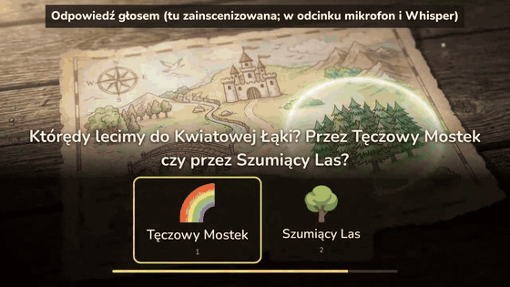
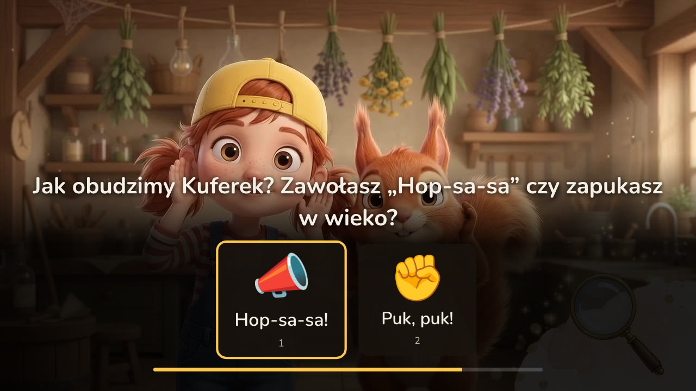
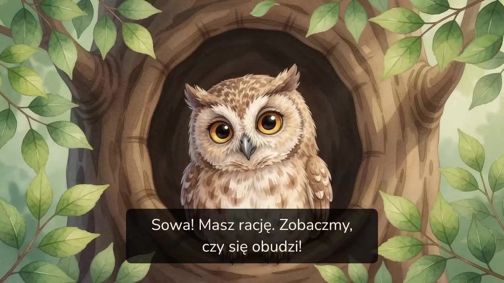
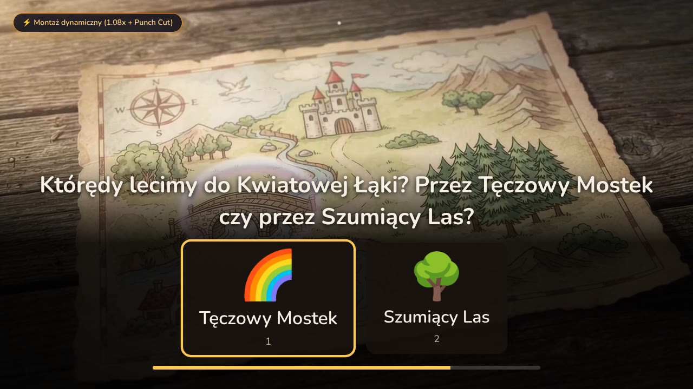
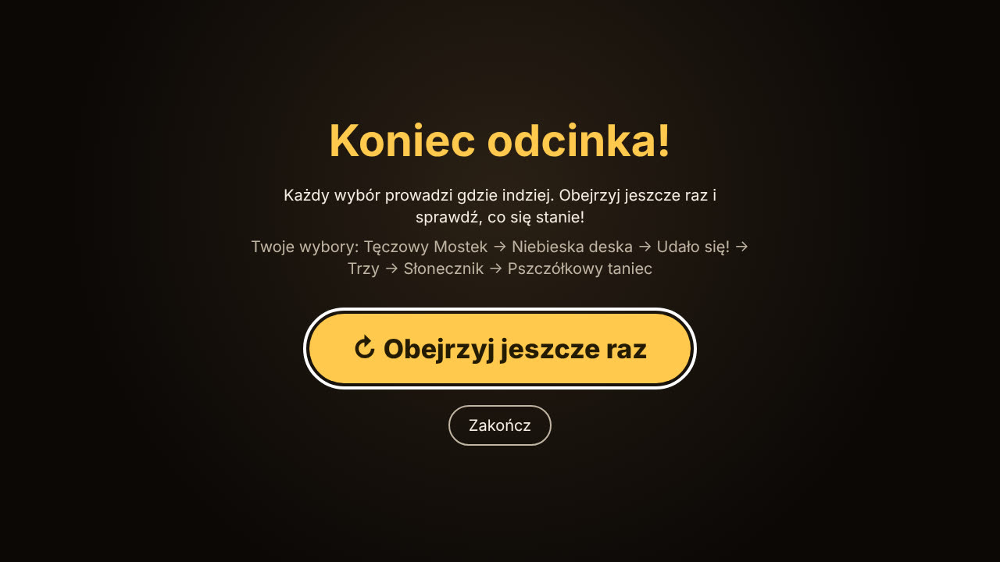
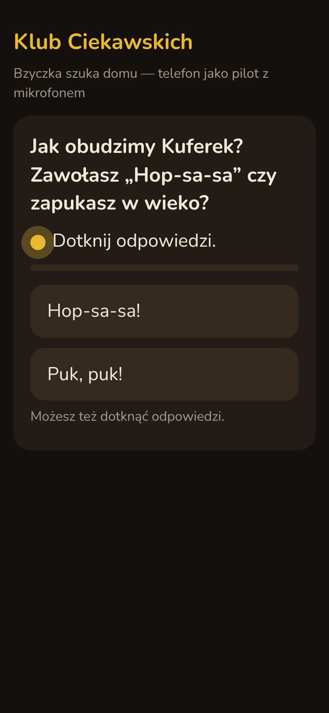
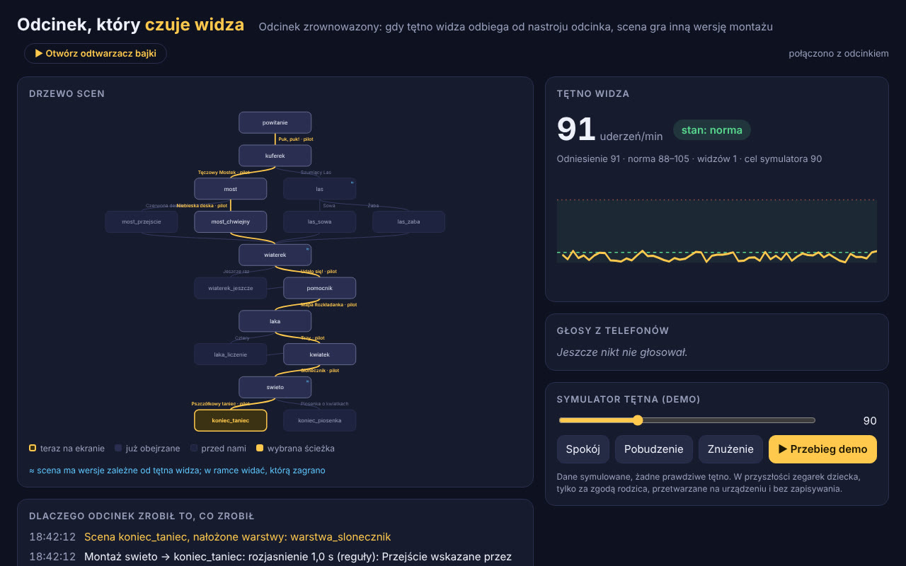
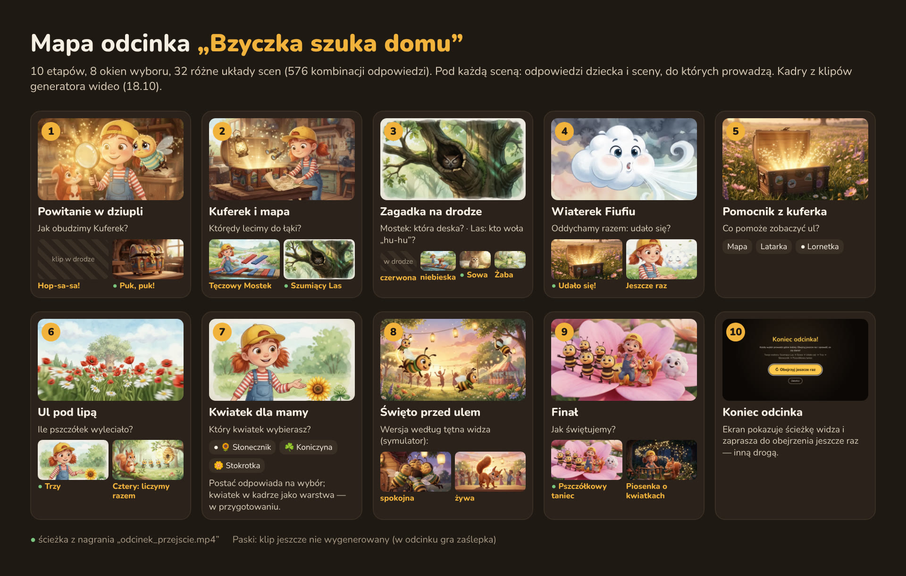

# Klub Ciekawskich — bajka, która słucha

**Interaktywny serial animowany dla dzieci 4–7 lat do serwisów streamingowych.** Postać zadaje pytanie, dziecko
odpowiada pilotem, dotykiem albo **własnymi słowami**, a historia idzie w wybraną stronę. Rozpoznawanie mowy
i model językowy działają na urządzeniu widza, więc głos dziecka nie trafia do chmury. Montażysta AI łączy klipy
przejściami dobranymi do sytuacji, a rodzic decyduje, czego dziecko się uczy.

Zgłoszenie na hackathon **FilmSpring Open 2026** („Kino szuka nowej formy”). Działający prototyp, odcinek
pilotażowy „Bzyczka szuka domu” i wszystkie dokumenty powstały w trakcie hackathonu, 16–18.10.2026.



*Fragment nagrania prawdziwego odtwarzacza. Napis „Słyszę…” jest tu zainscenizowany (nagrywaliśmy bez modelu mowy);
w odcinku odpowiedź rozpoznaje mikrofon i Whisper.*

## Obejrzyj w 5 minut

Nic nie trzeba instalować:

| Materiał | Co pokazuje |
|---|---|
| [Zwiastun](docs/prezentacja/media/zwiastun.mp4) (32 s) | Świat odcinka: Lila, Fiku i pszczółka Bzyczka; przejścia jak u montażysty AI |
| [Cały odcinek w odtwarzaczu](docs/prezentacja/media/odcinek_przejscie.mp4) (ok. 3 min, z dźwiękiem) | Jedno przejście od powitania do finału: 8 okien wyboru, napisy objaśniają każdy krok |
| [Tętno a montaż](docs/prezentacja/media/tetno_montaz.mp4) (47 s) | Odtwarzacz i panel obok siebie: symulowane tętno przyspiesza albo uspokaja montaż |
| [Mapa odcinka](docs/prezentacja/media/mapa_odcinka.jpg) | Wszystkie etapy, odpowiedzi i gałęzie na jednej planszy |
| [Zgłoszenie](docs/prezentacja/ZGLOSZENIE.md) ([PDF](docs/prezentacja/ZGLOSZENIE.pdf)) i [one-pager](docs/prezentacja/ONE_PAGER.md) | To samo co tutaj, w formie dokumentu do wysłania |
| [Slajdy i scenariusz wystąpienia](docs/prezentacja/README.md) | Prezentacja z notatkami prelegenta i plan pokazu online 29.10 |

## Problem

- **Bajka mówi do dziecka, ale go nie słyszy.** Dzieci od zawsze odpowiadają ekranowi („za tobą!”), a pytanie
  z ekranu to w zwykłym filmie tylko pauza. 15 minut z bajką to 15 minut słuchania.
- **Rodzic wybiera tytuł i na tym kończy się jego wpływ** na to, czego bajka uczy, ile w niej zadań i jak długo trwa.
  Zalecenia dla małych dzieci (WHO 2019, AAP 2016) mówią o ograniczonym czasie ekranu, w którym liczy się jakość
  i wspólne oglądanie, a rodzic nie ma narzędzia, żeby ten czas tak wyglądał.
- **Filmy interaktywne w serwisach się nie przyjęły.** Netflix usunął w 2024 r. 20 z 24 tytułów interaktywnych:
  były drogie w produkcji, dla dorosłych i bez rozmowy. Szukamy formy, która jest tania w produkcji i daje wartość,
  której zwykły film nie da.

**Co mówią badania.** Zespół Ying Xu dodał rozmowę do serialu PBS KIDS *Elinor Wonders Why*: w badaniu z udziałem
240 dzieci wersja, w której postać naprawdę reaguje na odpowiedź, dała **63%** poprawnych odpowiedzi w teście wiedzy,
wersja z pytaniem i pauzą 61%, zwykła 56%. Dzieci z biedniejszej dzielnicy z wersją z rozmową osiągnęły wyniki
porównywalne z rówieśnikami z zamożnej dzielnicy. To wyniki tamtych badań, nie nasze; źródła i wnioski dla projektu:
[BADANIA.md](docs/prezentacja/BADANIA.md).

## Rozwiązanie: jak wygląda odcinek

| | |
|---|---|
|  | **1. Pytanie i okno wyboru.** Postać pyta, klip przechodzi w cichą pętlę, a na dole ekranu pojawiają się 2–3 opcje z obrazkami i paskiem odliczania. Obrazki zamiast tekstu, bo widz w tym wieku często jeszcze nie czyta |
|  | **2. Odpowiedź pilotem, dotykiem albo głosem.** Mowę rozpoznaje Whisper, a sens odpowiedzi mały model Phi — oba na komputerze widza. Gdy model zawiedzie, wybór rozpoznają słowa kluczowe. „Nie wiem” albo cisza kończą się dopytaniem, a potem postać wybiera sama: odcinek nigdy nie staje |
|  | **3. Każda odpowiedź ma skutek.** Nagrana reakcja postaci i często osobna scena: „Sowa!” budzi sowę, która wskazuje drogę; zła deska w mostku nie kończy gry, tylko mostek się chwieje i naprawiamy go razem. Krótkie gałęzie (15–25 s) wracają na wspólną drogę, więc produkcja jest tania |
|  | **4. Montażysta AI.** Wybiera przejście między klipami (przenikanie, przetarcie, zaciemnienie, rozjaśnienie, cięcie) i jego długość według miejsca akcji, wyboru dziecka i jego stanu. Przy znużeniu montaż przyspiesza (przetarcie 0,4 s, tempo 1,08×, żywa wersja sceny), przy pobudzeniu zwalnia (przenikanie 1,2 s, tempo 0,92×, spokojna wersja). Tętno pochodzi dziś z symulatora |
|  | **5. Wyraźny koniec.** Ekran pokazuje drogę, którą wybrało dziecko, i zachęca, żeby obejrzeć jeszcze raz inną drogą. Bez automatycznego następnego odcinka |

Telewizor bez mikrofonu? **Telefon staje się pilotem z mikrofonem**: wystarczy zeskanować kod QR, bez instalowania
aplikacji. Twórcy widzą w **panelu podglądu** drogę widza, tętno i powód każdej decyzji montażysty zapisany jednym
zdaniem.

| Telefon jako pilot | Panel podglądu dla twórców |
|---|---|
|  |  |

**Kreator Rodzica** (koncepcja i klikalna makieta): rodzic wybiera, czego dziecko ma się dziś uczyć (liczenie,
wzory, emocje, przyroda), ile ma być zagadek, ile czasu na odpowiedź i czy odpowiada głosem, oraz ustawia limit
ekranu. Po odcinku dostaje krótki raport z pomysłami na rozmowę bez ekranu
([KREATOR_RODZICA.md](docs/prezentacja/KREATOR_RODZICA.md), [makiety](docs/prezentacja/mockupy/)).

## Odcinek pilotażowy: „Bzyczka szuka domu”

Lila Lupka i wiewiórek Fiku z Klubu Ciekawskich pomagają zagubionej pszczółce wrócić do ula. Po drodze dziecko budzi
Kuferek, wybiera drogę przez mostek albo las, rozwiązuje zagadkę, oddycha razem z wiaterkiem Fiufiu, liczy pszczółki
i wybiera zakończenie. Postacie mówią do widza w liczbie pojedynczej i bez form zależnych od płci, bo przed ekranem
siedzi zwykle jedno dziecko, czasem z rodzeństwem.



- **17 scen** (10 głównych i 7 krótkich gałęzi), na każdej ścieżce **8 okien wyboru**, **32 różne układy scen**
  (576 kombinacji odpowiedzi). Silnik sprawdza przy wczytaniu, że każda ścieżka kończy się finałem.
- **Trzy sceny mają dodatkowe wersje montażu** wybierane według stanu widza: las i święto — żywą i spokojną,
  wiaterek — spokojną.
- **31 z 33 klipów** pochodzi z generatora wideo według naszej biblii wizualnej postaci; w miejsce dwóch brakujących
  gra zaślepka. Scenariusz z dialogami i ujęciami: [scenarios/klub_ciekawskich.md](scenarios/klub_ciekawskich.md),
  biblia wizualna i przegląd klipów: [docs/SCENARIUSZ_WIZUALNY_PROMPTY_AI.md](docs/SCENARIUSZ_WIZUALNY_PROMPTY_AI.md).

## Dla kogo

| Kto | Co zyskuje |
|---|---|
| **Dzieci 4–7 lat** | Aktywne oglądanie: rozmowa z postacią, decyzje ze skutkiem, zagadki, w których pomyłka jest częścią przygody |
| **Dzieci, które nie czytają albo nie mówią płynnie** | Obrazki zamiast tekstu; pilot i dotyk działają zawsze, głos jest dodatkiem |
| **Rodzice** | Wpływ na treść i czas ekranu (Kreator), raport po odcinku, pomysły na rozmowę i zabawę bez ekranu |
| **Przedszkola i biblioteki** | Odcinki pod temat tygodnia; rzutnik i pilot u nauczyciela albo głosowanie z kilku telefonów |
| **Serwisy streamingowe i aplikacje dla dzieci** | Format interaktywny gotowy do wdrożenia: nasz odtwarzacz, manifest odcinka dla ich odtwarzacza albo zwykła wersja liniowa z napisami — bez kosztów chmury za AI |
| **Studia animacji i wydawcy** | Narzędzia do robienia odcinków interaktywnych z własnych bohaterów |

## Co sprawdziliśmy

| Próba | Wynik |
|---|---|
| **Cały odcinek w przeglądarce** (Chromium sterowany automatycznie) z klipami z 18.10 | Od powitania do finału: 8 okien wyboru, 10 decyzji montażysty, **0 błędów strony**. [Nagranie](docs/prezentacja/media/odcinek_przejscie.mp4) |
| **Tętno a montaż** (symulator w panelu) | Spadek tętna: przetarcie 0,4 s i żywa wersja lasu; wzrost: przenikanie 1,2 s i spokojna wersja wiaterka. [Nagranie](docs/prezentacja/media/tetno_montaz.mp4) |
| **Rozpoznawanie odpowiedzi po słowach kluczowych**: 100 typowych odpowiedzi dzieci napisanych przez zespół ([eksperyment](docs/prezentacja/eksperyment/)) | **79 z 81** jasnych odpowiedzi rozpoznanych dobrze, **0** złych wyborów; **19 z 19** niejasnych („nie wiem”) kończy się dopytaniem. Eksperyment znalazł błąd: przed poprawką 4 niejasne odpowiedzi wybierały opcję |
| **Testy automatyczne** silnika, okna wyboru, rozpoznawania, montażu, wersji liniowej, manifestu, importu klipów i skryptów stron | **444** testy przechodzą bez chmury, mikrofonu i przeglądarki |
| **Przegląd klipów z generatora** (dwie partie) | Uwagi i poprawione prompty; import kończy oba finały przed wymyślonymi przez generator napisami końcowymi |

**Czego jeszcze nie sprawdziliśmy:** testu z dziećmi (plan: 5–10 rodzin, wyniki w aktualizacji do 25.10), jakości
Whispera na polskiej mowie dzieci i czasów modeli na komputerze z NPU oraz zainteresowania rodziców Kreatorem.

## Bezpieczeństwo i prywatność

- **AI na urządzeniu.** Whisper i Phi działają lokalnie (Foundry Local); mikrofon słucha tylko w oknie wyboru,
  a nagranie znika zaraz po rozpoznaniu. Pilot działa zawsze.
- **AI nie generuje fabuły ani wideo na żywo.** Klipy powstają wcześniej i sprawdza je człowiek. Krótkie kwestie
  modelu przechodzą przez filtr treści, a montażysta wybiera tylko sposób połączenia gotowych klipów.
- **Tętno to funkcja przyszła.** Dane o zdrowiu (RODO, art. 9): osobna zgoda rodzica, przetwarzanie tylko na
  urządzeniu i tylko w trakcie odcinka, bez zapisu; w prototypie wyłącznie symulator.
- **Zdrowy czas ekranu.** Odcinki 10–15 minut z wyraźnym końcem, limit dnia i tryb „Oglądamy razem” w Kreatorze.

## Wyzwania

| Wyzwanie | Nasza odpowiedź |
|---|---|
| **Koszt produkcji gałęzi** — główna bariera filmów interaktywnych | Gałęzie trwają 15–25 s i wracają na wspólną drogę; trzy wersje montażu zamiast osobnych odcinków; wybory kosmetyczne jako przezroczyste warstwy na jednym klipie (silnik i odtwarzacz je obsługują, w odcinku wrócą z kwiatkiem wyciętym z ilustracji) |
| **Mowa małych dzieci** | Głos nie jest warunkiem (pilot, dotyk). Whisper z podpowiedzią słów odcinka, Phi do sensu odpowiedzi, słowa kluczowe w zapasie, dopytanie przy niejasnej odpowiedzi |
| **Spójność klipów z generatora** | Biblia wizualna postaci, stały dopisek stylu, przegląd każdej partii klipów; import wyrównuje format, robi płynne pętle i przycina klipy |
| **Klipy nie pasują do siebie montażowo** | Montażysta AI dobiera przejście; pętle oczekiwania mają płynny szew, a nowe ujęcie zachodzi na koniec poprzedniego |
| **Serwisy nie chcą nowego formatu** | Trzy drogi: nasz odtwarzacz, manifest JSON dla odtwarzacza serwisu, wersja liniowa jako zwykły film |
| **Słabszy sprzęt widza** | Gdy model jest wolny albo go nie ma, decydują reguły i słowa kluczowe; odcinek nigdy nie czeka na AI |

## Co powstało na hackathonie

Projekt **nie rozwija wdrożonego produktu**: pomysł, scenariusz, odcinek, kod i dokumentacja powstały 16–18.10.2026
(historia zmian w repozytorium od 16.10). W trakcie hackathonu zmieniliśmy formę z seansu kinowego z udziałem sali
na odcinek do serwisów streamingowych i dodaliśmy koncepcję Kreatora Rodzica.

**Nasze:** świat i postacie, scenariusz z gałęziami, silnik odcinka, odtwarzacz w przeglądarce z przejściami,
okno wyboru z odpowiedzią głosem, montażysta AI z regułami, telefon jako pilot, panel podglądu, symulator tętna,
wersja liniowa i manifest, import klipów, makiety Kreatora i raportu, eksperyment z rozpoznawaniem odpowiedzi.
**Gotowe składniki:** Foundry Local, Whisper, Phi, ffmpeg, generator wideo (klipy według naszych promptów),
biblioteki Pythona.

## Rynek, model i plan

Model biznesowy (hipotezy do sprawdzenia w pilotażu): subskrypcja dla rodzin, licencja dla serwisów i placówek
edukacyjnych, licencja narzędzi dla studiów. Realia rynku i drogi do serwisów:
[docs/STREAMING.md](docs/STREAMING.md), skrót: [ONE_PAGER.md](docs/prezentacja/ONE_PAGER.md).


## Jak uruchomić prototyp

Do oceny nie jest to potrzebne (nagrania wyżej pokazują prawdziwy odtwarzacz). Windows, macOS albo Linux,
Python 3.11+, ffmpeg i Edge albo Chrome:

```powershell
python -m venv .venv
.venv\Scripts\Activate.ps1
pip install -e ".[dev,local,mobile]"
python -m bajka.clips download/klipy.yaml                       # klipy z generatora pod nazwy scen
python -m bajka.placeholders scenarios/klub_ciekawskich.yaml    # zaślepki dla brakujących scen
python -m bajka scenarios/klub_ciekawskich.yaml --no-llm --no-mic --panel   # odcinek bez modeli, z panelem
```

Pełny prototyp z odpowiedziami głosem (Whisper i Phi lokalnie) to `python -m bajka scenarios/klub_ciekawskich.yaml`.
Wszystkie tryby, moduły, format scenariusza i rozwiązywanie problemów: [docs/URUCHOMIENIE.md](docs/URUCHOMIENIE.md).

## Dokumentacja

| Dokument | Zawartość |
|---|---|
| [docs/prezentacja/](docs/prezentacja/README.md) | Zgłoszenie, one-pager, slajdy, scenariusz wystąpienia, Kreator Rodzica, badania, eksperyment, makiety, nagrania |
| [docs/URUCHOMIENIE.md](docs/URUCHOMIENIE.md) | Instalacja, uruchomienie, moduły, format scenariusza, wskazówki do klipów, architektura, testy, problemy |
| [docs/DOKUMENTACJA_TECHNICZNA.md](docs/DOKUMENTACJA_TECHNICZNA.md) | Pełna dokumentacja inżynierska systemu |
| [docs/ONBOARDING.md](docs/ONBOARDING.md) | Architektura i wprowadzenie do kodu |
| [docs/LOKALNE_AI.md](docs/LOKALNE_AI.md) | AI na urządzeniu: Foundry Local, Whisper, Phi |
| [docs/STREAMING.md](docs/STREAMING.md) | Dlaczego streaming, realia rynku, dystrybucja odcinka |
| [docs/DEMO_DLA_JURY.md](docs/DEMO_DLA_JURY.md) | Przebieg pokazu na żywo |
| [docs/ZGODNOSC_Z_REGULAMINEM.md](docs/ZGODNOSC_Z_REGULAMINEM.md) | Zgodność z regulaminem i wytycznymi zgłoszenia |
| [scenarios/klub_ciekawskich.md](scenarios/klub_ciekawskich.md) | Scenariusz odcinka z ujęciami, dialogami i oknami wyboru |
