# Dokumentacja Techniczna: Interaktywna Bajka Streamingowa (Silnik Emisji i Dynamicznego Montażu)

> **Dokumentacja inżynierska i deweloperska systemu.**  
> Ostatnia aktualizacja: Październik 2026 | FilmSpring Open 2026  
> Repozytorium: [`FilmSpringOpen2026`](file:///C:/Users/skywa/.gemini/antigravity/scratch/FilmSpringOpen2026)

---

## 📑 Spis Treści
1. [Architektura Systemu (Hexagonal Architecture / Ports & Adapters)](#1-architektura-systemu)
2. [Gdzie co jest (Struktura Repozytorium i Moduły)](#2-gdzie-co-jest-struktura-repozytorium-i-moduły)
3. [Zrzuty Ekranu i Interfejsy Produktu](#3-zrzuty-ekranu-i-interfejsy-produktu)
   - [3.1. Odtwarzacz Streamingowy Web Player](#31-odtwarzacz-streamingowy-web-player-port-8080)
   - [3.2. Panel Realizatora i Telemetria Biofeedbacku](#32-panel-realizatora-i-telemetria-biofeedbacku-port-8090)
   - [3.3. Drugi Ekran i Seans Grupowy na Smartfonach](#33-drugi-ekran-i-seans-grupowy-na-smartfonach-port-8443-https)
   - [3.4. Panel i Ustawienia Rodzica w Odtwarzaczu (Parent Controls & Privacy)](#34-panel-i-ustawienia-rodzica-w-odtwarzaczu-parent-controls--privacy)
   - [3.5. Kreator Rodzica (Parent Studio & Personalizator Odcinka)](#35-kreator-rodzica-parent-studio--personalizator-odcinka)
   - [3.6. Raport Po Odcinku i Rekomendacje Rozmowy Offline](#36-raport-po-odcinku-i-rekomendacje-rozmowy-offline)
4. [Instrukcja Uruchomienia Krok po Kroku (Runbook)](#4-instrukcja-uruchomienia-krok-po-kroku-runbook)
   - [4.1. Wymagania wstępne](#41-wymagania-wstępne)
   - [4.2. Konfiguracja środowiska wirtualnego](#42-konfiguracja-środowiska-wirtualnego)
   - [4.3. Konfiguracja zmiennych środowiskowych (.env)](#43-konfiguracja-zmiennych-środowiskowych-env)
   - [4.4. Przygotowanie mediów (placeholdery vs klipy wideo)](#44-przygotowanie-mediów-placeholdery-vs-klipy-wideo)
   - [4.5. Zestawienie wszystkich trybów uruchomienia (CLI)](#45-zestawienie-wszystkich-trybów-uruchomienia-cli)
   - [4.6. Rozwiązywanie typowych problemów (Troubleshooting)](#46-rozwiązywanie-typowych-problemów-troubleshooting)
5. [Dynamiczny Montaż AI i Silnik Biofeedbacku](#5-dynamiczny-montaż-ai-i-silnik-biofeedbacku)
   - [5.1. Analiza biometryczna i klasyfikacja tętna](#51-analiza-biometryczna-i-klasyfikacja-tętna)
   - [5.2. Adaptacja tempa (playbackRate)](#52-adaptacja-tempa-playbackrate)
   - [5.3. Efekt Punch Cut (Mikro-Zoom)](#53-efekt-punch-cut-mikro-zoom)
   - [5.4. Przejścia montażowe i silnik regułowo-modelowy](#54-przejścia-montażowe-i-silnik-regułowo-modelowy)
6. [Specyfikacja Grafu Scenariusza (YAML Reference)](#6-specyfikacja-grafu-scenariusza-yaml-reference)
   - [6.1. Schemat węzła sceny](#61-schemat-węzła-sceny)
   - [6.2. Akumulacja przezroczystych warstw WebM (kanał alfa)](#62-akumulacja-przezroczystych-warstw-webm-kanał-alfa)
7. [Silnik Przetwarzania Mowy i Bezpieczeństwo AI](#7-silnik-przetwarzania-mowy-i-bezpieczeństwo-ai)
8. [Architektura Sieciowa, Porty i API REST / SSE](#8-architektura-sieciowa-porty-i-api-rest--sse)
9. [Testowanie i Weryfikacja Jakości (Pytest)](#9-testowanie-i-weryfikacja-jakości-pytest)

---

## 1. Architektura Systemu

System zaprojektowano zgodnie z wzorcem **architektury heksagonalnej (Ports & Adapters)**. Rdzeń logiki biznesowej ([`bajka/engine.py`](file:///C:/Users/skywa/.gemini/antigravity/scratch/FilmSpringOpen2026/bajka/engine.py)) jest całkowicie odizolowany od warstwy wejścia/wyjścia. Wszystkie kontrakty zdefiniowane są jako protokoły w pliku [`bajka/ports.py`](file:///C:/Users/skywa/.gemini/antigravity/scratch/FilmSpringOpen2026/bajka/ports.py).

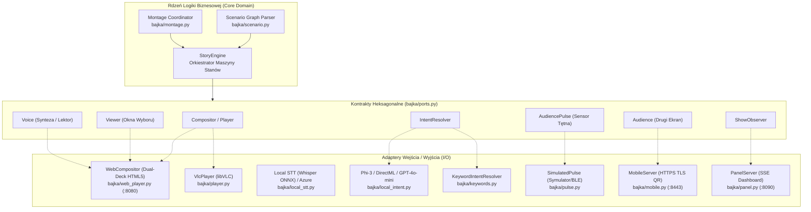

### Cykl Przetwarzania Węzła Sceny (Execution Flow)
1. **Analiza stanu biometrycznego:** `StoryEngine` pobiera bieżący odczyt tętna z portu `AudiencePulse`. Jeśli tętno odbiega od wartości bazowej (`baseline`), wybierany jest alternatywny wariant klipu (`variants: spokojna / zywa`).
2. **Kalkulacja parametrów odtwarzania:**
   - Wybór przejścia montażowego (`Cut`: `ciecie`, `przenikanie`, `przetarcie`, `zaciemnienie`, `rozjasnienie`).
   - Ustalenie tempa odtwarzania (`playbackRate`: `1.08x` dla znużenia, `0.92x` dla pobudzenia, `1.0x` w normie).
   - Włączenie mikro-najazdu kadru (**Punch Cut** `scale(1.06) -> scale(1.0)`).
   - Agregacja przezroczystych warstw WebM (`layers`) zebranych z wcześniejszych wyborów widza.
3. **Emisja ujęcia (Shot):** Silnik przekazuje obiekt `Shot` do `Compositora`, który uruchamia wideo w wolnym decku odtwarzacza i dokonuje płynnego przejścia.
4. **Pętla oczekiwania (Idle Loop):** Po dojściu do końca klipu głównego odtwarzacz wchodzi w zapętlone tło (`idle_clip`) i wysuwa okno wyboru (`Viewer.ask`).
5. **Arbitraż wejścia (Input Arbitration):**
   - Klawisze strzałek / Enter / mysz / dotyk.
   - Analiza mowy z mikrofonu (Whisper ONNX lub Web Speech API).
   - Odbiór głosów z telefonów komórkowych przez serwer HTTPS (`Audience`).
6. **Rozpoznanie intencji i fallback:** Ekstrakcja intencji przez lokalny model Phi z natychmiastowym deterministycznym zapasem na słowa kluczowe (`KeywordIntentResolver`).
7. **Przejście do krawędzi:** Zlecenie montażyście w tle wyliczenia kolejnego cięcia, opcjonalne odtworzenie klipu reakcji postaci (`reaction_clip`) i przejście do kolejnego węzła grafu.

---

## 2. Gdzie co jest (Struktura Repozytorium i Moduły)

Układ katalogów i plików w repozytorium:

```text
FilmSpringOpen2026/
├── bajka/                     # Główny pakiet źródłowy silnika w Pythonie
│   ├── app.py                 # Punkt wejścia CLI (argparse, konfiguracja, orkiestracja)
│   ├── engine.py              # StoryEngine - silnik maszyny stanów grafu i pętli emisji
│   ├── ports.py               # Definicje protokołów (Hexagonal Architecture)
│   ├── scenario.py            # Parser, walidator i struktury grafu scen YAML
│   ├── web_player.py          # Serwer HTTP i kontroler odtwarzacza Web Player (:8080)
│   ├── montage.py             # Silnik montażu: RuleEditor i ModelEditor (Phi/Azure)
│   ├── pulse.py               # Obsługa biometrii: tętno, progi (bored/excited), symulator
│   ├── panel.py               # Serwer panelu realizatora z podglądem stanu grafu (:8090)
│   ├── mobile.py              # Drugi ekran: serwer HTTPS (:8443) dla telefonów
│   ├── keywords.py            # Rozpoznawanie intencji po słowach kluczowych (regex/scoring)
│   ├── local_stt.py           # Transkrypcja mowy Whisper ONNX przez Foundry Local
│   ├── local_intent.py        # Ekstrakcja intencji przez lokalny model Phi
│   ├── safety.py              # Filtr bezpieczeństwa treści dla dzieci
│   ├── clips.py               # Narzędzie transkodowania i bezszwowego zapętlania klipów
│   ├── placeholders.py        # Generator technicznych plansz wideo dla brakujących scen
│   ├── linear.py              # Generator filmu liniowego (eksport MP4 przez FFmpeg)
│   ├── player_app/            # Frontend Web Playera (index.html, Vanilla JS, CSS)
│   ├── panel_app/             # Frontend Panelu Realizatora (index.html, SVG graf, SSE)
│   ├── mobile_app/            # PWA drugiego ekranu dla smartfonów (index.html, HTTPS)
│   └── fonts/                 # Wbudowane fonty (Nunito Variable WOFF2)
├── scenarios/                 # Pliki scenariuszy i mediów
│   ├── klub_ciekawskich.yaml  # Główny graf odcinka demonstracyjnego (węzły, pytania)
│   ├── klub_ciekawskich.md    # Scenariusz literacki odcinka
│   └── clips/                 # Pliki wideo MP4 oraz przezroczyste nakładki WebM
├── download/                  # Pobrane klipy z zewnętrznych generatorów wideo AI
├── docs/                      # Dokumentacja techniczna, wizualna i prezentacyjna
│   ├── DOKUMENTACJA_TECHNICZNA.md  # Niniejszy dokument
│   ├── SCENARIUSZ_WIZUALNY_PROMPTY_AI.md # Scenopis i prompty wideo AI
│   └── prezentacja/media/     # Zrzuty ekranu produktu i plansze wizualne
├── tests/                     # Zestaw 168 testów jednostkowych i integracyjnych (pytest)
└── pyproject.toml             # Konfiguracja pakietu, zależności i narzędzi
```

### Szczegółowa mapa modułów technicznych

| Moduł / Plik | Odpowiedzialność techniczna |
|---|---|
| [`bajka/engine.py`](file:///C:/Users/skywa/.gemini/antigravity/scratch/FilmSpringOpen2026/bajka/engine.py) | **Maszyna stanów:** Zarządza cyklem życia ujęć, akumuluje warstwy przezroczyste, odpytuje montażystę asynchronicznie, rozstrzyga timeouty oraz emituje telemetrię do obserwatora. |
| [`bajka/web_player.py`](file:///C:/Users/skywa/.gemini/antigravity/scratch/FilmSpringOpen2026/bajka/web_player.py) | **Compositor Server:** Wielowątkowy most między silnikiem Pythona a odtwarzaczem w przeglądarce (`threading.Condition`, numeracja sekwencyjna `seq`, obsługa HTTP 206 Partial Content). |
| [`bajka/player_app/index.html`](file:///C:/Users/skywa/.gemini/antigravity/scratch/FilmSpringOpen2026/bajka/player_app/index.html) | **Dual-Deck Engine:** Implementacja frontendu w czystym JS. Dwa elementy `<video>` A/B, obsługa przejść CSS, dynamiczny Punch Cut, skalowanie tempa `playbackRate`, Web Audio API. |
| [`bajka/montage.py`](file:///C:/Users/skywa/.gemini/antigravity/scratch/FilmSpringOpen2026/bajka/montage.py) | **Silnik montażu:** Oblicza rodzaj cięcia (`Cut`) na podstawie kontekstu sceny i tętna widza. Zawiera asynchroniczny model LLM (`ModelEditor`) oraz deterministyczny fallback (`RuleEditor`). |
| [`bajka/pulse.py`](file:///C:/Users/skywa/.gemini/antigravity/scratch/FilmSpringOpen2026/bajka/pulse.py) | **Biofeedback:** Algorytmy filtrowania odczytów tętna, wyznaczanie odchylenia od normy (`baseline`), wykrywanie znużenia (<68-72 BPM) i pobudzenia (>88-92 BPM), symulator z natychmiastową reakcją. |
| [`bajka/panel.py`](file:///C:/Users/skywa/.gemini/antigravity/scratch/FilmSpringOpen2026/bajka/panel.py) | **Telemetry Server:** Serwuje panel realizatora (`:8090`). Przesyła zdarzenia SSE (`scena`, `montaz`, `wersja`, `glosy`), generuje topologię grafu w SVG i obsługuje suwak tętna. |
| [`bajka/mobile.py`](file:///C:/Users/skywa/.gemini/antigravity/scratch/FilmSpringOpen2026/bajka/mobile.py) | **Drugi ekran:** Serwer HTTPS (`:8443`) z certyfikatem TLS generowanym w locie (umożliwia dostęp do mikrofonu w mobilnym Safari/Chrome). Generuje kody QR w konsoli. |
| [`bajka/keywords.py`](file:///C:/Users/skywa/.gemini/antigravity/scratch/FilmSpringOpen2026/bajka/keywords.py) | **Lekki klasyfikator intencji:** Odporny na brak połączenia i błędy LLM silnik dopasowywania mowy w języku polskim (usuwanie znaków diakrytycznych, stemming prefiksowy, wagi słów). |
| [`bajka/local_stt.py`](file:///C:/Users/skywa/.gemini/antigravity/scratch/FilmSpringOpen2026/bajka/local_stt.py) | **Lokalny Speech-to-Text:** Integracja z modelem Whisper ONNX przez Foundry Local SDK i DirectML/NPU. |
| [`bajka/local_intent.py`](file:///C:/Users/skywa/.gemini/antigravity/scratch/FilmSpringOpen2026/bajka/local_intent.py) | **Lokalny LLM:** Integracja z modelem Phi-3/4 przez DirectML na Windows 11. |
| [`bajka/safety.py`](file:///C:/Users/skywa/.gemini/antigravity/scratch/FilmSpringOpen2026/bajka/safety.py) | **Filtr bezpieczeństwa:** Walidacja wyjścia modeli AI pod kątem słownictwa odpowiedniego dla dzieci 4–7 lat. |
| [`bajka/clips.py`](file:///C:/Users/skywa/.gemini/antigravity/scratch/FilmSpringOpen2026/bajka/clips.py) | **Transkoder FFmpeg:** Przygotowuje klipy z generatorów wideo AI, tworząc bezszwowe zapętlenie pętli `idle` (płynny crossfade ostatniej sekundy z pierwszą). |

---

## 3. Zrzuty Ekranu i Interfejsy Produktu

System składa się z trzech zsynchronizowanych w czasie rzeczywistym interfejsów użytkownika:

### 3.1. Odtwarzacz Streamingowy Web Player (Port `:8080`)

Odtwarzacz zaprojektowano z myślą o telewizorach Smart TV oraz przeglądarkach w serwisach VOD. Obsługuje sterowanie pilotem (strzałki + Enter), dotykiem oraz głosem.

#### Ekran startowy i odblokowanie uprawnień multimedialnych
Przeglądarki wymagają interakcji użytkownika przed odtworzeniem dźwięku i uruchomieniem mikrofonu. Przycisk **▶ Oglądaj** inicjalizuje `AudioContext` i odblokowuje odtwarzanie.

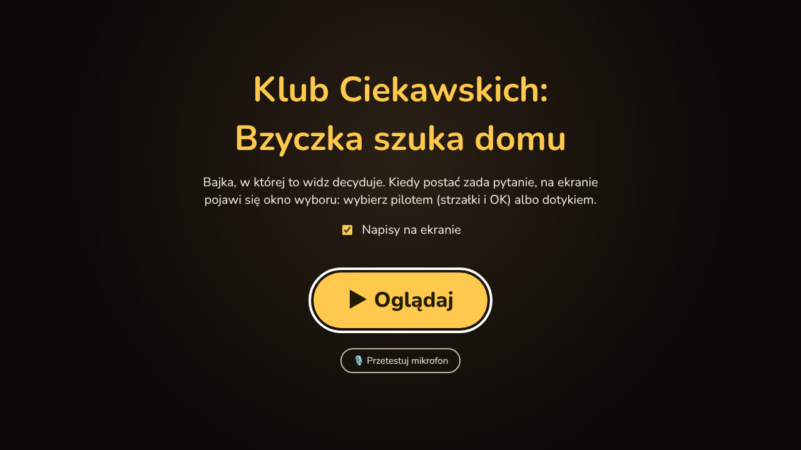

#### Płynne odtwarzanie sceny narracyjnej (Deck A/B)
Podczas gdy postacie prowadzą dialog, kolejny klip wideo jest wstępnie buforowany w niewidocznym decku.


#### Okno wyboru z odliczaniem i detekcją mowy
Po zakończeniu klipu sceny odtwarzacz przechodzi w cichą pętlę oczekiwania (`idle_clip`), a od dołu wysuwa się panel decyzyjny z paskiem upływu czasu.

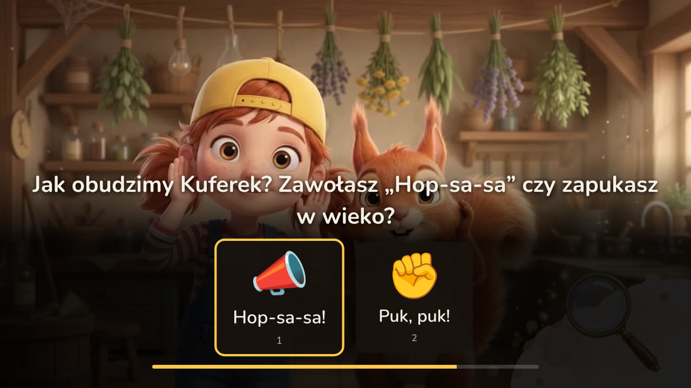

#### Wybór ścieżki i nasłuchiwanie głosu widza
Gdy mikrofon jest aktywny, widz może po prostu powiedzieć: *„Przez ten kolorowy mostek!”*. Transkrypcja na żywo natychmiast podświetla właściwą opcję.

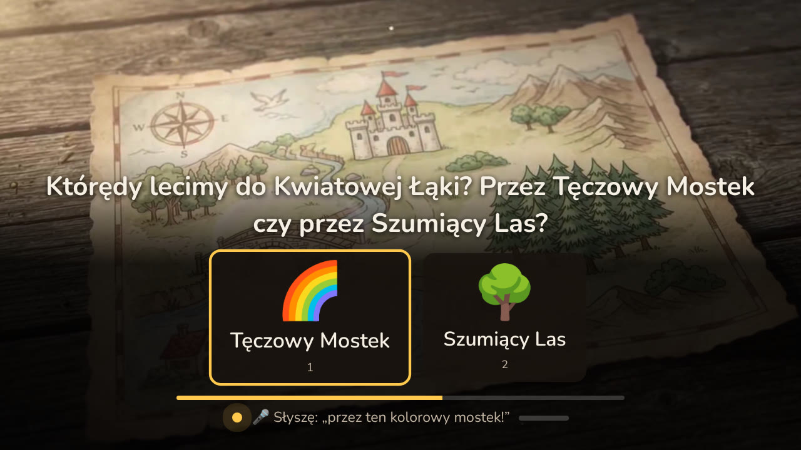

#### Zagadka edukacyjna (dopasowanie wzoru)
Dziecko rozwiązuje zagadkę rytmiczną desek na mostku. Wybór błędny prowadzi do gałęzi pomocniczej, a prawidłowy naprawia mostek.

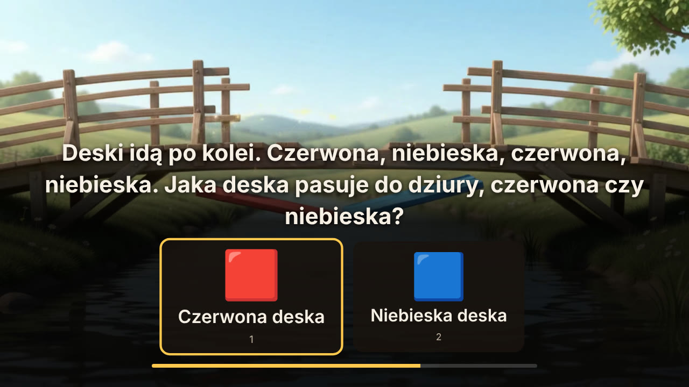

#### Dynamiczna reakcja postaci i montażowe przejście
Po zatwierdzeniu wyboru odtwarzany jest klip reakcji postaci, a montażysta AI płynnie łączy ujęcia.


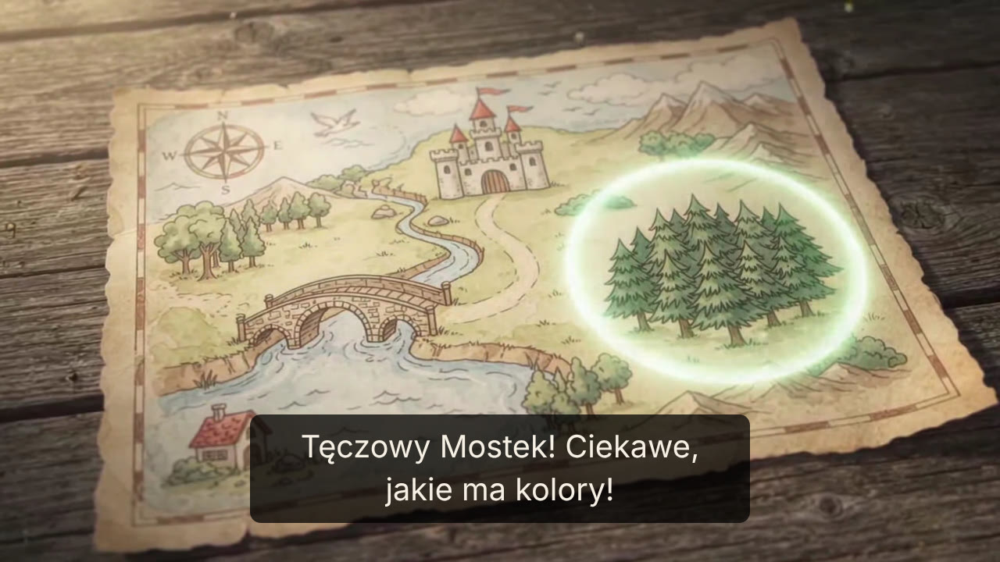

#### Ekran podsumowania odcinka
Na koniec seansu widz widzi podsumowanie swoich unikalnych wyborów oraz przycisk ponownego uruchomienia z inną ścieżką fabularną.


---

### 3.2. Panel Realizatora i Telemetria Biofeedbacku (Port `:8090`)

Dedykowany kokpit dla reżysera, technika lub rodzica. Pozwala śledzić postęp w grafie scen, monitorować decyzje montażysty AI oraz w czasie rzeczywistym symulować tętno widza.

#### Główny pulpit telemetrii
Zawiera interaktywne drzewo scen SVG, log zdarzeń Server-Sent Events oraz suwak biometrii.


#### Wizualizacja grafu scen na żywo
Aktywny węzeł podświetla się na złoto, a przebyta ścieżka rysuje się w czasie rzeczywistym.

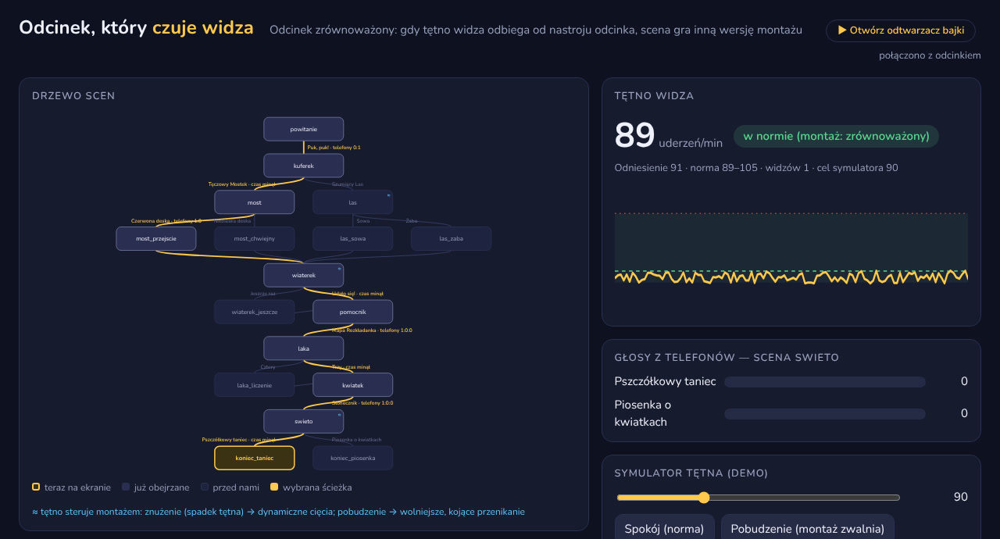

#### Dziennik decyzji montażowych AI
Pokazuje dokładny rodzaj przejścia (`ciecie`, `przenikanie`, `przetarcie`), czas w sekundach, źródło decyzji (`model` vs `reguly`) oraz uzasadnienie montażysty w odniesieniu do tętna widza.

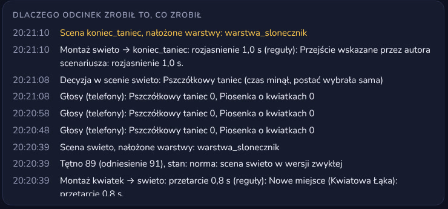

---

### 3.3. Drugi Ekran i Seans Grupowy na Smartfonach (Port `:8443` HTTPS)

Umożliwia wspólne oglądanie bajki przez całą rodzinę lub grupę dzieci w przedszkolu. Smartfony działają jako bezprzewodowe piloty z mikrofonem.

#### Parowanie przez kod QR w terminalu lub przeglądarce
Uruchomienie serwera generuje kod QR, który otwiera aplikację na telefonach w tej samej sieci Wi-Fi.

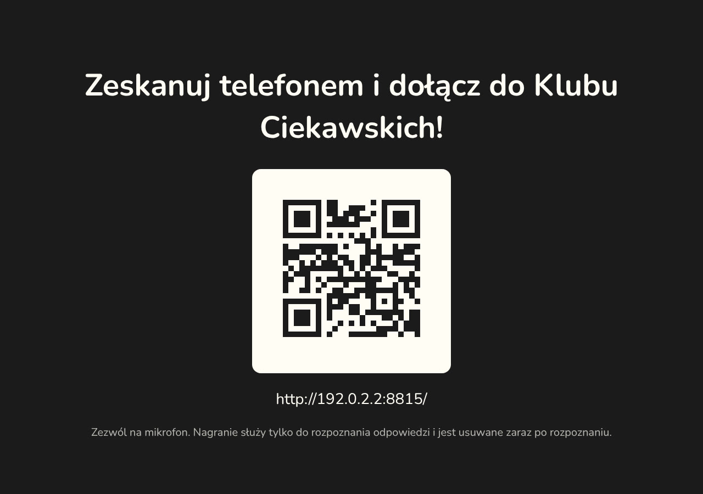

#### Ekran oczekiwania na smartfonie
Telefon synchronizuje się ze stanem odcinka na dużym ekranie.

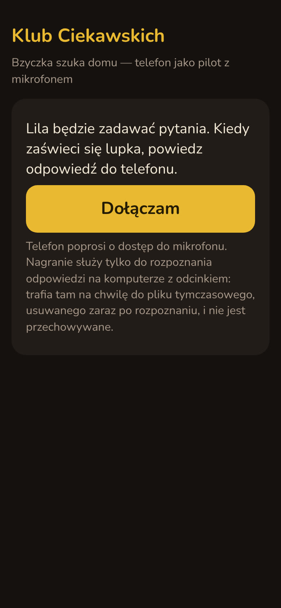

#### Runda głosowania grupowego
Podczas okna wyboru opcje pojawiają się na ekranach wszystkich połączonych urządzeń. Głosy są agregowane większościowo.


---

### 3.4. Panel i Ustawienia Rodzica w Odtwarzaczu (Parent Controls & Privacy)

Bezpośrednio w interfejsie odtwarzacza ([`bajka/player_app/index.html`](file:///C:/Users/skywa/.gemini/antigravity/scratch/FilmSpringOpen2026/bajka/player_app/index.html)) rodzic ma dostęp do dedykowanego panelu konfiguracyjnego (przycisk zębatki `⚙` na górnym pasku sterowania lub sekcja na ekranie startowym).

#### Funkcjonalności techniczne panelu rodzica w odtwarzaczu:
1. **Przełącznik mikrofonu i prywatność (RODO / COPPA Compliance):**
   - Rodzic decyduje, czy w oknie wyboru dziecko może odpowiadać głosem (`micSetting`), czy wyłącznie pilotem / dotykiem.
   - **Gwarancja prywatności:** Mikrofon jest aktywowany wyłącznie podczas odliczania w oknie wyboru (12 s). Próbki audio trafiają do bufora pamięci RAM w formacie 16 kHz mono WAV, są przetwarzane lokalnie przez model Whisper i **natychmiast usuwane z pamięci**. Żadne nagrania głosu dziecka nie są zapisywane na dysku ani wysyłane do chmury.
2. **Narzędzie testowania mikrofonu na żywo (`testMicBox`):**
   - Zanim rozpocznie się bajka, rodzic może sprawdzić czułość mikrofonu (`testMeterFill`). Wskaźnik decybeli reaguje w czasie rzeczywistym na mowę dziecka (np. próba zawołania *„Hop-sa-sa!”* lub *„Puk, puk”*), potwierdzając gotowość sprzętową.
3. **Napisy dla dzieci (Wczesna Nauka Czytania & Dostępność):**
   - Opcja włączenia napisów synchronicznych (`captionsSetting`). Każde pytanie i kwestia postaci pojawia się na ekranie, wspierając dzieci w wieku przedszkolnym i wczesnoszkolnym w nauce czytania oraz zapewniając dostępność dla dzieci z wadami słuchu.
4. **Zabezpieczenie seansu i skróty klawiszowe:**
   - Klawisz `F` — przełączenie w tryb pełnoekranowy (True Fullscreen).
   - Klawisz `Esc` / Przycisk `✕` (`stopButton`) — bezpieczne zakończenie odcinka i zwolnienie zasobów silnika.
   - Minimalizacja okna lub przełączenie karty automatycznie wstrzymuje odtwarzanie (ochrona przed utratą wątku przez dziecko).

---

### 3.5. Kreator Rodzica (Parent Studio & Personalizator Odcinka)

**Kreator Rodzica** ([`docs/prezentacja/KREATOR_RODZICA.md`](file:///C:/Users/skywa/.gemini/antigravity/scratch/FilmSpringOpen2026/docs/prezentacja/KREATOR_RODZICA.md)) to moduł pozwalający rodzicowi na zdefiniowanie celów edukacyjnych, trudności i czasu trwania bajki, zanim dziecko usiądzie przed ekranem.


#### Architektura generowania spersonalizowanego odcinka:
```text
┌────────────────────────────────────────────────────────┐
│                    KREATOR RODZICA                     │
│  - Wybór celów (liczenie, wzory, emocje, przyroda)     │
│  - Liczba zagadek (np. 3 z 6) i trudność               │
│  - Czas na odpowiedź (10-20 s) i liczba dopytań        │
│  - Limit czasu ekranowego (zgodny z wytycznymi WHO)    │
└───────────────────────────┬────────────────────────────┘
                            │ Parametry JSON
                            ▼
┌────────────────────────────────────────────────────────┐
│                   PLANISTA ODCINKA                     │
│   Dobiera certyfikowane moduły scen z biblioteki       │
│   i kompiluje spójny graf logiczny w formacie YAML     │
└───────────────────────────┬────────────────────────────┘
                            │ Graf YAML
                            ▼
┌────────────────────────────────────────────────────────┐
│              WALIDACJA SILNIKA (Scenario)              │
│   Weryfikacja: brak martwych krawędzi, kompletność     │
│   plików MP4/WebM, poprawność wyborów domyślnych       │
└───────────────────────────┬────────────────────────────┘
                            │
                            ▼
┌────────────────────────────────────────────────────────┐
│             StoryEngine & Compositor AI                │
│             Emisja spersonalizowanego seansu           │
└────────────────────────────────────────────────────────┘
```

#### Dostępne parametry konfiguracyjne:
- **Cele dydaktyczne (Modular Curriculum):**
  - *Liczenie do trzech:* aktywacja modułu ula [`06_laka.mp4`](file:///C:/Users/skywa/.gemini/antigravity/scratch/FilmSpringOpen2026/scenarios/clips/klub_ciekawskich/06_laka.mp4).
  - *Rytm i myślenie logiczne:* aktywacja modułu naprzemiennego wzoru desek [`03a_most.mp4`](file:///C:/Users/skywa/.gemini/antigravity/scratch/FilmSpringOpen2026/scenarios/clips/klub_ciekawskich/03a_most.mp4).
  - *Samoregulacja emocji (Oddech relaksacyjny):* moduł uspokojenia Wiaterka Fiufiu [`04_wiaterek.mp4`](file:///C:/Users/skywa/.gemini/antigravity/scratch/FilmSpringOpen2026/scenarios/clips/klub_ciekawskich/04_wiaterek.mp4) z cyklem oddechowym 4s wdech / 4s wydech.
  - *Zrozumienie funkcji narzędzi:* dobór lornetki w module [`05_pomocnik.mp4`](file:///C:/Users/skywa/.gemini/antigravity/scratch/FilmSpringOpen2026/scenarios/clips/klub_ciekawskich/05_pomocnik.mp4).
- **Liczba zagadek i czas:** Możliwość skrócenia seansu do np. 7 minut przed obiadem (zagadki nieaktywne postać rozwiązuje samodzielnie w locie).
- **Poziom trudności:** Wybór pomiędzy 2 a 3 opcjami w oknie decyzyjnym.
- **Bezpieczeństwo treści (Zero-Hallucination):** Odcinek składa się wyłącznie ze sprawdzonych w studiu i zweryfikowanych przez człowieka (human-in-the-loop) modułów wideo. Sztuczna inteligencja nie generuje obrazu ani fabuły na żywo w sposób niekontrolowany.

---

### 3.6. Raport Po Odcinku i Rekomendacje Rozmowy Offline

Zamiast mechanizmu autoplay (*„następny odcinek za 5 sekund”*), aplikacja po zakończeniu bajki wyświetla lub przesyła na telefon rodzica **Raport z Seansu**:

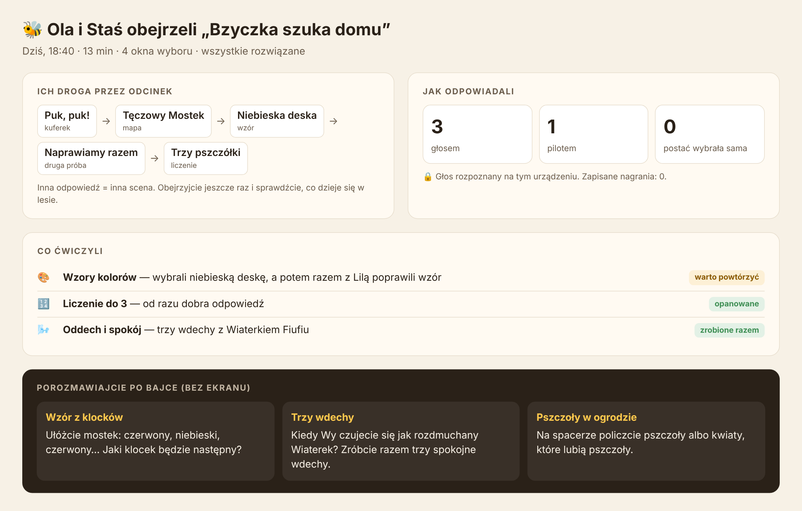

#### Struktura danych telemetrycznych raportu:
Silnik [`StoryEngine`](file:///C:/Users/skywa/.gemini/antigravity/scratch/FilmSpringOpen2026/bajka/engine.py) w trakcie całego seansu zbiera metryki w strukturze `self.decisions`:
1. **Ścieżka fabularna:** Dokładny przebieg węzłów (np. *Dziupla -> Tęczowy Mostek -> Skraj Łąki -> Ul pod Lipą -> Pszczółkowy Taniec*).
2. **Profil interakcji dziecka:**
   - Udział odpowiedzi głosowych (np. 65%),
   - Udział wyboru pilotem / dotykiem (np. 35%),
   - Czy wystąpiła konieczność dopytania (`reprompt`),
   - Szybkość podejmowania decyzji w oknie wyboru.
3. **Kompetencje poznawcze:** Zestawienie pojęć, z którymi dziecko weszło w interakcję (np. układ naprzemienny ABAB, synchronizacja oddechowa, liczenie obiektów w ruchu).
4. **Most do świata offline (Wytyczne WHO i AAP):**
   - Raport generuje **3 konkretne tematy do rozmowy** rodzica z dzieckiem nawiązujące do bajki (np. *„Bzyczka zgubiła drogę, ale poprosiła o pomoc. A Ty do kogo podchodzisz, gdy czegoś nie wiesz?”*).
   - Propozycje zabaw ruchowych bez użycia ekranu (np. wspólne układanie klocków w kolorowy wzór mostka lub liczenie zabawek).

---

## 4. Instrukcja Uruchomienia Krok po Kroku (Runbook)

### 4.1. Wymagania wstępne
- **System:** Windows 10/11 (optymalny dla Foundry Local i DirectML), Linux lub macOS.
- **Python:** Wersja **3.11 lub nowsza** (64-bit).
- **FFmpeg:** Niezbędny do transkodowania i generowania wideo:
  ```powershell
  # Windows (winget):
  winget install --id Gyan.FFmpeg -e
  ```
- **Przeglądarka:** Google Chrome lub Microsoft Edge (obsługa Web Audio, Web Speech API oraz kodeków WebM VP9).

---

### 4.2. Konfiguracja środowiska wirtualnego

Otwórz terminal PowerShell w głównym katalogu projektu:

```powershell
# 1. Utworzenie środowiska wirtualnego Python
python -m venv .venv

# 2. Aktywacja środowiska w PowerShell
.venv\Scripts\Activate.ps1

# 3. Instalacja projektu w trybie edytowalnym ze wszystkimi zależnościami
pip install -e ".[dev,local,mobile]"
```

---

### 4.3. Konfiguracja zmiennych środowiskowych (`.env`)

Skopiuj domyślny plik konfiguracyjny:
```powershell
Copy-Item .env.example .env
```

Najważniejsze parametry w pliku `.env`:
| Zmienna | Domyślnie | Opis |
|---|---|---|
| `BAJKA_BACKEND` | `local` | `local` (Foundry Local Whisper/Phi bez chmury) lub `azure` (Azure Cognitive Services). |
| `BAJKA_PLAYER` | `web` | `web` (odtwarzacz w przeglądarce) lub `vlc` (okno natywne libVLC). |
| `BAJKA_CHOICE_SECONDS` | `12` | Domyślny czas okna wyboru w sekundach (3–60 s). |
| `BAJKA_PORT` | `8080` | Port serwera Web Playera. |
| `BAJKA_PANEL_PORT` | `8090` | Port serwera Panelu Realizatora. |
| `BAJKA_MOBILE_PORT` | `8443` | Port serwera drugiego ekranu HTTPS dla telefonów. |
| `BAJKA_MONTAGE` | `auto` | `auto` (model AI decyduje, reguły w zapasie) lub `reguly` (tylko reguły deterministyczne). |

---

### 4.4. Przygotowanie mediów (placeholdery vs klipy wideo)

Przed pierwszym uruchomieniem należy upewnić się, że pliki wideo istnieją. Jeśli nie pobrano jeszcze wszystkich animacji produkcyjnych, wygeneruj plansze testowe (placeholdery):

```powershell
# Utworzenie kolorowych klipów zastępczych MP4 dla wszystkich brakujących scen
python -m bajka.placeholders scenarios/klub_ciekawskich.yaml
```

Gdy posiadasz wygenerowane pliki wideo z generatora (np. w folderze `download/`):
```powershell
# Transkodowanie, normalizacja i utworzenie płynnych szwów w pętlach idle:
python -m bajka.clips download/klipy.yaml
```

---

### 4.5. Zestawienie wszystkich trybów uruchomienia (CLI)

Głównym punktem wejścia do aplikacji jest moduł `bajka`:

#### Tryb 1: Rekomendowany pokaz demonstracyjny (Web Player + Panel + Symulator Tętna)
Najlepszy tryb na prezentację i testy. Odtwarzacz w przeglądarce z pełnym sterowaniem pilota i podglądem telemetrii:
```powershell
python -m bajka scenarios/klub_ciekawskich.yaml --player web --no-llm --panel
```
- **Odtwarzacz dla widza:** `http://127.0.0.1:8080/`
- **Panel realizatora / suwak tętna:** `http://127.0.0.1:8090/`

#### Tryb 2: Pełne lokalne AI (Whisper STT + model Phi na Copilot+ PC)
Wymaga zainstalowanych modeli w Foundry Local SDK:
```powershell
python -m bajka scenarios/klub_ciekawskich.yaml --player web --panel
```

#### Tryb 3: Szybki test logiki w konsoli (Headless Dev Mode)
Brak wymagań odnośnie wideo, audio i przeglądarki. Cały graf przechodzi w terminalu tekstowym (wybór cyframi 1–3):
```powershell
python -m bajka scenarios/klub_ciekawskich.yaml --text --no-llm
```

#### Tryb 4: Seans grupowy ze smartfonami (Drugi Ekran HTTPS)
Generuje kod QR w terminalu i uruchamia szyfrowany serwer HTTPS dla telefonów:
```powershell
python -m bajka scenarios/klub_ciekawskich.yaml --player web --mobile --panel
```

#### Tryb 5: Eksport całego odcinka do pojedynczego filmu liniowego MP4
Generuje zmontowany plik MP4 z wybraną ścieżką fabularną za pomocą FFmpeg:
```powershell
python -m bajka.linear scenarios/klub_ciekawskich.yaml --choices most,czerwona,spokojnie,lornetka,trzy,slonecznik,taniec -o film.mp4
```

---

### 4.6. Rozwiązywanie typowych problemów (Troubleshooting)

1. **Brak dźwięku po uruchomieniu przeglądarki:**
   - *Przyczyna:* Polityka bezpieczeństwa przeglądarek blokuje automatyczne odtwarzanie audio bez gestu użytkownika.
   - *Rozwiązanie:* Kliknij duży przycisk **▶ Oglądaj** na ekranie startowym.
2. **Telefon nie może połączyć się z mikrofonem na drugim ekranie:**
   - *Przyczyna:* Przeglądarki mobilne (iOS Safari, Android Chrome) blokują `getUserMedia` na niezabezpieczonych połączeniach HTTP.
   - *Rozwiązanie:* Uruchom aplikację z flagą `--mobile`. Moduł [`bajka/mobile.py`](file:///C:/Users/skywa/.gemini/antigravity/scratch/FilmSpringOpen2026/bajka/mobile.py) automatycznie wygeneruje certyfikat TLS i uruchomi połączenie HTTPS (`https://<IP>:8443/`). Na telefonie zaakceptuj certyfikat lokalny.
3. **Błąd: Port `8080` lub `8090` zajęty:**
   - *Rozwiązanie:* Zmień port w pliku `.env` (`BAJKA_PORT=8085`, `BAJKA_PANEL_PORT=8095`).
4. **Zamknięcie karty przeglądarki wstrzymuje odcinek:**
   - *Zachowanie zamierzone:* Odtwarzacz pauzuje silnik w przypadku utraty połączenia (`stale`). Po ponownym otwarciu adresu `http://127.0.0.1:8080/` odcinek wznawia bieżący klip od początku.

---

## 5. Dynamiczny Montaż AI i Silnik Biofeedbacku

Montaż nie jest statyczną listą cięć – adaptuje się na bieżąco do zaangażowania i stanu psychofizjologicznego widza.

### 5.1. Analiza biometryczna i klasyfikacja tętna
Moduł [`bajka/pulse.py`](file:///C:/Users/skywa/.gemini/antigravity/scratch/FilmSpringOpen2026/bajka/pulse.py) monitoruje parametr BPM (Beats Per Minute). W pierwszej scenie ustala się wartość referencyjną widza w spoczynku (`baseline`, zazwyczaj 78–82 BPM dla dziecka).

```text
       Spadek tętna (< 68 BPM)                 Norma (68 - 88 BPM)                 Wzrost tętna (> 88 BPM)
┌───────────────────────────────────┐  ┌───────────────────────────────────┐  ┌───────────────────────────────────┐
│        STAN: ZNUŻENIE             │  │          STAN: NORMA              │  │        STAN: POBUDZENIE           │
│  - Montaż: dynamiczny             │  │  - Montaż: zrównoważony           │  │  - Montaż: relaksujący, kojący    │
│  - Cięcie: ostre / przetarcie 0.4s│  │  - Cięcie: przenikanie 0.6s       │  │  - Cięcie: miękkie przenikanie 1.5s│
│  - Tempo: 1.08x                   │  │  - Tempo: 1.00x                   │  │  - Tempo: 0.92x                   │
│  - Efekt Punch Cut: AKTYWNY       │  │  - Efekt Punch Cut: wyłączony     │  │  - Efekt Punch Cut: wyłączony     │
└───────────────────────────────────┘  └───────────────────────────────────┘  └───────────────────────────────────┘
```

### 5.2. Adaptacja tempa (`playbackRate`)
Silnik modyfikuje właściwość `HTMLMediaElement.playbackRate` na elementach `<video>`:
- **`1.08x` (Znużenie):** Subtelne przyspieszenie akcji i dialogów. Dzięki przeglądarkowemu algorytmowi time-stretching wysokość głosu (pitch) bohaterów nie ulega zniekształceniu.
- **`0.92x` (Pobudzenie):** Spowolnienie narracji pozwalające dziecku uspokoić oddech i zredukować przestymulowanie sensoryczne.

### 5.3. Efekt Punch Cut (Mikro-Zoom)
W stanie znużenia lub przy dynamicznym cięciu, nowy kadr wchodzi z dynamicznym mikronajazdem realizowanym w CSS GPU:
```javascript
// Implementacja w bajka/player_app/index.html
if (punch) {
  videoElement.style.transformOrigin = "center center";
  videoElement.animate([
    { transform: "scale(1.06)" },
    { transform: "scale(1.0)" }
  ], {
    duration: 420,
    easing: "cubic-bezier(0.12, 0.82, 0.3, 1.15)",
    fill: "forwards"
  });
}
```
Zabieg ten natychmiast przyciąga uwagę widza do środka ekranu, imitując profesjonalny montaż teledyskowy/kinowy bez strat jakości wideo.

### 5.4. Przejścia montażowe i silnik regułowo-modelowy
W module [`bajka/montage.py`](file:///C:/Users/skywa/.gemini/antigravity/scratch/FilmSpringOpen2026/bajka/montage.py) zaimplementowano dwa uzupełniające się silniki:
- **`ModelEditor`:** Wysyła do lokalnego modelu Phi lub Azure OpenAI strukturę JSON z informacjami o scenie źródłowej, docelowej, wyborze widza i tętnie. Model zwraca decyzję montażową w czasie trwania reakcji postaci.
- **`RuleEditor`:** Niezawodny silnik regułowy działający w czasie < 1 ms. Używany jako fallback, gdy model nie zdąży przed końcem klipu reakcji.

Dozwolone rodzaje przejść:
| Typ przejścia | Zakres czasu | Zastosowanie |
|---|---|---|
| `ciecie` | `0.0 s` | Ostre cięcie w tym samym miejscu lub przy ożywianiu znużonego widza. |
| `przenikanie` | `0.3 – 2.0 s` | Domyślne łagodne nałożenie kadrów (cross-dissolve). |
| `przetarcie` | `0.4 – 1.5 s` | Wsuwanie nowego obrazu (wipe) przy zmianie lokacji sceny. |
| `zaciemnienie` | `0.6 – 2.5 s` | Ściemnienie do czerni (fade-to-black) na finał lub uspokojenie. |
| `rozjasnienie` | `0.8 – 2.5 s` | Rozbłysk do bieli (fade-to-white) przy radosnym odkryciu. |

---

## 6. Specyfikacja Grafu Scenariusza (YAML Reference)

Graf scen zdefiniowany jest w formacie YAML (np. [`scenarios/klub_ciekawskich.yaml`](file:///C:/Users/skywa/.gemini/antigravity/scratch/FilmSpringOpen2026/scenarios/klub_ciekawskich.yaml)).

### 6.1. Schemat węzła sceny

```yaml
id: "nazwa_sceny"                 # Unikalny identyfikator węzła
place: "Nazwa Miejsca"            # Lokacja diegetyczna (dla reguł montażu zmiany miejsca)
clip: "clips/.../scena.mp4"       # Główny klip narracyjny
idle: "clips/.../scena_idle.mp4"  # Pętla tła pod okno wyboru
question: "Pytanie do widza?"     # Treść pytania w UI i dla syntezatora mowy
reprompt: "Kwestia dopytania"     # Tekst odtwarzany po upływie czasu bez odpowiedzi
default: "opcja_a"                # Identyfikator wyboru domyślnego
timeout: 15                       # Czas okna wyboru w sekundach
layers: ["slot_warstwy"]          # Sloty przezroczystych nakładek aplikowanych na ten klip

variants:                         # Alternatywne warianty klipu według stanu biometrycznego
  spokojna: "clips/.../spokojna.mp4" # Uspokajająca wersja ujęcia
  zywa: "clips/.../zywa.mp4"         # Dynamiczna wersja ujęcia

choices:                          # Dostępne krawędzie decyzyjne
  opcja_a:
    label: "Napis na kafelku"     # Etykieta widoczna w oknie wyboru
    icon: "🎨"                    # Ikona emoji lub plik graficzny
    next: "węzeł_docelowy"        # Identyfikator następnej sceny w grafie
    reaction: "clips/.../reakcja.mp4" # Opcjonalny klip reakcji postaci
    reply: "Kwestia mówiona"      # Kwestia wypowiadana przy braku klipu reakcji
    layer: "clips/.../warstwa.webm" # Przypisanie przezroczystego wideo do slotu
    slot: "slot_warstwy"          # Nazwa slotu
    keywords: ["słowo1", "słowo2"]# Słowa kluczowe dla bezmodelowego rozpoznawania mowy
```

### 6.2. Akumulacja przezroczystych warstw WebM (kanał alfa)
Gdy dziecko dokonuje wyboru (np. wybiera słonecznik, koniczynę lub stokrotkę), silnik zapisuje przypisany plik wideo `.webm` w słowniku `StoryEngine._layers`. W kolejnych scenach posiadających wpis `layers: [kwiatek]`, odtwarzacz pobiera odpowiednią przezroczystą nakładkę WebM (kodek VP8/VP9 z przezroczystością alfa) i nakłada ją w synchronizacji klatkowej na odtwarzany klip. Dzięki temu bohater trzyma wybrany kwiatek aż do samego finału bez konieczności renderowania dziesiątek osobnych wersji całych scen.

---

## 7. Silnik Przetwarzania Mowy i Bezpieczeństwo AI

1. **Rejestracja dźwięku:** Przeglądarka nagrywa strumień 16 kHz mono PCM za pomocą Web Audio API.
2. **Lokalny Speech-to-Text (Whisper):**
   - Transkrypcja wykonywana lokalnie na urządzeniu za pomocą zoptymalizowanego modelu ONNX INT8 w środowisku Foundry Local.
   - W przypadku braku Foundry Local, Chromium korzysta z wbudowanego Web Speech API.
3. **Ekstrakcja intencji i zapas słów kluczowych:**
   - Model językowy Phi analizuje transkrypcję i przypisuje ją do identyfikatora wyboru.
   - Jeśli model nie jest pewny lub upłynął limit czasu, moduł [`bajka/keywords.py`](file:///C:/Users/skywa/.gemini/antigravity/scratch/FilmSpringOpen2026/bajka/keywords.py) wykonuje natychmiastowe dopasowanie scoringowe na słowach kluczowych ze scenariusza.
4. **Filtr bezpieczeństwa (`bajka/safety.py`):**
   - Wszystkie kwestie generowane dynamicznie przez model podlegają rygorystycznemu filtrowaniu leksykalnemu, gwarantując brak jakichkolwiek nieodpowiednich treści w bajce dla dzieci.

---

## 8. Architektura Sieciowa, Porty i API REST / SSE

Aplikacja zarządza trzema niezależnymi serwerami HTTP/HTTPS:

```text
               ┌─────────────────────────────────────────────────────┐
               │             Aplikacja Bajka (Host Machine)          │
               └──────────┬─────────────────┬───────────────────┬─────┘
                          │                 │                   │
                Port :8080│       Port :8090│         Port :8443│ (TLS HTTPS)
                          ▼                 ▼                   ▼
                  ┌──────────────┐  ┌──────────────┐    ┌──────────────┐
                  │  Web Player  │  │    Panel     │    │ Mobile Server│
                  │  Compositor  │  │  Realizatora │    │ Drugi Ekran  │
                  └──────────────┘  └──────────────┘    └──────────────┘
```

### Endpointy Web Playera (`:8080`)
- `GET /` — Aplikacja SPA odtwarzacza wideo.
- `GET /media/<id>/<plik>` — Strumieniowanie wideo (obsługa nagłówków HTTP `Range: bytes=X-Y`).
- `GET /api/state` — Odpytywanie przez odtwarzacz o nowe polecenie silnika (`play`, `loop`, `ask`, `say`, `end`).
- `POST /api/event` — Przesyłanie zdarzeń z UI do silnika (`done`, `choice`, `speech`, `restart`, `stop`).
- `POST /api/voice` — Odbiór binarnego bufora WAV do lokalnej transkrypcji Whisper.

### Endpointy Panelu Realizatora (`:8090`)
- `GET /` — Kokpit podglądu telemetrycznego.
- `GET /stream` — Strumień Server-Sent Events (SSE) wysyłający w czasie rzeczywistym zdarzenia `scena`, `montaz`, `wersja`, `glosy` i `pulse`.
- `POST /api/pulse` — Ustawienie wartości BPM lub presetu symulatora (`znuzenie`, `norma`, `pobudzenie`).

### Endpointy Drugiego Ekranu (`:8443` HTTPS)
- `GET /` — PWA dla smartfonów.
- `GET /api/state` — Pobranie aktywnego pytania i kafelków decyzyjnych.
- `POST /api/vote` — Przesłanie głosu lub wypowiedzi ze smartfona.

---

## 9. Testowanie i Weryfikacja Jakości (Pytest)

Pakiet posiada zestaw testów automatycznych pokrywających silnik maszyny stanów, algorytmy montażowe, biometrię oraz serwery HTTP.

### Uruchomienie testów
W aktywnym środowisku wirtualnym:
```powershell
python -m pytest tests --ignore=tests/test_stt.py --ignore=tests/test_tts.py
```
*(Flagi `--ignore` pomijają opcjonalne testy chmurowe wymagające zewnętrznych kluczy API Azure).*

### Zakres pokrycia testowego
- [`tests/test_engine.py`](file:///C:/Users/skywa/.gemini/antigravity/scratch/FilmSpringOpen2026/tests/test_engine.py) — Spójność maszyny stanów, przechodzenie po krawędziach grafu, obsługa timeoutów.
- [`tests/test_montage.py`](file:///C:/Users/skywa/.gemini/antigravity/scratch/FilmSpringOpen2026/tests/test_montage.py) — Poprawność wyboru cięć, czasy trwania przejść, działanie reguł `RuleEditor`.
- [`tests/test_pulse.py`](file:///C:/Users/skywa/.gemini/antigravity/scratch/FilmSpringOpen2026/tests/test_pulse.py) — Progi klasyfikacji tętna, filtrowanie odczytów i wygładzanie szumu.
- [`tests/test_web_player.py`](file:///C:/Users/skywa/.gemini/antigravity/scratch/FilmSpringOpen2026/tests/test_web_player.py) — Synchronizacja wątkowa komend, serwowanie plików i obsługa zdarzeń przeglądarki.
- [`tests/test_keywords.py`](file:///C:/Users/skywa/.gemini/antigravity/scratch/FilmSpringOpen2026/tests/test_keywords.py) — Poprawność dopasowywania wypowiedzi w języku polskim do opcji wyboru.
