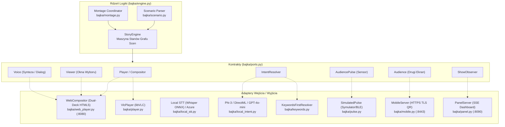
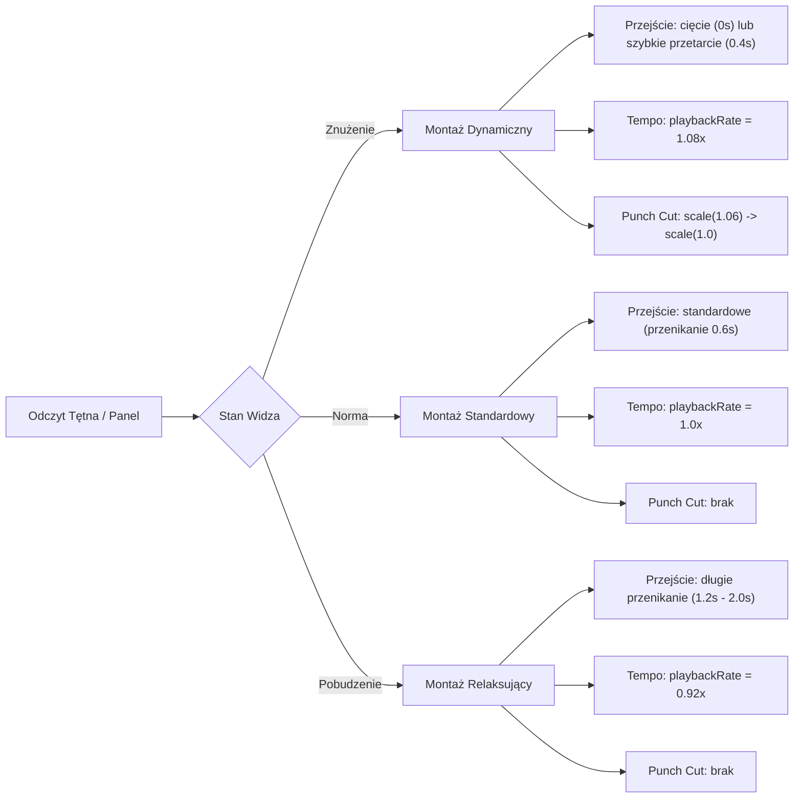

# Dokumentacja Techniczna: Interaktywna Bajka Streamingowa (Silnik Emisji i Dynamicznego Montażu)

Niniejszy dokument stanowi pełną dokumentację inżynierską i techniczną systemu interaktywnego wideo opracowanego na hackathon FilmSpring Open 2026. Dokument pomija aspekty czysto biznesowe i marketingowe, skupiając się na architekturze oprogramowania, protokołach komunikacyjnych, przetwarzaniu multimediów, silniku dynamicznego montażu AI, biometrii oraz procedurach wdrożeniowych i operacyjnych.

---

## 1. Architektura Systemu

System zaprojektowano w oparciu o **architekturę heksagonalną (Ports & Adapters)**. Rdzeń logiki biznesowej (`StoryEngine`) jest całkowicie odseparowany od mechanizmów wejścia/wyjścia (odtwarzacze wideo, silniki rozpoznawania mowy, modele językowe, sensory tętna czy serwery HTTP). Wszystkie interakcje z otoczeniem definiują abstrakcyjne protokoły w module [`bajka/ports.py`](file:///C:/Users/skywa/.gemini/antigravity/scratch/FilmSpringOpen2026/bajka/ports.py).



### 1.1. Cykl życia węzła sceny (Scene State Flow)
1. **Pobranie ujęcia i wariantu:** `StoryEngine` sprawdza stan biometryczny widza (`AudiencePulse`). Jeśli zdefiniowano warianty sceny (np. wersja relaksująca lub dynamiczna), wybierany jest właściwy klip MP4.
2. **Kalkulacja parametrów odtwarzania:**
   - Wybór przejścia montażowego (`Cut`: typ `ciecie`, `przenikanie`, `przetarcie`, `zaciemnienie`, `rozjasnienie` oraz czas trwania w sekundach).
   - Zastosowanie mnożnika tempa: `playbackRate = 1.08` dla znużenia, `0.92` dla pobudzenia, `1.0` w normie.
   - Flaga efektu **Punch Cut** (mikro-zoom kadru `scale(1.06) -> scale(1.0)`).
   - Akumulacja warstw przezroczystych (`layers` WebM VP8/VP9 z kanałem alfa), pochodzących z wcześniejszych decyzji widza.
3. **Emisja do Compositora:** Wywołanie `play_shot(Shot)` blokuje wątek silnika do momentu, gdy klip zbliża się do końca.
4. **Pętla oczekiwania (Idle Loop):** Po zakończeniu klipu narracyjnego odtwarzacz płynnie wchodzi w zapętlone tło (`loop_shot`) i wyświetla interfejs okna wyboru (`ask`).
5. **Obsługa wejścia (Input Arbitration):**
   - Równoległe nasłuchiwanie zdarzeń UI (klawisze strzałek, Enter, pilot CEC/SmartTV, kliknięcie myszą/dotyk).
   - Nagrywanie audio z mikrofonu (Web Speech API w przeglądarce lub strumień PCM 16 kHz przesyłany do lokalnego modelu Whisper).
   - Jeśli aktywny jest drugi ekran (`--mobile`), zbieranie głosów z telefonów przez HTTPS.
6. **Rozpoznanie intencji i fallback:**
   - Próba ekstrakcji wyboru przez model językowy (Phi/DirectML lub GPT-4o-mini).
   - Równoległy, niezawodny fallback na deterministyczny silnik słów kluczowych (`KeywordIntentResolver`).
   - W przypadku braku decyzji lub upływu czasu (timeout grace period) uruchamiane jest ponowienie pytania (`reprompt`), a ostatecznie wybór domyślny (`default`).
7. **Przejście do krawędzi grafu:** Silnik zleca montażyście (`Montage.request()`) wyliczenie przejścia w tle, odtwarzając ewentualny klip reakcji postaci, po czym ładuje docelowy węzeł.

---

## 2. Stos Technologiczny i Zależności

### 2.1. Warstwa Backendowa (Python 3.11+)
- **Język:** Python 3.11+ (64-bit).
- **Struktury danych & concurrency:** `dataclasses`, `threading.Condition`, `concurrent.futures.ThreadPoolExecutor`, `pathlib.Path`.
- **Serwery HTTP:** Standardowa biblioteka `http.server.ThreadingHTTPServer` z implementacją `SimpleHTTPRequestHandler` obsługującą zakresy bajtowe (HTTP 206 Partial Content dla streamingu wideo), Server-Sent Events (SSE) dla panelu oraz REST endpoints (`/api/state`, `/api/event`, `/api/voice`, `/api/pulse`).
- **Parsowanie scenariusza:** `PyYAML>=6.0`.
- **Konfiguracja środowiska:** `python-dotenv>=1.0`.

### 2.2. Lokalne Modele AI i Przetwarzanie Brzegowe (Edge / Copilot+ PC)
- **Local STT (Mowa na tekst):**
  - Whisper (Small / Base INT8) uruchamiany przez **Foundry Local SDK** (`foundry-local-sdk>=2.1`) i DirectML/Windows ML.
  - Wykorzystuje NPU (Snapdragon X Elite / Intel Core Ultra / AMD Ryzen AI) lub GPU (DirectX 12).
  - Wejście: 16 kHz, 16-bit mono PCM WAV.
- **Local LLM (Intencje i Montażysta):**
  - Rodzina Phi-3 / Phi-3.5 / Phi-4 Mini (ONNX Runtime / DirectML).
  - Posiada wbudowany filtr bezpieczeństwa `bajka/safety.py` weryfikujący zgodność z treściami dla dzieci.
- **Alternatywny backend chmurowy:**
  - `azure-cognitiveservices-speech>=1.52` (Azure Speech STT & TTS).
  - `openai>=3.31` (Azure OpenAI API dla `gpt-4o-mini`).

### 2.3. Frontend Odtwarzacza i Paneli (Web Player & Dashboard)
- **Zero-Build Stack:** Czysty Vanilla JavaScript (ES6+), HTML5, CSS3. Brak ciężkich frameworków (React/Vue/Webpack/Vite), zerowy czas kompilacji.
- **Architektura Compositora (Dual-Deck Video Engine):**
  - Dwa niezależne elementy `<video>` (Deck A i Deck B) przełączane w relacji front/back.
  - Podczas gdy Deck A odtwarza bieżącą scenę, Deck B w tle buforuje kolejne ujęcie.
  - Przejścia realizowane sprzętowo w GPU za pomocą CSS transitions (`opacity`, `clip-path: polygon(...)`, CSS animations).
- **Obsługa kanału alfa (Wideo Przezroczyste):**
  - Kontenery nakładek z elementami `<video>` odtwarzającymi format WebM (kodek VP8/VP9 z przezroczystością alfa) w pełnej synchronizacji czasowej z klipem bazowym.
- **Punch Cut i Dynamika Obrazu:**
  - Dynamiczna transformacja CSS Matrix (`scale(1.06) -> scale(1.0)`) z krzywą `cubic-bezier(0.12, 0.82, 0.3, 1.15)` trwającą 320–450 ms, wykonywana bez przycinania wideo.
  - Płynna regulacja `HTMLMediaElement.playbackRate` (`1.08x` / `0.92x`) w czasie rzeczywistym.
- **Typografia i UI:**
  - Lokalnie serwowany krój pisma Google Font **Nunito** (`bajka/fonts/nunito-variable.woff2`).
- **Mikrofon i Dźwięk w Przeglądarce:**
  - Web Audio API (`AudioContext`, `ScriptProcessorNode` / `AudioWorklet`) do rejestracji strumienia 16 kHz.
  - Web Speech API (`webkitSpeechRecognition`) jako bezopóźnieniowy fallback w przeglądarkach Chromium.

### 2.4. Drugi Ekran i Bezpieczeństwo Sieciowe
- **TLS / HTTPS:** Moduł `cryptography>=42` generujący w locie certyfikat X.509 RSA/ECDSA i klucz prywatny dla lokalnego serwera HTTPS (`:8443`), co umożliwia dostęp do API `navigator.mediaDevices.getUserMedia` na urządzeniach mobilnych w sieci LAN.
- **Kody QR:** Biblioteka `segno>=1.6` generująca kody QR w terminalu konsoli oraz w oknie przeglądarki.

---

## 3. Struktura Katalogów i Moduły

```text
FilmSpringOpen2026/
├── bajka/                     # Pakiet źródłowy silnika w Pythonie
│   ├── app.py                 # Punkt wejścia CLI, routing flag i orkiestracja
│   ├── engine.py              # StoryEngine - silnik maszyny stanów grafu i pętli emisji
│   ├── ports.py               # Definicje protokołów (Hexagonal Architecture)
│   ├── scenario.py            # Parser, walidator i struktury grafu scen YAML
│   ├── web_player.py          # Serwer HTTP i kontroler odtwarzacza Web Player (:8080)
│   ├── montage.py             # Silnik montażu: RuleEditor i ModelEditor (Phi/Azure)
│   ├── pulse.py               # Obsługa biometrii: tętno, progi (bored/excited), symulator
│   ├── panel.py               # Serwer panelu realizatora z podglądem stanu grafu (:8090)
│   ├── mobile.py              # Drugi ekran: serwer HTTPS (:8443) dla telefonów
│   ├── keywords.py            # Rozpoznawanie intencji po słowach kluczowych (regex/scoring)
│   ├── local_stt.py           # Transkrypcja mowy Whisper ONNX przez Foundry Local
│   ├── local_intent.py        # Ekstrakcja intencji przez lokalny model Phi
│   ├── safety.py              # Filtr bezpieczeństwa treści dla dzieci
│   ├── clips.py               # Narzędzie transkodowania i normalizacji klipów (ffmpeg)
│   ├── placeholders.py        # Generator technicznych plansz wideo dla brakujących scen
│   ├── linear.py              # Generator filmu liniowego (eksport MP4 przez ffmpeg)
│   ├── player_app/            # Aplikacja frontendowa Web Playera (index.html, JS, CSS)
│   ├── panel_app/             # Aplikacja frontendowa Panelu Realizatora (SVG graf, SSE)
│   ├── mobile_app/            # PWA drugiego ekranu dla smartfonów
│   └── fonts/                 # Wbudowane fonty (Nunito WOFF2)
├── scenarios/                 # Pliki scenariuszy i metadanych
│   ├── klub_ciekawskich.yaml  # Główny graf odcinka demonstracyjnego
│   ├── klub_ciekawskich.md    # Scenariusz literacki odcinka
│   └── clips/                 # Wygenerowane pliki wideo (.mp4, .webm)
├── tests/                     # Zestaw 168 testów jednostkowych i integracyjnych (pytest)
├── docs/                      # Dokumentacja techniczna i architektoniczna
└── pyproject.toml             # Konfiguracja pakietu, zależności i narzędzi
```

### Szczegółowy opis kluczowych modułów

| Plik | Rola techniczna |
|---|---|
| [`bajka/engine.py`](file:///C:/Users/skywa/.gemini/antigravity/scratch/FilmSpringOpen2026/bajka/engine.py) | **Maszyna stanów.** Iteruje po scenach, zarządza wątkiem pętli oczekiwania, wywołuje montażystę AI, rozstrzyga głosy i emituje zdarzenia do obserwatora (`ShowObserver`). |
| [`bajka/web_player.py`](file:///C:/Users/skywa/.gemini/antigravity/scratch/FilmSpringOpen2026/bajka/web_player.py) | **Compositor Server.** Zapewnia wątkowo-bezpieczną komunikację między silnikiem a przeglądarką za pomocą `threading.Condition` i kolejki komend JSON (`play`, `loop`, `ask`, `say`, `end`). |
| [`bajka/montage.py`](file:///C:/Users/skywa/.gemini/antigravity/scratch/FilmSpringOpen2026/bajka/montage.py) | **Koordynator montażu.** Oblicza parametry przejścia na podstawie kontekstu (`CutContext`). Wdraża asynchroniczne odpytywanie LLM z limitem czasu oraz deterministyczny fallback w klasie `RuleEditor`. |
| [`bajka/pulse.py`](file:///C:/Users/skywa/.gemini/antigravity/scratch/FilmSpringOpen2026/bajka/pulse.py) | **Moduł biometryczny.** Oblicza stan emocjonalny widza w oparciu o tętno spoczynkowe (`baseline`). Klasyfikuje stany: `znużenie` (spadek tętna poniżej bazowego), `pobudzenie` (wzrost tętna powyżej progu), `norma`. |
| [`bajka/scenario.py`](file:///C:/Users/skywa/.gemini/antigravity/scratch/FilmSpringOpen2026/bajka/scenario.py) | **Model danych grafu.** Reprezentuje węzły (`Scene`), krawędzie, opcje wyboru (`Choice`), warianty biometryczne oraz przezroczyste nakładki (`LayerSlot`). |
| [`bajka/keywords.py`](file:///C:/Users/skywa/.gemini/antigravity/scratch/FilmSpringOpen2026/bajka/keywords.py) | **Lekki klasyfikator intencji.** Działa bez LLM; wykonuje normalizację tekstu (usunięcie znaków diakrytycznych, stemming prefiksowy, dopasowanie leksykalne wg wag słów). |
| [`bajka/panel.py`](file:///C:/Users/skywa/.gemini/antigravity/scratch/FilmSpringOpen2026/bajka/panel.py) | **Telemetry Dashboard Server.** Zapewnia wizualizację topologii grafu w SVG, strumieniowanie SSE zdarzeń montażowych oraz interaktywny suwak symulatora tętna. |

---

## 4. Specyfikacja Grafu Scenariusza (YAML)

Plik scenariusza (np. [`scenarios/klub_ciekawskich.yaml`](file:///C:/Users/skywa/.gemini/antigravity/scratch/FilmSpringOpen2026/scenarios/klub_ciekawskich.yaml)) definiuje skierowany graf scen, warunki brzegowe oraz parametry audiowizualne.

### Struktura węzła sceny:
```yaml
id: "zagadka_mostek"              # Unikalny identyfikator węzła
place: "polana"                   # Lokalizacja diegetyczna (do wykrywania zmiany miejsca)
clip: "01_polana_pytanie.mp4"     # Klip główny (pytanie narracyjne)
idle_clip: "01_polana_idle.mp4"   # Pętla tła pod okno wyboru (odtwarzana bezszwowo)
question: "Którą drogą idziemy?"   # Pytanie wyświetlane w UI i czytane przez TTS
reprompt: "Powiedz, który mostek wybierasz!" # Kwestia ponowienia przy braku reakcji
default: "kolorowy"               # Identyfikator wyboru domyślnego po timeout
layers: ["ozdoba"]                # Sloty przezroczystych warstw WebM aplikowane na ten klip

variants:                         # Warianty klipu według stanu biometrycznego
  pobudzenie: "01_polana_spokojna.mp4" # Uspokajająca wersja kadru
  znuzenie: "01_polana_dynamiczna.mp4" # Wersja o wysokiej dynamice ruchu

choices:                          # Dostępne krawędzie decyzyjne
  kolorowy:
    label: "Kolorowy mostek"      # Etykieta w interfejsie
    icon: "mostek.png"           # Ikona graficzna w oknie wyboru
    target: "scena_mostek"        # Węzeł docelowy w grafie
    reaction_clip: "reakcja_kolorowy.mp4" # Klip reakcji postaci przed sceną docelową
    keywords: ["kolorowy", "mostek", "tęcza", "barwny"] # Słowa kluczowe dla STT
    layer: "wianek_kolorowy.webm" # Przypisanie warstwy do slotu 'ozdoba' na kolejne sceny
```

---

## 5. Dynamiczny Montaż AI i Silnik Biofeedbacku

### 5.1. Klasyfikacja Biometryczna (`bajka/pulse.py`)
Silnik monitoruje parametr BPM (Beats Per Minute). Wartość odniesienia (`baseline`) ustalana jest w pierwszej scenie (domyślnie 78–80 BPM dla dziecka w spoczynku).

- **Znużenie (`BORED`):** `BPM < baseline - delta` (np. spadek poniżej 68–72 BPM). Oznacza spadek zaangażowania i apatię widza.
- **Pobudzenie (`EXCITED`):** `BPM > baseline + delta` (np. wzrost powyżej 88–92 BPM). Oznacza przestymulowanie lub nadmierny stres.
- **Norma (`NORMAL`):** Przedział optymalny.

### 5.2. Mechanizmy Adaptacji Montażowej
Montaż reaguje na stan widza na trzech poziomach:



1. **Typ i Długość Przejścia (`Cut`):**
   - Przy **znużeniu:** Montażysta forsuje natychmiastowe ostre cięcie (`ciecie`, `0.0s`) lub agresywne, krótkie przetarcie (`przetarcie`, `0.4s`), aby nadać rytm narracji.
   - Przy **pobudzeniu:** Montażysta wybiera miękkie, wydłużone przenikanie (`przenikanie`, `1.2–2.0s`) lub łagodne zaciemnienie (`zaciemnienie`, `1.5s`), stabilizując percepcję sensoryczną.
2. **Skalowanie Tempa (`playbackRate`):**
   - Elementy wideo odtwarzacza mają natychmiast dostosowywaną prędkość:
     - `1.08x` w stanie znużenia (subtelne przyspieszenie dialogów i akcji bez zniekształceń wysokości dźwięku dzięki algorytmom time-stretching w przeglądarkach).
     - `0.92x` w stanie pobudzenia (spowolnienie kadru, uspokajający flow).
3. **Efekt Punch Cut (Mikro-Zoom):**
   - W momencie cięcia lub nagłej zmiany stanu na znużenie, warstwa wideo wykonuje dynamiczny mikronajazd:
     ```javascript
     animate(videoElement, [
       { transform: "scale(1.06)" },
       { transform: "scale(1.0)" }
     ], 420, "cubic-bezier(0.12, 0.82, 0.3, 1.15)");
     ```
   - Skutkuje to natychmiastowym skupieniem wzroku widza na środku kadru bez utraty ostrości.

---

## 6. Przetwarzanie Głosu i Rozpoznawanie Mowy

System obsługuje pełną redundancję ścieżki audio:

```text
               ┌───────────────────────────────┐
               │    Mikrofon (Audio Stream)    │
               └──────────────┬────────────────┘
                              │
               ┌──────────────▼────────────────┐
               │ Buforowanie 16 kHz Mono PCM   │
               └──────────────┬────────────────┘
                              │
             ┌────────────────┴────────────────┐
             ▼                                 ▼
   [Foundry Local Whisper]            [Web Speech API]
   Lokalny model NPU/GPU/CPU         Chromium STT Fallback
             │                                 │
             └────────────────┬────────────────┘
                              ▼
                      Ztranskrybowany Tekst
                              │
             ┌────────────────┴────────────────┐
             ▼                                 ▼
   [Local LLM / Azure LLM]          [KeywordIntentResolver]
   Ekstrakcja semantyczna           Dopasowanie leksykalne regex
   i generowanie wypowiedzi         ze scenariusza (100% determinizm)
             │                                 │
             └────────────────┬────────────────┘
                              ▼
                      Bezpieczna Decyzja
                      (SafeReplyResolver)
```

1. **Foundry Local Whisper:** Rejestruje nagranie przez Web Audio API, przesyła do endpointu `/api/voice`, gdzie model Whisper zamienia mowę na tekst.
2. **KeywordIntentResolver:** Jeśli model językowy jest wyłączony (`--no-llm`), działa wolno lub nie zwróci jednoznacznej odpowiedzi, silnik bada słowa kluczowe przypisane do opcji w pliku YAML.
3. **SafeReplyResolver:** Każda kwestia generowana dynamicznie przez model podlega weryfikacji leksykalnej pod kątem bezpieczeństwa i braku wulgaryzmów czy pojęć niestosownych dla dzieci.

---

## 7. Instrukcja Instalacji i Uruchomienia (Runbook)

### 7.1. Wymagania Środowiskowe
- **System operacyjny:** Windows 10/11 (rekomendowany ze względu na DirectML/Foundry), Linux, macOS.
- **Python:** 3.11 lub nowszy (wersja 64-bitowa).
- **FFmpeg:** Niezbędny do transkodowania klipów i generowania placeholderów (`winget install --id Gyan.FFmpeg -e` na Windows).
- **Przeglądarka internetowa:** Google Chrome lub Microsoft Edge (dla wsparcia Web Audio, Web Speech API oraz kodeków WebM VP9).

### 7.2. Przygotowanie Środowiska Wirtualnego
W konsoli PowerShell:
```powershell
# 1. Klonowanie repozytorium (jeśli jeszcze nie sklonowano)
git clone <URL_REPOZYTORIUM> FilmSpringOpen2026
cd FilmSpringOpen2026

# 2. Utworzenie i aktywacja środowiska wirtualnego
python -m venv .venv
.venv\Scripts\Activate.ps1

# 3. Instalacja projektu z zależnościami deweloperskimi i lokalnymi
pip install -e ".[dev,local,mobile]"

# 4. Inicjalizacja pliku konfiguracyjnego
Copy-Item .env.example .env
```

### 7.3. Przygotowanie Mediów
Przed pierwszym uruchomieniem należy upewnić się, że wideo dla scen istnieje. Jeśli nie wygenerowano jeszcze animacji produkcyjnych AI, należy utworzyć plansze techniczne (placeholdery):
```powershell
# Generowanie kolorowych klipów testowych MP4 dla wszystkich scen z pliku YAML
python -m bajka.placeholders scenarios/klub_ciekawskich.yaml
```

W przypadku posiadania gotowych klipów z generatorów AI:
```powershell
# Normalizacja i transkodowanie klipów do wspólnego formatu
python -m bajka.clips download/klipy.yaml
```

---

## 8. Tryby Uruchomienia (CLI Reference)

Głównym punktem wejścia aplikacji jest moduł `bajka` (`python -m bajka`).

### 8.1. Zestawienie Flag CLI

| Flaga | Domyślnie | Opis |
|---|---|---|
| `scenario` | *(wymagany)* | Ścieżka do pliku YAML ze scenariuszem (np. `scenarios/klub_ciekawskich.yaml`). |
| `--player` | `web` | Wybór odtwarzacza: `web` (odtwarzacz w przeglądarce) lub `vlc` (okno libVLC). |
| `--panel` | `false` | Uruchamia serwer panelu telemetrycznego realizatora na porcie `8090`. |
| `--no-llm` | `false` | Wyłącza model językowy; sterowanie montażem z reguł, a intencjami ze słów kluczowych. |
| `--no-mic` | `false` | Wyłącza nasłuchiwanie mikrofonu (wybór wyłącznie pilotem, klawiaturą lub dotykiem). |
| `--no-browser` | `false` | Nie otwiera automatycznie karty przeglądarki po starcie serwera. |
| `--mobile` | `false` | Aktywuje serwer drugiego ekranu HTTPS dla smartfonów widowni. |
| `--backend` | `local` | `local` (Foundry Local Whisper + Phi na NPU/GPU) lub `azure` (Azure Cognitive Services). |
| `--text` | `false` | Tryb próbny w konsoli (tekstowy), bez wideo, mikrofonu i AI. |
| `--windowed` | `false` | Uruchamia odtwarzacz VLC w oknie zamiast pełnego ekranu (tylko z `--player vlc`). |

---

### 8.2. Rekomendowane Przykłady Uruchomienia

#### Tryb 1: Pełny Seans Demonstracyjny (Web Player + Panel Telemetrii + Biofeedback)
Rekomendowany tryb pokazowy na hackathonie. Odtwarzacz w przeglądarce z pełnym podglądem na żywo i symulatorem tętna:
```powershell
python -m bajka scenarios/klub_ciekawskich.yaml --player web --no-llm --panel
```
- **Odtwarzacz widza:** `http://127.0.0.1:8080/`
- **Panel realizatora / biofeedback:** `http://127.0.0.1:8090/`

#### Tryb 2: Pełne Lokalne AI (Whisper + Phi na Copilot+ PC)
Wymaga zainstalowanych modeli w Foundry Local:
```powershell
python -m bajka scenarios/klub_ciekawskich.yaml --player web --panel
```

#### Tryb 3: Szybki Test Konsolowy (Headless / Dev)
Brak wymagań co do przeglądarki, wideo czy mikrofonu. Cała logika grafu testowana w terminalu (wybór cyframi 1–3):
```powershell
python -m bajka scenarios/klub_ciekawskich.yaml --text --no-llm
```

#### Tryb 4: Seans Grupowy z Telefonami (Drugi Ekran)
Uruchamia bezpieczny serwer HTTPS i generuje w konsoli kod QR do zeskanowania smartfonem:
```powershell
python -m bajka scenarios/klub_ciekawskich.yaml --player web --mobile --panel
```
Smartfony w tej samej sieci Wi-Fi łączą się pod adres wskazany w kodzie QR (np. `https://192.168.1.X:8443/`).

---

## 9. Architektura Portów Sieciowych i API

Aplikacja uruchamia do trzech równoległych serwerów HTTP/HTTPS:

```text
+-------------------------------------------------------------------------+
|                               HOST MACHINE                              |
|                                                                         |
|   +--------------------------+             +------------------------+   |
|   |  Web Player HTTP Server  |             |  Panel Realizatora SSE |   |
|   |       Port :8080         |             |       Port :8090       |   |
|   +-------------▲------------+             +------------▲-----------+   |
|                 │                                       │               |
|                 │ GET /api/state                        │ GET /stream   |
|                 │ POST /api/event                       │ POST /pulse   |
|                 │ POST /api/voice                       │               |
|                 │                                       │               |
|   +-------------▼------------+             +------------▼-----------+   |
|   |  Przeglądarka Odtwarzacz |             |  Przeglądarka Panel    |   |
|   |  (Duży Ekran / TV)       |             |  (Laptop Realizatora)  |   |
|   +--------------------------+             +------------------------+   |
|                                                                         |
|   +-----------------------------------------------------------------+   |
|   |               Mobile HTTPS Server (Port :8443)                  |   |
|   |          Szyfrowany certyfikatem TLS (Web Audio Access)         |   |
|   +---------------------------------▲-------------------------------+   |
|                                     │                                   |
+-------------------------------------┼-----------------------------------+
                                      │ Wi-Fi LAN
                           +----------▼----------+
                           | Smartfony Widzów    |
                           | (Głosowanie / PWA)  |
                           +---------------------+
```

### 9.1. Web Player Server (`:8080`)
- `GET /` — Serwowanie aplikacji SPA odtwarzacza ([`bajka/player_app/index.html`](file:///C:/Users/skywa/.gemini/antigravity/scratch/FilmSpringOpen2026/bajka/player_app/index.html)).
- `GET /media/<id>/<filename>` — Strumieniowanie plików wideo i przezroczystych nakładek WebM z obsługą nagłówków `Range: bytes=...`.
- `GET /api/state` — Odpytywanie przez odtwarzacz o aktualne polecenie silnika (`play`, `loop`, `ask`, `say`, `end`).
- `POST /api/event` — Przesyłanie zdarzeń z odtwarzacza (`done`, `choice`, `speech`, `restart`, `stop`).
- `POST /api/voice` — Odbiór binarnego strumienia audio WAV z przeglądarki do transkrypcji przez model Whisper.

### 9.2. Panel Server (`:8090`)
- `GET /` — Panel podglądu telemetrycznego ([`bajka/panel_app/index.html`](file:///C:/Users/skywa/.gemini/antigravity/scratch/FilmSpringOpen2026/bajka/panel_app/index.html)).
- `GET /stream` — Strumień Server-Sent Events (SSE) wysyłający w czasie rzeczywistym zdarzenia z silnika:
  - `scena`: zmiana aktywnej sceny i odtwarzanego klipu,
  - `montaz`: decyzja montażysty (rodzaj przejścia, czas trwania, uzasadnienie),
  - `wersja`: wybór alternatywnego klipu na podstawie tętna,
  - `pulse`: aktualny stan biometryczny widza.
- `POST /api/pulse` — Ustawienie parametrów symulatora tętna (`bpm`, `preset`: `znuzenie`, `norma`, `pobudzenie`).

### 9.3. Mobile Server (`:8443`, HTTPS)
- `GET /` — Aplikacja drugiego ekranu ([`bajka/mobile_app/index.html`](file:///C:/Users/skywa/.gemini/antigravity/scratch/FilmSpringOpen2026/bajka/mobile_app/index.html)).
- `GET /api/state` — Pobranie aktualnego pytania i opcji wyboru.
- `POST /api/vote` — Oddanie głosu dotykowego lub przesłanie nagrania mowy ze smartfona.

---

## 10. Weryfikacja i Testy Jednostkowe

Pakiet zawiera zestaw testów automatycznych opartych o framework `pytest`. Testy weryfikują kontrakty architektoniczne, parser scenariuszy, symulację biometryczną, silnik montażu oraz serwery HTTP.

### 10.1. Uruchomienie Testów
W aktywnym środowisku wirtualnym:
```powershell
# Uruchomienie pełnego zestawu testów jednostkowych (168 testów)
python -m pytest tests --ignore=tests/test_stt.py --ignore=tests/test_tts.py
```
*(Uwaga: flagi `--ignore` pomijają opcjonalne testy integracyjne wymagające aktywnych kluczy do chmury Azure Speech).*

### 10.2. Kluczowe Obszary Testowe
- [`tests/test_engine.py`](file:///C:/Users/skywa/.gemini/antigravity/scratch/FilmSpringOpen2026/tests/test_engine.py): Weryfikacja maszyny stanów, przejść między węzłami i odporności na przerwanie seansu.
- [`tests/test_montage.py`](file:///C:/Users/skywa/.gemini/antigravity/scratch/FilmSpringOpen2026/tests/test_montage.py): Testy widełek czasowych przejść, reguł montażowych oraz formatowania promptów i JSON dla modeli AI.
- [`tests/test_pulse.py`](file:///C:/Users/skywa/.gemini/antigravity/scratch/FilmSpringOpen2026/tests/test_pulse.py): Weryfikacja progów tętna, klasyfikacji emocjonalnej widza i algorytmu wygładzania.
- [`tests/test_web_player.py`](file:///C:/Users/skywa/.gemini/antigravity/scratch/FilmSpringOpen2026/tests/test_web_player.py): Testy serwera HTTP, synchronizacji wątkowej komend i transmisji wideo.
- [`tests/test_keywords.py`](file:///C:/Users/skywa/.gemini/antigravity/scratch/FilmSpringOpen2026/tests/test_keywords.py): Poprawność dopasowywania wypowiedzi w języku polskim do opcji wyboru.
