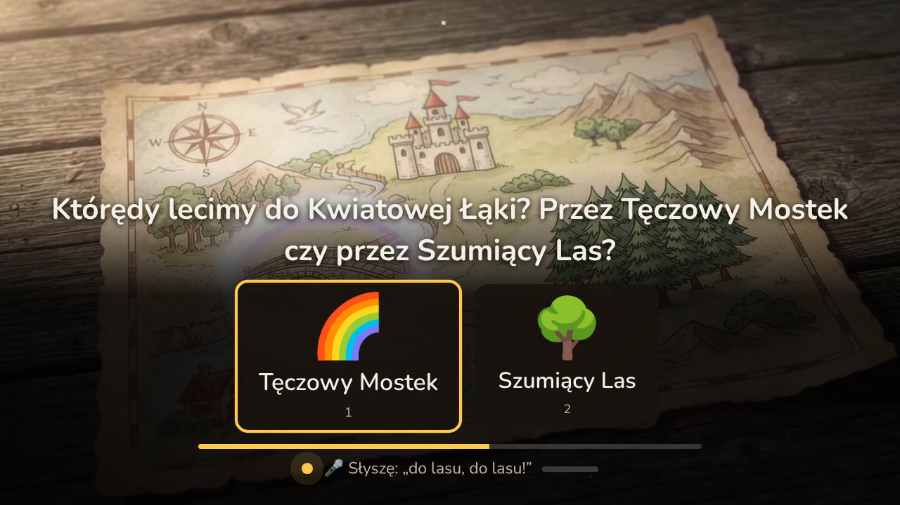
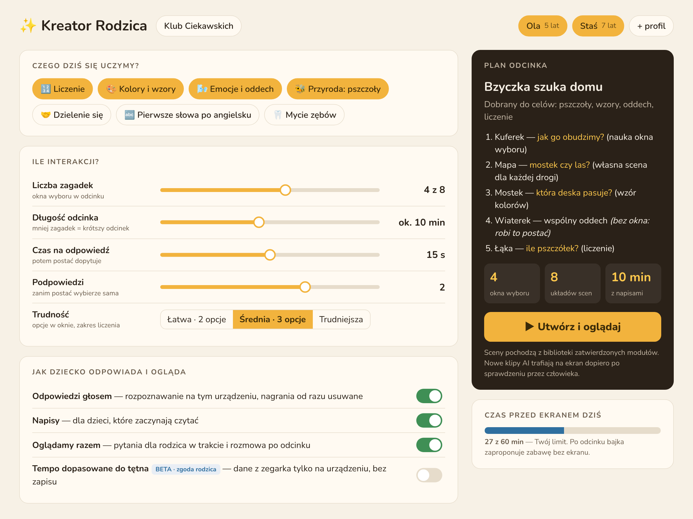

# Klub Ciekawskich — bajka, która słucha

**Zgłoszenie na hackathon FilmSpring Open 2026 „Kino szuka nowej formy”** · 18.10.2026

**Zespół:** [imiona i role — do uzupełnienia] · **Lider:** [imię i nazwisko] · **Kontakt:** [e-mail]

| Do obejrzenia (bez instalowania czegokolwiek) | |
|---|---|
| Cały odcinek w prawdziwym odtwarzaczu, ok. 3 min, z dźwiękiem i napisami | [media/odcinek_przejscie.mp4](media/odcinek_przejscie.mp4) |
| Zwiastun z klipów odcinka, 32 s | [media/zwiastun.mp4](media/zwiastun.mp4) |
| Tętno a montaż: odtwarzacz i panel obok siebie, 47 s | [media/tetno_montaz.mp4](media/tetno_montaz.mp4) |
| Mapa odcinka: etapy, odpowiedzi i gałęzie | [media/mapa_odcinka.jpg](media/mapa_odcinka.jpg) |
| Slajdy (27) z notatkami | eksport PDF w załączniku · [link do slajdów](https://claude.ai/artifact/LhY5PzguvLUpW7VHhCCYtg) |
| Kod, scenariusz i cała dokumentacja | [github.com/KsaweryTrebacz/FilmSpringOpen2026](https://github.com/KsaweryTrebacz/FilmSpringOpen2026) |

> **In English (summary).** *Klub Ciekawskich* (“The Curious Club”) is an interactive animated series for children
> aged 4–7 on streaming platforms. At key moments a character asks a question and a choice window appears: the child
> answers with the remote, by touch or **by voice, in their own words**, and the story follows — every answer has its
> own scene, and the editing adapts to the child's state. An **AI editor** on the device picks the transition
> between clips (dissolve, wipe, fade) from the place, the choice and the child's mood. A **Parent Creator** lets a
> parent set what the child learns, how many puzzles there are and how much screen time is allowed. Speech recognition
> and the language model run **locally**, so the child's voice never leaves the device. Research on a conversational
> version of a PBS KIDS show found that children learned more when the character really responded (63% vs 56% correct
> answers, 240 children). The working prototype, the episode and all documents were built during the hackathon.

## 1. Co to jest

Animowany serial dla dzieci 4–7 lat do serwisów streamingowych, w którym **dziecko rozmawia z bohaterami**.
Odcinek pilotażowy: „Bzyczka szuka domu” — Lila Lupka i wiewiórek Fiku pomagają zagubionej pszczółce wrócić do ula.

1. Postać zadaje pytanie, klip przechodzi w cichą pętlę, a na dole ekranu pojawia się **okno wyboru**: 2–3 opcje
   z obrazkami, nazwami i paskiem odliczania.
2. Dziecko wybiera **pilotem, dotykiem albo głosem**. Głos rozpoznaje model Whisper, a sens odpowiedzi — mały model
   językowy Phi; oba działają na komputerze widza. Gdy model zawiedzie, wybór rozpoznają słowa kluczowe.
3. **Każda odpowiedź ma skutek**: nagrana reakcja postaci i często osobna scena. Zła deska w mostku nie kończy gry —
   mostek się chwieje i naprawiamy go razem. Wybory „kosmetyczne” (kwiatek dla mamy Bzyczki) mogą być przezroczystymi
   **warstwami** nakładanymi na jeden klip zamiast osobnych wersji scen — silnik i odtwarzacz je obsługują, a w odcinku
   wrócą z kwiatkiem wyciętym z ilustracji.
4. **Montażysta AI** wybiera przejście między klipami (przenikanie, przetarcie, zaciemnienie, rozjaśnienie, cięcie)
   i jego długość — według miejsca akcji, wyboru i słów dziecka oraz jego tętna (dziś z symulatora). Gdy nie zdąży,
   decydują reguły; odcinek nigdy nie staje.
5. Cisza nie karze: postać dopytuje, a potem wybiera sama. Na końcu ekran „Twoje wybory” i „Obejrzyj jeszcze raz”.
6. Telewizor bez mikrofonu? **Telefon** staje się pilotem z mikrofonem: wystarczy zeskanować kod QR.
7. Każdy odcinek ma też **wersję liniową** (zwykły film z napisami) i **manifest** dla odtwarzacza serwisu.
   Twórcy widzą w **panelu podglądu** drogę widza, tętno i uzasadnienie każdej decyzji montażysty.

**Kreator Rodzica** (koncepcja i makieta): rodzic wybiera, czego dziecko ma się dziś uczyć (liczenie, wzory, emocje,
przyroda), ile ma być zagadek, ile czasu dziecko ma na odpowiedź i czy odpowiada głosem, oraz ustawia limit ekranu.
Po odcinku dostaje krótki raport z pomysłami na rozmowę bez ekranu ([KREATOR_RODZICA.md](KREATOR_RODZICA.md)).

**Język filmowy.** Odcinek ma scenopis z przebiegiem barwnym (ciepły bursztyn dziupli, turkus strumyka, złota godzina
na łące, szafirowy zmierzch finału) i biblię wizualną postaci dla generatora wideo
([SCENARIUSZ_WIZUALNY_PROMPTY_AI.md](../SCENARIUSZ_WIZUALNY_PROMPTY_AI.md)). Montażysta stosuje zasady
montażowe: to samo miejsce — łagodne przenikanie, nowe miejsce — przetarcie, zakończenie — zaciemnienie albo
przejście wskazane przez autora (finał Bzyczki: rozjaśnienie). Gdy dziecko jest pobudzone, montaż zwalnia (dłuższe
przenikanie), gdy się nudzi — przyspiesza (krótkie przetarcie). Rozjaśnienie trwa co najmniej 0,8 s, żeby nie
powstawały błyski.

## 2. Dlaczego to ważne — jaki problem rozwiązuje

- **Bajka mówi do dziecka, ale go nie słyszy.** 15 minut z bajką to 15 minut słuchania; pytanie z ekranu to tylko pauza.
- **Rodzic wybiera tytuł — i na tym kończy się jego wpływ** na to, czego bajka uczy, ile w niej zadań i jak długo trwa.
- **Zalecenia dla małych dzieci** (WHO 2019, pediatrzy AAP 2016): do 1 godziny ekranu dziennie dla 2–4 lat,
  liczy się jakość i oglądanie razem z dorosłym. Rodzic nie ma narzędzia, żeby ten czas tak wyglądał.
- **Interaktywne filmy w serwisach się nie przyjęły**: Netflix usunął 20 z 24 tytułów interaktywnych w 2024 r.
  Były drogie w produkcji, dla dorosłych i bez rozmowy. Szukamy formy, która jest tania i daje wartość, której
  zwykły film nie da.

## 3. Kto skorzysta

| Kto | Co zyskuje |
|---|---|
| **Dzieci 4–7 lat** | Aktywne oglądanie: rozmowa z postacią, decyzje ze skutkiem, zagadki, w których pomyłka jest częścią przygody |
| **Dzieci, które nie czytają albo nie mówią płynnie** | Obrazki zamiast tekstu, pilot i dotyk działają zawsze, głos jest dodatkiem, długi czas na odpowiedź |
| **Dzieci z rodzin o mniejszych zasobach** | W badaniu wersji serialu z rozmową dzieci z biedniejszej dzielnicy dorównały rówieśnikom z zamożnej (sekcja 5) |
| **Rodzice** | Wpływ na treść i czas ekranu (Kreator), raport po odcinku, pomysły na rozmowę i zabawę bez ekranu |
| **Rodzeństwo, rodzic oglądający z dzieckiem** | Ta sama bajka dla dziewczynek i chłopców (bez form zależnych od płci), tryb „Oglądamy razem” |
| **Przedszkola, biblioteki** | Odcinki pod temat tygodnia, rzutnik i pilot u nauczyciela albo głosowanie z kilku tabletów |
| **Serwisy streamingowe i aplikacje dla dzieci** | Format interaktywny, który wdrożą u siebie (manifest, wersja liniowa), bez kosztów chmury za AI |
| **Studia animacji i właściciele postaci** | Narzędzia do robienia odcinków interaktywnych z własnych bohaterów |

## 4. Wyzwania i jak je rozwiązujemy

| Wyzwanie | Nasza odpowiedź |
|---|---|
| **Koszt produkcji gałęzi** (główna bariera filmów interaktywnych) | Gałęzie trwają 15–25 s i wracają na wspólną drogę; trzy sceny mają wersje montażu zamiast osobnych odcinków; wybory kosmetyczne mogą być warstwami na jednym klipie. Odcinek Bzyczki: 17 scen (10 głównych, 7 krótkich gałęzi) daje 32 różne układy scen |
| **Rozpoznawanie mowy małych dzieci** | Głos nie jest warunkiem (pilot, dotyk). Whisper z podpowiedzią słów odcinka, model Phi do sensu odpowiedzi, słowa kluczowe w zapasie, dopytanie przy niejasnej odpowiedzi. Zmierzone w eksperymencie (sekcja 5), do sprawdzenia z dziećmi |
| **Prywatność dziecka, RODO** | AI na urządzeniu, bez chmury. Mikrofon tylko w oknie wyboru, nagranie usuwane zaraz po rozpoznaniu. Tętno (przyszła funkcja) to dane o zdrowiu (art. 9): osobna zgoda rodzica, przetwarzanie na urządzeniu, bez zapisu; dziś tylko symulator |
| **Bezpieczeństwo treści AI** | AI nie generuje wideo ani fabuły na żywo. Klipy powstają wcześniej i sprawdza je człowiek; krótkie kwestie modelu przechodzą przez filtr treści. Montażysta wybiera tylko sposób połączenia gotowych klipów |
| **Spójność klipów z generatora wideo** | Biblia wizualna postaci, stały dopisek stylu do promptów, generowanie z klatki startowej. Przegląd pierwszej partii klipów i poprawione prompty: [SCENARIUSZ_WIZUALNY_PROMPTY_AI.md](../SCENARIUSZ_WIZUALNY_PROMPTY_AI.md#-4-przegląd-klipów-z-1710) |
| **Klipy nie pasują do siebie montażowo** | Montażysta AI dobiera przejście; pętle oczekiwania mają płynny szew (koniec przenika w początek), a pętla wchodzi przenikaniem |
| **Serwisy nie chcą formatu interaktywnego** | Trzy drogi: nasz odtwarzacz, manifest JSON dla odtwarzacza serwisu, wersja liniowa jako zwykły film. Pierwsze kanały: aplikacje edukacyjne i biblioteczne |
| **Czas przed ekranem** | Odcinki 10–15 min z wyraźnym końcem, bez automatycznego następnego odcinka; limit dnia i „Oglądamy razem” w Kreatorze |
| **Słabszy sprzęt widza** | Gdy model jest wolny albo go nie ma, decydują reguły i słowa kluczowe (`--no-llm`); odcinek nigdy nie czeka na AI |
| **Prawa do treści** | Własne postacie i świat; muzyka tylko własna; warunki generatora wideo sprawdzamy przed publikacją |

## 5. Co sprawdziliśmy

### Badania innych zespołów

- **Rozmowa z postacią poprawia naukę.** Zespół Ying Xu (CHI 2022 i dalsze badania) dodał rozmowę do serialu PBS KIDS
  *Elinor Wonders Why*. 240 dzieci w trzech grupach: wersja, w której postać rozpoznaje odpowiedź — **63%** poprawnych
  odpowiedzi w teście; wersja z pytaniem i pauzą — 61%; zwykła — 56%. Dzieci z biedniejszej dzielnicy z wersją z AI
  osiągnęły wyniki porównywalne z dziećmi z zamożnej dzielnicy oglądającymi zwykłą wersję.
- **Dwulatki uczą się z wideo, gdy osoba na ekranie na nie reaguje** (Troseth, Saylor, Archer, *Child Development* 2006).
- Źródła i wnioski dla projektu: [BADANIA.md](BADANIA.md). To wyniki tamtych badań, nie nasze — nasz efekt zmierzymy w pilotażu.

### Nasze próby (17–18.10.2026)

| Próba | Wynik |
|---|---|
| **Cały odcinek w przeglądarce**, sterowany automatycznie (Chromium), z klipami z generatora wideo (18.10) i zaślepkami dla 2 scen bez animacji | Przeszedł od powitania do finału: 8 okien wyboru, 10 decyzji montażysty, ekran końcowy z wyborami widza, **0 błędów strony**. Nagranie: [odcinek_przejscie.mp4](media/odcinek_przejscie.mp4) |
| **Tętno a montaż** (symulator w panelu podglądu) | Spadek tętna: przetarcie 0,4 s, tempo 1,08× i żywa wersja lasu; wzrost: przenikanie 1,2 s, tempo 0,92× i spokojna wersja wiaterka. Nagranie: [tetno_montaz.mp4](media/tetno_montaz.mp4) |
| **Rozpoznawanie odpowiedzi po słowach kluczowych** (tryb bez modelu i zapas): 100 typowych odpowiedzi dzieci napisanych przez zespół, nie nagrania ([eksperyment](eksperyment/)) | Przed poprawkami: 4 z 18 niejasnych odpowiedzi (np. „nie wiem”) wybierało konkretną opcję. Po poprawkach: **79 z 81** jasnych odpowiedzi rozpoznanych dobrze, **0** złych wyborów, 2 kończą się dopytaniem; **19 z 19** niejasnych — dopytanie |
| **Testy automatyczne** silnika, okna wyboru, rozpoznawania, montażu, wersji liniowej, manifestu, importu klipów i skryptów stron | **444** testy przechodzą; działają bez chmury, mikrofonu i przeglądarki. Test składni strony powstał po błędzie, który 18.10 wyłączył odtwarzacz |
| **Graf odcinka** | 17 scen, na każdej ścieżce 8 okien wyboru, 32 różne układy scen (576 kombinacji odpowiedzi); każda ścieżka kończy się finałem — sprawdza to silnik przy wczytaniu |
| **Pierwsza partia klipów z generatora wideo** (8 klipów, 17.10) | 4 dobre, 3 użyteczne z uwagami, 1 do wymiany. Test wykrył błąd naszego importu (pętle traciły dźwięk) — naprawiony |
| **Druga partia klipów** (31 klipów, 18.10) | Pokrywa 31 z 33 klipów odcinka. Oba finały kończyły się wymyślonymi przez generator napisami końcowymi — import przycina je przed tym tekstem |

### Czego jeszcze nie sprawdziliśmy

- **Testu z dziećmi.** Plan: 5–10 rodzin z dziećmi 4–7 lat, bez instruktażu; pomiary z dziennika aplikacji (pilot czy
  głos, ile dopytań, czasy odpowiedzi) i rozmowa z rodzicami
  ([plan](../ZGODNOSC_Z_REGULAMINEM.md#test-z-prawdziwą-publicznością-5-ust-3)). Wyniki chcemy dosłać w aktualizacji do 25.10.
- **Jakości Whispera na polskiej mowie dzieci** i czasów modeli na komputerze z NPU — w tym kontenerze nie było modeli,
  więc nagranie pokazuje wybór głosem zainscenizowany (napis „Słyszę…” wstawiony ręcznie, oznaczony w nagraniu).
- **Zainteresowania rodziców Kreatorem** — pokażemy im klikalną makietę w pilotażu.

## 6. Co powstało na hackathonie („delta”)

Projekt **nie opiera się na wdrożonym produkcie**. Pomysł, scenariusz, odcinek, kod i dokumentacja powstały
16–18.10.2026 (historia zmian w repozytorium od 16.10). W trakcie hackathonu zmieniliśmy formę z seansu kinowego
z udziałem sali (16.10) na odcinek do serwisów streamingowych (17.10) i dodaliśmy koncepcję Kreatora Rodzica.

**Nasze:** świat i postacie, scenariusz odcinka z gałęziami i warstwami, silnik odcinka, odtwarzacz w przeglądarce
z przejściami i warstwami, okno wyboru z odpowiedzią głosem, montażysta AI (decyzje i reguły), wersja liniowa
i manifest, import klipów z generatora z płynnymi pętlami, panel podglądu, symulator tętna, makiety Kreatora
i raportu, eksperyment z rozpoznawaniem odpowiedzi.

**Gotowe składniki, z których korzystamy:** Foundry Local (uruchamianie modeli na urządzeniu), Whisper (mowa → tekst),
Phi (zrozumienie odpowiedzi i decyzje montażysty), ffmpeg (wideo), generator wideo (klipy według naszych promptów),
biblioteki Pythona. Badania z sekcji 5 to prace innych zespołów.

## 7. Co dalej

| Kiedy | Co |
|---|---|
| do 25.10 (aktualizacja zgłoszenia) | Test z kilkoma rodzinami, 2 brakujące klipy i warstwy kwiatków, uzupełnione badania zespołu |
| 29.10 | Pokaz na żywo na sesji online: widzowie transmisji wybierają drogę na czacie |
| 1–3 miesiące | Pilotaż z 5–10 rodzinami, pełny odcinek z nagranymi głosami postaci, Kreator v0 |
| 3–6 miesięcy | Biblioteka modułów z oznaczonymi umiejętnościami, planista Kreatora, raport dla rodzica, trzy odcinki |
| 6–12 miesięcy | Pierwszy partner (serwis albo platforma edukacyjna); tętno w becie, tylko za zgodą rodzica |

Model biznesowy (hipotezy do sprawdzenia): subskrypcja dla rodzin, licencja dla serwisów i placówek edukacyjnych,
licencja narzędzi dla studiów. Ceny ustalimy po pilotażu ([ONE_PAGER.md](ONE_PAGER.md)).

## Załączniki i dalsza lektura

[ONE_PAGER.md](ONE_PAGER.md) (jedna strona) · [PITCH.md](PITCH.md) (scenariusz wystąpienia) ·
[KREATOR_RODZICA.md](KREATOR_RODZICA.md) · [BADANIA.md](BADANIA.md) · [scenariusz odcinka](../../scenarios/klub_ciekawskich.md) ·
[realia rynku](../STREAMING.md) · [zgodność z regulaminem](../ZGODNOSC_Z_REGULAMINEM.md) ·
[uruchomienie prototypu](../URUCHOMIENIE.md) (Windows, Python, ffmpeg — nie jest potrzebne do oceny)
