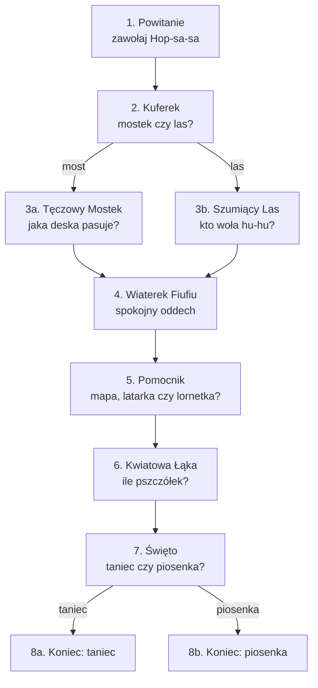

# Klub Ciekawskich — odcinek 1: „Bzyczka szuka domu”

Interaktywna bajka edukacyjna dla dzieci w wieku 4–7 lat, prowadzona wyłącznie głosem (Zero-UI).
Dziecko jest członkiem Klubu: postacie zwracają się do niego, czekają na odpowiedź i reagują na nią.

- **Plik dla aplikacji:** [`klub_ciekawskich.yaml`](klub_ciekawskich.yaml) — graf scen, pytania, reakcje Lili.
- **Długość:** ok. 8–10 minut (zależy od dziecka).
- **Logline:** Pszczółka Bzyczka zgubiła drogę do ula. Lila, Fiku i dziecko ruszają z pomocą: wybierają
  drogę, rozwiązują zagadki, uspokajają rozbrykany Wiaterek i liczą pszczółki, aż Bzyczka wraca do domu.

## Cele edukacyjne

| Scena | Czego uczymy | Mechanika |
|---|---|---|
| Powitanie | Śmiałość, wspólne działanie | Zawołanie hasła „Hop-sa-sa!” |
| Kuferek | Podejmowanie decyzji | Wybór drogi (rozgałęzienie fabuły) |
| Tęczowy Mostek | Kolory, rytm i wzór (myślenie matematyczne) | Zagadka „co dalej?” |
| Szumiący Las | Zwierzęta i ich odgłosy, uważne słuchanie | Zgadywanie po odgłosie |
| Wiaterek Fiufiu | Emocje, samoregulacja oddechem, empatia | Wspólny spokojny oddech |
| Pomocnik z Kuferka | Do czego służą przedmioty, rozwiązywanie problemów | Wybór właściwego narzędzia |
| Kwiatowa Łąka | Liczenie do trzech | Liczenie razem |
| Święto | Ruch i muzyka, radość ze wspólnego sukcesu | Wybór zakończenia |

## Zasady koedukacyjne

1. **Równe prowadzenie.** Dziewczynka i chłopiec prowadzą klub razem, na zmianę zadają pytania i chwalą.
2. **Bez stereotypów.** Lila majsterkuje, liczy i jest liderką; Fiku mówi o uczuciach, lubi kwiaty
   i piecze ciasteczka. Oboje bywają dzielni i oboje czasem się boją — i to jest w porządku.
3. **Neutralny język wobec dziecka.** Nigdy „zrobiłeś/zrobiłaś”. Mówimy: „Udało się!”, „Brawo!”,
   „Pomożesz?”, „Świetnie ci idzie!”. Ta zasada jest też w prompcie modelu językowego.
4. **Każda odpowiedź jest dobra do nauki.** Pomyłka nie zatrzymuje historii: postać łagodnie pokazuje
   dobrą odpowiedź i chwali za próbę. Cisza też nie: postać dopytuje, a potem sama wybiera.
5. **Bez straszenia.** Ciemność, wiatr i wysokość są przygodą, nie zagrożeniem.

## Postacie

| Postać | Kim jest | Wygląd | Charakter | Powiedzonko | Głos |
|---|---|---|---|---|---|
| **Lila Lupka** | Siedmioletnia odkrywczyni, liderka klubu | Żółte kalosze, ogrodniczki z kieszeniami na śrubki, wielka lupa na sznurku | Ciekawska, cierpliwa, uwielbia zagadki i liczenie | „Zajrzyjmy przez lupkę!” | Ciepły, dziewczęcy, spokojne tempo. Lila odpowiada dziecku na żywo (TTS) |
| **Fiku Fikołek** | Rudy wiewiórek, przyjaciel Lili | Puszysty ogon w kształcie znaku zapytania, zielony szalik, fartuszek piekarza | Wesoły i ruchliwy, wrażliwy, mówi otwarcie, gdy się boi | „Fiku-miku, fikołek!” (i robi fikołka) | Wysoki, energiczny, chłopięcy |
| **Kuferek Hopsasa** | Gadający kufer podróżnik | Kolorowy, oklejony naklejkami z podróży, wieko jak usta | Rymuje, budzi się na hasło, zawsze ma trzy pomocniki | „Hopsasa, co tu mam? Trzy pomocniki dla was dam!” | Głęboki, ciepły, wesoły (jak dobry dziadek) |
| **Wiaterek Fiufiu** | Mały, puszysty obłoczek-wietrzyk | Biały obłoczek z różowymi policzkami | Gdy się cieszy albo złości, dmucha za mocno i wszystko fruwa. Nie jest zły — uczy się spokoju | „Fiu-fiu-fiuuu! Ojej, znowu za mocno!” | Szybki, świszczący, trochę zadyszany |
| **Pszczółka Bzyczka** | Gość odcinka | Malutka, w pasiastym sweterku, z koszyczkiem na pyłek | Nieśmiała, wdzięczna | „Bzz-dziękuję!” | Cienki, delikatny, z „bzz” na początku zdań |

**Pomocniki z Kuferka** (pojawiają się w scenie 2 i wracają w scenie 5): **Mapa Rozkładanka** (pokazuje drogę),
**Latarka Świetliczka** (świeci w ciemności), **Lornetka Patrzałka** (przybliża to, co daleko).

**Motto klubu** (mówione na początku i na końcu, najlepiej z gestem): „Patrzymy (dłonie jak lornetka przy oczach),
myślimy (palec przy skroni), pomagamy (ręce do przodu)!”

## Mapa scen

Dobre i złe odpowiedzi w zagadkach prowadzą do tej samej kolejnej sceny — różni się tylko reakcja Lili.
Dzięki temu animujemy 10 scen, a nie drzewo kilkudziesięciu klipów.

## Jak czytać sceny

- **KLIP** — animacja z dialogami. Kończy się pytaniem do dziecka, po którym postać patrzy w kamerę.
- **PĘTLA** — cicha animacja oczekiwania (mikrofon słucha, więc bez dźwięku!). Pierwsza klatka pętli =
  ostatnia klatka klipu.
- **REAKCJE** — to mówi Lila na żywo po odpowiedzi dziecka (syntezator mowy). Teksty są w pliku YAML;
  model językowy może je sformułować po swojemu, ale sens zostaje.
- `[pauza 2 s]` — miejsce w klipie, w którym dziecko ma coś zrobić razem z postaciami (bez nasłuchu).

---

## Scena 1 — Powitanie (`powitanie`)

**KLIP** `01_powitanie.mp4` (~50 s). Wnętrze dziupli w starym dębie: półki ze słoikami, mapa na ścianie,
w kącie śpi chrapiący Kuferek.

> **LILA** (macha do kamery): Cześć! Jestem Lila Lupka!
> **FIKU** (robi fikołka i ląduje obok): A ja jestem Fiku Fikołek! Fiku-miku, fikołek!
> **LILA:** Witamy w Klubie Ciekawskich! Pamiętasz nasze motto? Powiedz z nami!
> **LILA I FIKU** (z gestami): Patrzymy, myślimy, pomagamy! `[pauza 2 s]`
> *(Do dziupli wpada, kręcąc się w powietrzu, malutka pszczółka.)*
> **BZYCZKA** (pochlipując): Bzz… Dzień dobry… Jestem Bzyczka. Zgubiłam drogę do mojego ula na Kwiatowej Łące…
> **FIKU** (przytula ją ogonem): Oj, rozumiem cię. Ja też kiedyś się zgubiłem i było mi bardzo smutno.
> **LILA:** Pomożemy ci, Bzyczko! Klub Ciekawskich zawsze pomaga. Ale najpierw musimy obudzić Kuferek Hopsasa.
> **FIKU** (do kamery, szeptem): Kuferek budzi się tylko wtedy, gdy wszyscy razem zawołają hasło…
> **LILA** (do kamery): Zawołasz z nami Kuferek? Powiedz głośno: „Hop-sa-sa”!

**PĘTLA** `01_powitanie_idle.mp4`: Lila i Fiku z dłońmi przy uszach nasłuchują, Kuferek pochrapuje (bez dźwięku).

**REAKCJE**
- Dziecko woła „Hopsasa” (albo „hop”, „tak”): *„Hop-sa-sa! Słyszysz? Kuferek się budzi!”* → scena 2
- Cisza: *„Kuferek śpi jak suseł! Zawołajmy głośniej, razem ze mną. Hop-sa-sa!”* (najwyżej 2 razy), potem
  Lila sama: *„Nic nie szkodzi, zawołam go sama. Hop-sa-sa! Słyszysz? Kuferek się budzi!”*

## Scena 2 — Kuferek Hopsasa (`kuferek`)

**KLIP** `02_kuferek.mp4` (~45 s). Kuferek ziewa, otwiera wieko, z wnętrza bije kolorowe światło.

> **KUFEREK:** Ooo, hopsasa! Kto mnie woła? Lila, Fiku i… ty! Witaj w klubie!
> **KUFEREK** (śpiewnie): Hopsasa, co tu mam? Trzy pomocniki dla was dam!
> *(Z kufra wyskakują po kolei trzy przedmioty, każdy z dźwiękiem „pling”.)*
> **KUFEREK:** Mapa Rozkładanka — pokaże drogę! Latarka Świetliczka — zaświeci w ciemności!
> I Lornetka Patrzałka — przybliży to, co daleko!
> **LILA** (rozkłada mapę, przygląda się przez lupkę): Zajrzyjmy przez lupkę… Do Kwiatowej Łąki prowadzą dwie drogi!
> **FIKU** (pokazuje łapką): Jedna przez Tęczowy Mostek nad strumykiem… a druga przez Szumiący Las!
> **BZYCZKA:** Bzz… Ja nie pamiętam, którędy przyleciałam…
> **LILA** (do kamery): Którędy lecimy do Kwiatowej Łąki? Przez Tęczowy Mostek czy przez Szumiący Las?

**PĘTLA** `02_kuferek_idle.mp4`: mapa na pierwszym planie, na niej mieni się mostek i kołyszą drzewka.

**REAKCJE**
- „Mostek”, „tęcza”, „przez wodę”: *„Na Tęczowy Mostek! Ciekawe, jakie ma kolory!”* → scena 3a
- „Las”, „przez drzewa”: *„Do Szumiącego Lasu! Posłuchamy, kto tam mieszka!”* → scena 3b
- Cisza: *„Mapa pokazuje dwie drogi. Tęczowy Mostek albo Szumiący Las. Którą wybierasz?”*, potem Lila
  wybiera mostek.

## Scena 3a — Tęczowy Mostek (`most`)

**KLIP** `03a_most.mp4` (~40 s). Drewniany mostek nad szemrzącym strumykiem. Deski są kolorowe:
czerwona, niebieska, czerwona, niebieska — a potem dziura.

> **FIKU** (zatrzymuje się, ogon mu drży): Ojej… Brakuje jednej deski. Trochę się boję…
> **LILA** (kładzie mu rękę na ramieniu): To nic, Fiku. Każdy czasem się boi. Razem coś wymyślimy.
> **FIKU** (uśmiecha się): Z wami się nie boję!
> **LILA** (przez lupkę, wskazując kolejne deski): Zajrzyjmy przez lupkę. Deski idą po kolei:
> czerwona… niebieska… czerwona… niebieska… *(każda deska podświetla się po kolei)*
> **KUFEREK** (z tyłu, z wieka wysuwa dwie deski): Mam tu dwie zapasowe! Czerwoną i niebieską!
> **LILA** (do kamery): Jaka deska pasuje do dziury, czerwona czy niebieska?

**PĘTLA** `03a_most_idle.mp4`: obie deski unoszą się obok dziury, delikatnie się kołyszą; wzór desek mruga po kolei.

**REAKCJE**
- „Czerwona”: *„Czerwona! Brawo, wzór się zgadza. Czerwona, niebieska, czerwona!”* → scena 4
- „Niebieska”: *„Niebieska była przed chwilą, więc teraz kolej na czerwoną. Wkładamy czerwoną i pasuje!”* → scena 4
- Cisza: *„Popatrz na deski. Czerwona, niebieska, czerwona, niebieska… a teraz?”*

## Scena 3b — Szumiący Las (`las`)

**KLIP** `03b_las.mp4` (~40 s). Las w zielonym świetle, liście szumią. Z dziupli wysokiego drzewa dobiega „hu-hu”.

> **LILA** (przykłada palec do ust): Ćśś… W lesie trzeba uważnie słuchać.
> *(Cisza, szum liści, potem wyraźnie: „Hu-hu… hu-hu…”)*
> **FIKU** (podskakuje): Ja wiem, ja wiem! To na pewno żaba!
> **BZYCZKA:** Bzz… Hmm… A ja nie jestem pewna…
> **LILA** (mruga do kamery): Fiku, nie spieszmy się. Zapytajmy kogoś, kto zawsze nam pomaga!
> **LILA** (do kamery): Kto tak woła „hu-hu”? Sowa czy żaba?

**PĘTLA** `03b_las_idle.mp4`: w dziupli drzewa mrugają dwa duże oczy (sowa jeszcze niewidoczna), liście się kołyszą.

**REAKCJE**
- „Sowa”, „hu-hu”: *„Sowa! Masz rację, sowa woła hu-hu. A żaba robi kum-kum!”* → scena 4
- „Żaba”: *„Żaba robi kum-kum! A hu-hu woła sowa. Zobacz, siedzi tam na gałęzi!”* → scena 4
- Cisza: *„Posłuchaj jeszcze raz. Hu-hu, hu-hu. To sowa czy żaba?”*

> W scenie 4 sowa może mignąć w tle z obu ścieżek — animatorzy nie muszą robić osobnej wersji.

## Scena 4 — Wiaterek Fiufiu (`wiaterek`)

**KLIP** `04_wiaterek.mp4` (~55 s). Ścieżka na skraju łąki. Nagle nadlatuje mały obłoczek.

> **FIUFIU** (radośnie, coraz szybciej): Fiu-fiu-fiuuu! Przygoda? Ja też chcę! Ja też, ja też!
> *(Dmucha tak mocno, że Bzyczka kręci się w powietrzu, Fiku łapie się za ogon, mapa fruwa.)*
> **FIKU** (trzymając czapkę): Hej, Fiufiu, za mocno!
> **FIUFIU** (zatrzymuje się, smutnieje): Ojej, znowu za mocno… Kiedy bardzo się cieszę, nie umiem przestać dmuchać…
> **LILA** (łagodnie): Fiufiu, to normalne, że czasem emocje są wielkie jak wichura.
> Znamy na to sposób. Spokojny oddech!
> **LILA** (do kamery, pokazując): Zrób to z nami. Wielki wdech nosem… `[pauza 3 s]` …i powolny wydech buzią:
> fffuuu… `[pauza 3 s]` Jeszcze raz: wdech… `[pauza 3 s]` …i wydech: fffuuu… `[pauza 3 s]`
> *(Fiufiu oddycha razem z nimi, z każdym oddechem robi się mniejszy i spokojniejszy, mapa łagodnie opada.)*
> **LILA** (do kamery): Pomożesz Fiufiu się uspokoić? Weź ze mną wielki wdech nosem… i powolny wydech buzią. Udało się?

**PĘTLA** `04_wiaterek_idle.mp4`: Fiufiu powoli „oddycha” (rośnie i maleje w rytmie ok. 4 s), Lila i Fiku oddychają z nim.

**REAKCJE**
- „Tak”, „już”, „fuuu”, „udało się”: *„Hurra! Fiufiu oddycha spokojnie i już nic nie fruwa. Dziękujemy za pomoc!”* → scena 5
- Cisza: *„Spróbujmy jeszcze raz. Wdech nosem… i wydech buzią, fffuuu. Udało się?”*, potem
  *„Fiufiu chyba sam to poczuł. Hurra! Fiufiu oddycha spokojnie…”*

## Scena 5 — Pomocnik z Kuferka (`pomocnik`)

**KLIP** `05_pomocnik.mp4` (~40 s). Brzeg Kwiatowej Łąki. Na horyzoncie bardzo wysokie drzewo, ula nie widać.

> **FIUFIU** (już spokojny, cichutko): Fiu… Dziękuję. Polecę z wami, ale delikatnie.
> **BZYCZKA** (wypatruje): Bzz… Mój ul jest gdzieś na tym wysokim drzewie… ale to tak daleko! Nic nie widzę…
> **FIKU:** Kuferku, pomocy!
> **KUFEREK** (otwiera wieko): Hopsasa, co tu mam? Trzy pomocniki dla was dam!
> Mapa Rozkładanka, Latarka Świetliczka i Lornetka Patrzałka!
> **LILA** (do kamery): Który pomocnik pomoże zobaczyć ul daleko na drzewie? Mapa, latarka czy lornetka?

**PĘTLA** `05_pomocnik_idle.mp4`: trzy pomocniki unoszą się nad Kuferkiem i po kolei delikatnie świecą.

**REAKCJE**
- „Lornetka”: *„Lornetka! Przybliża to, co jest daleko. Widzę ul!”* → scena 6
- „Latarka”: *„Latarka świeci w ciemności, a teraz jest jasno. Weźmy lornetkę… Jest ul!”* → scena 6
- „Mapa”: *„Mapa pokazała nam drogę! A żeby zobaczyć daleko, weźmy lornetkę… Jest ul!”* → scena 6
- Cisza: *„Mapa pokazuje drogę, latarka świeci w ciemności, a lornetka przybliża. Który pomocnik wybierasz?”*

## Scena 6 — Kwiatowa Łąka (`laka`)

**KLIP** `06_laka.mp4` (~40 s). Widok przez lornetkę (okrągła ramka), potem lot nad kwiatami do ula.

> **BZYCZKA** (radośnie): Bzz! To mój ul! Jestem w domu!
> *(Z ula wylatują po kolei trzy pszczółki — każda z dźwiękiem „bzzz” i błyskiem. Na ekranie zostają wszystkie trzy.)*
> **BZYCZKA:** To moje siostry i mój brat! Przyleciały mnie przywitać!
> **FIKU** (podskakuje): Tyle pszczółek! Ja się chyba pogubię w liczeniu…
> **LILA:** Policzymy razem! Pokaż paluszkiem każdą pszczółkę. `[pauza 3 s]`
> **LILA** (do kamery): Ile pszczółek wyleciało z ula, żeby przywitać Bzyczkę?

**PĘTLA** `06_laka_idle.mp4`: trzy pszczółki krążą powoli w stałych miejscach (łatwe do policzenia), kwiaty się kołyszą.

**REAKCJE**
- „Trzy”: *„Trzy! Jedna, dwie, trzy pszczółki. Brawo, świetnie liczysz!”* → scena 7
- Inna liczba: *„Policzmy razem jeszcze raz. Jedna, dwie, trzy! Trzy pszczółki. Super, że liczysz ze mną!”* → scena 7
- Cisza albo liczenie w trakcie („jedna, dwie…”): *„Policzmy razem paluszkiem. Jedna, dwie… ile ich jest?”*

## Scena 7 — Święto (`swieto`)

**KLIP** `07_swieto.mp4` (~30 s). Pszczoły, Fiufiu, Kuferek, Lila i Fiku na łące pełnej kwiatów.

> **BZYCZKA:** Bzz-dziękuję! Bez waszej pomocy nigdy bym nie trafiła do domu!
> **FIKU** (robi trzy fikołki): Fiku-miku, fikołek! To trzeba uczcić!
> **FIUFIU** (delikatnie): Fiu… Ja mogę zrobić leciutki wietrzyk do zabawy!
> **LILA** (do kamery): Jak świętujemy powrót Bzyczki? Pszczółkowym tańcem czy piosenką o kwiatkach?

**PĘTLA** `07_swieto_idle.mp4`: wszyscy kołyszą się w oczekiwaniu, Kuferek przytupuje (bez dźwięku).

**REAKCJE**
- „Taniec”, „tańczyć”: *„Pszczółkowy taniec! Wstań i machaj rękami jak skrzydełkami. Bzz, bzz!”* → zakończenie 8a
- „Piosenka”, „śpiewać”: *„Piosenka! Śpiewaj z nami. La, la, la!”* → zakończenie 8b
- Cisza: *„Taniec pszczółek czy piosenka o kwiatkach? Ty wybierasz!”*, potem Lila wybiera taniec.

## Zakończenie 8a — Pszczółkowy taniec (`koniec_taniec`)

**KLIP** `08a_koniec_taniec.mp4` (~60 s). Prosty taniec do powtarzania, z muzyką.

> **WSZYSCY** (śpiewnie, rytmicznie, z ruchem):
> Skrzydełka w górę! *(ręce w górę)* Skrzydełka w dół! *(ręce w dół)*
> Kręcimy się w kółko, bzz, bzz, bzz! *(obrót)* I hop — na kwiatek! *(podskok)* `[powtórzyć 2 razy]`

Dalej wspólne **pożegnanie** (takie samo w 8a i 8b).

## Zakończenie 8b — Piosenka o kwiatkach (`koniec_piosenka`)

**KLIP** `08b_koniec_piosenka.mp4` (~60 s). Krótka piosenka, tekst na ekranie przy kwiatkach.

> **WSZYSCY** (na prostą melodię, w rytmie marszu):
> Kwiatek żółty, kwiatek biały, pszczółki z ula przyleciały.
> Jedna, druga, trzecia — hop! Dzisiaj święto, bzz i stop! `[powtórzyć 2 razy, za drugim razem wolniej]`

Dalej wspólne **pożegnanie**.

## Pożegnanie (końcówka obu zakończeń)

> **LILA:** Co dziś odkryliśmy w Klubie Ciekawskich?
> **FIKU:** Że trzeba uważnie patrzeć i słuchać!
> **LILA:** Że liczenie jest super — jedna, dwie, trzy!
> **FIUFIU:** Fiu… I że kiedy emocje dmuchają jak wiatr, pomaga spokojny oddech.
> **BZYCZKA:** I że razem można pomóc każdemu! Bzz-dziękuję!
> **LILA I FIKU** (z gestami): Patrzymy, myślimy, pomagamy!
> **FIKU:** Do zobaczenia w Klubie Ciekawskich!
> **WSZYSCY:** Hop-sa-sa!
> *(Kuferek zamyka wieko, dziupla gaśnie, napis „Klub Ciekawskich”.)*

---

## Lista klipów do produkcji

Pliki trafiają do `scenarios/clips/klub_ciekawskich/` (katalog jest w `.gitignore`, klipy trzymamy na dysku
współdzielonym). Do prób: `python -m bajka.placeholders scenarios/klub_ciekawskich.yaml`.

| Plik | Co | Dźwięk | Długość |
|---|---|---|---|
| `01_powitanie.mp4` | Powitanie, motto, Bzyczka, prośba o „Hop-sa-sa” | tak | ~50 s |
| `01_powitanie_idle.mp4` | Lila i Fiku nasłuchują | **cisza** | 4–6 s (pętla) |
| `02_kuferek.mp4` | Kuferek, trzy pomocniki, mapa, wybór drogi | tak | ~45 s |
| `02_kuferek_idle.mp4` | Mapa z mostkiem i lasem | **cisza** | 4–6 s |
| `03a_most.mp4` | Mostek, wzór kolorów | tak | ~40 s |
| `03a_most_idle.mp4` | Dwie deski przy dziurze | **cisza** | 4–6 s |
| `03b_las.mp4` | Las, „hu-hu”, pomyłka Fiku | tak | ~40 s |
| `03b_las_idle.mp4` | Oczy w dziupli | **cisza** | 4–6 s |
| `04_wiaterek.mp4` | Fiufiu, wspólny oddech | tak | ~55 s |
| `04_wiaterek_idle.mp4` | Fiufiu „oddycha” | **cisza** | 4–8 s |
| `05_pomocnik.mp4` | Daleki ul, trzy pomocniki | tak | ~40 s |
| `05_pomocnik_idle.mp4` | Pomocniki świecą po kolei | **cisza** | 4–6 s |
| `06_laka.mp4` | Ul, trzy pszczółki, liczenie | tak | ~40 s |
| `06_laka_idle.mp4` | Trzy pszczółki krążą | **cisza** | 4–6 s |
| `07_swieto.mp4` | Podziękowania, wybór świętowania | tak | ~30 s |
| `07_swieto_idle.mp4` | Wszyscy się kołyszą | **cisza** | 4–6 s |
| `08a_koniec_taniec.mp4` | Taniec + pożegnanie | tak | ~60 s |
| `08b_koniec_piosenka.mp4` | Piosenka + pożegnanie | tak | ~60 s |

## Wskazówki dla animacji i nagrań

- **Pętle bez dźwięku** — w tym czasie słucha mikrofon. Muzyka w tle pętli zagłuszyłaby dziecko.
- **Ostatnia klatka klipu = pierwsza klatka pętli**, wtedy przejście jest niewidoczne.
- **Pytanie na końcu klipu** mówi zawsze Lila, patrząc w kamerę, i tymi samymi słowami co pole `question`
  w YAML — na tej podstawie model językowy rozumie odpowiedź dziecka.
- **Głos Lili w klipach** nagrywamy możliwie podobny do głosu syntezatora (`BAJKA_WINDOWS_VOICE`),
  bo reakcje na żywo mówi syntezator. Wysokość i tempo dostroicie przez `BAJKA_WINDOWS_VOICE_PITCH`
  i `BAJKA_WINDOWS_VOICE_RATE`.
- **Pauzy na wspólne działanie** (`[pauza …]`) zostawiamy w klipie — postacie w tym czasie same coś robią
  (oddychają, liczą), żeby dziecko miało wzór do naśladowania.
- **Format:** MP4, H.264 + AAC, 1280×720 lub 1920×1080.
- **Kolejne odcinki** mogą korzystać z tych samych postaci i mechanik (zawołanie Kuferka, trzy pomocniki,
  Wiaterek i oddech, liczenie); zmienia się gość i cel wyprawy.
