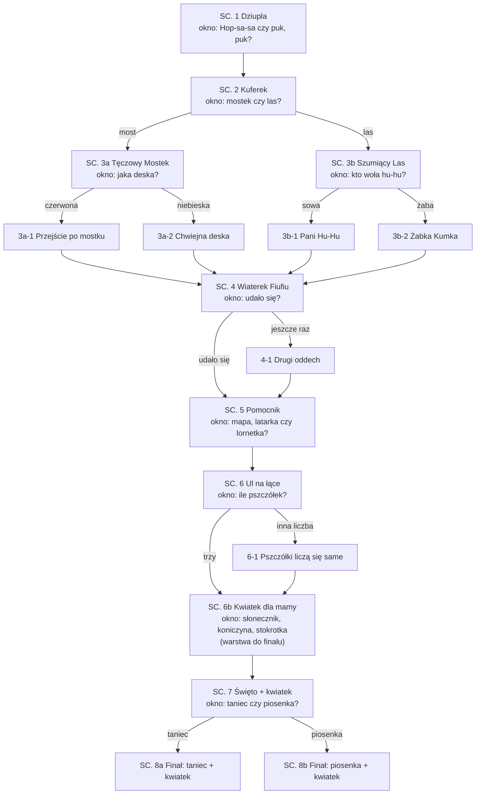

# Bzyczka szuka domu

**Interaktywny odcinek animowany z cyklu „Klub Ciekawskich” dla serwisów streamingowych**

| | |
|---|---|
| **Forma** | Odcinek interaktywny do oglądania w domu: w kluczowych momentach na ekranie pojawia się okno wyboru, a widz decyduje pilotem, dotykiem albo głosem. Postacie reagują na jego wybory |
| **Widz** | Dzieci 4–7 lat, w domu, zwykle jedno dziecko (czasem z rodzeństwem albo rodzicem). Telewizor, tablet, komputer |
| **Czas** | ok. 12 minut: ok. 9 min animacji i ok. 3 min okien wyboru (zależy od widza) |
| **Styl** | Ilustrowana książka 2D: miękka akwarela, ciepłe pastele (zgodnie z [projektem flow filmu](../docs/superpowers/specs/2026-10-16-flow-filmu-design.md)) |
| **Obraz** | 16:9, 1920×1080, 24 kl./s; dolna jedna trzecia kadru w pętlach oczekiwania wolna od ważnych elementów (tam jest okno wyboru) |
| **Dźwięk** | Stereo; dialogi i muzyka w klipach, w pętlach oczekiwania cichy podkład (wtedy może słuchać mikrofon) |
| **Język** | Polski; napisy dla niesłyszących w odtwarzaczu (kwestie mówione na żywo zawsze mają napisy) |
| **Montaż** | Klipy nakładają się na siebie według wyborów widza: przejścia (przenikanie, przetarcie, zaciemnienie, rozjaśnienie) wybiera montażysta AI, a warstwy z wyborami widza (kwiatek Bzyczki) leżą nad klipem sceny |
| **Plik dla aplikacji** | [`klub_ciekawskich.yaml`](klub_ciekawskich.yaml) — graf scen, okna wyboru, gałęzie, warstwy, reakcje i wersje scen |

**Logline.** Mała pszczółka zgubiła drogę do domu. Lila, Fiku i widz przed ekranem ruszają z pomocą:
widz wybiera drogę, rozwiązuje zagadki, uspokaja rozbrykany wiatr i liczy pszczółki, aż Bzyczka wraca do ula.

**Streszczenie.** W dziupli starego dębu Lila Lupka i Fiku Fikołek prowadzą Klub Ciekawskich — a nowym członkiem
klubu jest widz. Do dziupli wpada zapłakana pszczółka Bzyczka: zgubiła drogę do ula na końcu Kwiatowej Łąki.
Widz budzi gadający Kuferek Hopsasa, który daje trzy pomocniki i mapę, potem wybiera drogę — przez Tęczowy Mostek
albo Szumiący Las — i pomaga pokonać przeszkodę: dopasować brakującą deskę albo rozpoznać, kto woła „hu-hu”.
W połowie drogi rozbrykany Wiaterek Fiufiu rozdmuchuje wszystko, bo nie umie zapanować nad radością; widz
oddycha z nim spokojnie. Lornetka pozwala dostrzec daleki ul, widz liczy pszczółki z rodziny Bzyczki, wybiera
kwiatek, który Bzyczka da mamie na powitanie, a na koniec decyduje, jak świętować: tańcem czy piosenką.

**O czym jest ten odcinek.** Razem dajemy radę. Każdy czasem się boi albo ma wielkie emocje — i to jest w porządku,
a spokojny oddech pomaga. Pomyłka to część uczenia się.

## Budowa odcinka

| Część | Sceny | Co się dzieje | Czas |
|---|---|---|---|
| **Prolog** | 1 (początek) | Plansza tytułowa, Lila zaprasza widza do klubu i pokazuje, jak działa okno wyboru | 0:30 |
| **Akt I — Wezwanie** | 1–2 | Bzyczka zgubiła drogę. Widz budzi Kuferek i wybiera drogę | 3:00 |
| **Akt II — Droga** | 3a/3b z gałęziami, 4, 5 | Przeszkoda na drodze (każda odpowiedź ma własną scenę), kryzys z Wiaterkiem (środek odcinka), dostrzeżenie ula | 5:00 |
| **Akt III — Powrót** | 6, 6b, 7, 8a/8b | Ul i rodzina Bzyczki, kwiatek na powitanie, wybór świętowania, finał i pożegnanie | 3:30 |
| **Napisy końcowe** | 8 (koniec) | Napisy z informacją o AI i zaproszenie do obejrzenia jeszcze raz | 0:40 |

**Gałęzie.** Każda odpowiedź w zagadce prowadzi do innej sceny: czerwona deska — przechodzimy od razu, niebieska —
mostek się chwieje i naprawiamy go razem; sowa budzi się i pokazuje drogę, a przy żabie poznajemy żabkę Kumkę,
zanim odezwie się sowa; „jeszcze raz” to drugi, wolniejszy oddech; zła liczba — pszczółki liczą się same w rządku.
Gałęzie są krótkie (15–25 s) i wracają na wspólną drogę (pole `next`), więc dziecko widzi skutek swojej decyzji,
a my animujemy kilka krótkich scen zamiast drzewa kilkudziesięciu. Dwie duże decyzje (droga i finał) dają cztery
różne odcinki, a z gałęziami zagadek — kilkanaście ścieżek. To powód, żeby obejrzeć jeszcze raz.

**Warstwy.** Kwiatek, który widz wybierze dla mamy Bzyczki (słonecznik, koniczyna albo stokrotka), to przezroczysty
klip nakładany na sceny święta i finału. Jedna animacja finału + trzy małe warstwy zamiast trzech wersji finału.

**Montaż AI.** O tym, jak połączyć klipy, decyduje montażysta: model językowy na urządzeniu (Phi) dostaje miejsce
akcji (`place`), wybór widza, to, co powiedział, jego stan według tętna i podpowiedź autora (`transition`),
i wybiera przejście oraz jego długość. Myśli w tle, gdy gra reakcja postaci; gdy nie zdąży, decydują reguły
(nowe miejsce → przetarcie, ta sama scena → przenikanie, radosny finał → rozjaśnienie, pobudzone dziecko →
dłużej i łagodniej, znużone → krócej i żywiej). Odtwarzacz nakłada klipy na siebie, więc nie ma czarnych przerw.

## Bohaterowie

Wszystkie postacie, ich imiona i wygląd są oryginalne. Projektując je, nie wzorujemy się na postaciach
z innych filmów i seriali (zob. [zgodność z regulaminem](../docs/ZGODNOSC_Z_REGULAMINEM.md)).

| Postać | Kim jest | Wygląd | Charakter | Przemiana w odcinku | Głos |
|---|---|---|---|---|---|
| **Lila Lupka** | Siedmioletnia odkrywczyni, liderka klubu | Żółte kalosze, ogrodniczki z kieszeniami na śrubki, wielka lupa na sznurku | Ciekawska, cierpliwa, uwielbia zagadki, liczenie i majsterkowanie. Powiedzonko: „Zajrzyjmy przez lupkę!” | Uczy się oddawać decyzję innym: zamiast rozstrzygać sama, pyta widza | Ciepły, dziewczęcy, spokojne tempo. Reakcje nagrane w klipach; kwestie pisane na żywo czyta głos syntezatora z napisami |
| **Fiku Fikołek** | Rudy wiewiórek, przyjaciel Lili | Puszysty ogon w kształcie znaku zapytania, zielony szalik, fartuszek piekarza | Wesoły i ruchliwy, wrażliwy, piecze żołędziowe ciasteczka. Powiedzonko: „Fiku-miku, fikołek!” (i fikołek) | Od „trochę się boję” do „z tobą się nie boję” | Wysoki, energiczny, chłopięcy |
| **Pszczółka Bzyczka** | Zagubiona pszczółka | Malutka, w miętowym sweterku w miodowe paski, różowe policzki, koszyczki na pyłek przy nóżkach | Nieśmiała, mówi cicho, z „bzz” przed zdaniami | Od pochlipywania do głośnego „Bzz-dziękuję!” i prowadzenia świętowania | Cienki, delikatny |
| **Wiaterek Fiufiu** | Mały obłoczek-wietrzyk | Biały, puszysty, z różowymi policzkami; rośnie, gdy się emocjonuje | Gdy się cieszy albo złości, dmucha za mocno. Nie jest zły. Powiedzonko: „Fiu-fiu-fiuuu! Ojej, znowu za mocno!” | Od wichury emocji do spokojnego oddechu | Szybki, świszczący, zadyszany |
| **Kuferek Hopsasa** | Gadający kufer podróżnik | Kolorowy, oklejony naklejkami z podróży, wieko jak usta | Budzi się na wołanie albo pukanie, rymuje, zawsze ma trzy pomocniki: „Hopsasa, co tu mam? Trzy pomocniki tobie dam!” | — (stały pomocnik) | Głęboki, ciepły, wesoły |

**Postacie z gałęzi:** Pani Hu-Hu (zaspana sowa w okularach z liści), żabka Kumka (mieszka przy strumyku,
mówi „kum-kum”), mama Bzyczki (królowa ula).

**Pomocniki z Kuferka:** Mapa Rozkładanka (pokazuje drogę), Latarka Świetliczka (świeci w ciemności),
Lornetka Patrzałka (przybliża to, co daleko).

**Motto klubu** z gestami: „Patrzymy (dłonie jak lornetka przy oczach), myślimy (palec przy skroni),
pomagamy (ręce do przodu)!”

## Zasady pisania

1. **Do widza w liczbie pojedynczej, bez czasu przeszłego i bez przymiotników zależnych od płci**: „Pomożesz?”,
   „Brawo, świetnie liczysz!”, „Masz rację!”. Nigdy „zrobiłeś/zrobiłaś”, „gotowy/gotowa”. Postacie mówią też
   „my” („posłuchamy”, „policzmy razem”), bo widz jest w drużynie. Pilnuje tego test `tests/test_klub_ciekawskich.py`.
2. **Bez stereotypów.** Lila majsterkuje i prowadzi; Fiku mówi o uczuciach i piecze. Oboje bywają dzielni
   i oboje czasem się boją.
3. **Pomyłka uczy.** Zła odpowiedź nie zatrzymuje odcinka: postać łagodnie pokazuje dobrą odpowiedź i chwali próbę.
4. **Tylko prawdziwe fakty** o świecie (lista na końcu). Fantazja dotyczy postaci, nie wiedzy.
5. **Bez straszenia i bez pośpiechu.** Wiatr, wysokość i las to przygoda, nie zagrożenie. Okno wyboru nie popędza:
   gdy czas minie, postać łagodnie dopytuje, a potem wybiera sama.
6. **Bez sztuczek na uwagę.** Odcinek ma koniec i nie zachęca do oglądania bez przerwy; tempo dopasowuje się
   do widza, a nie odwrotnie.

## Jak działa odcinek interaktywny

**Okno wyboru.** Gdy postać zada pytanie, klip przechodzi w cichą pętlę oczekiwania, a na dole ekranu wysuwa się
okno wyboru: 2–3 opcje, każda z dużym obrazkiem (dla dzieci, które jeszcze nie czytają) i krótką nazwą, pod nimi
pasek odliczania. Pytanie i opcje są też w napisach i czytane na głos, więc widz nie musi czytać.

| Jak widz wybiera | Jak działa |
|---|---|
| **Pilot** (telewizor, dekoder) | Strzałki przesuwają podświetlenie, OK wybiera. To podstawa: działa wszędzie, także bez mikrofonu |
| **Dotyk, mysz, klawiatura** | Dotknięcie opcji; na klawiaturze też cyfry 1–3 |
| **Głos** (opcja, rodzic włącza w ustawieniach) | W trakcie okna wyboru mikrofon nasłuchuje. Mowa jest rozpoznawana lokalnie (Whisper), a wybór ustala model Phi albo słowa kluczowe ze scenariusza. Dziecko może powiedzieć swoimi słowami („przez ten kolorowy mostek!”) |
| **Drugi ekran** (opcja) | Telefon domownika jako pilot z mikrofonem, gdy telewizor nie ma mikrofonu. Kilka telefonów naraz: wygrywa większość |

**Gdy czas minie.** Okno trwa domyślnie 12 s (w scenach z oddechem i liczeniem dłużej). Bez wyboru postać dopytuje
(`reprompt`, np. „Mostek czy las? Wybierz drogę na ekranie albo powiedz ją głośno!”) i okno otwiera się znowu.
Po dwóch dopytaniach postać wybiera sama (`fallback` i wybór domyślny) — odcinek nigdy nie staje.

**Reakcja na wybór.** Po wyborze gra krótki nagrany klip reakcji (pole `reaction`) — ten sam głos i animacja co
w odcinku. Gdzie reakcji nie nagraliśmy, postać mówi kwestię ze scenariusza (`reply`) głosem syntezatora,
z napisami, a skutek wyboru pokazuje scena gałęzi. Gdy widz odpowie głosem, model może dopisać krótką osobistą kwestię („Mostek? Ja też lubię kolory!”);
przechodzi ona przez filtr bezpieczeństwa (`bajka/safety.py`).

**Montaż i warstwy.** Kolejny klip wchodzi przejściem wybranym przez montażystę AI i nakłada się na koniec
poprzedniego; warstwy z wyborami widza (kwiatek) leżą nad klipem i pętlą sceny. Pętla zawsze zaczyna się cięciem,
bo jej pierwsza klatka to ostatnia klatka klipu.

**Tempo według tętna (przyszłość).** Odcinek jest zrównoważony (`mood: zrownowazony`). Jeśli rodzic połączy zegarek
z czujnikiem tętna, sceny z wersjami (`variants`) grają wersję spokojną, gdy dziecko jest bardzo pobudzone,
i żywą, gdy tętno spada (znużenie). Dziś zamiast zegarka działa symulator w panelu podglądu (`--panel`).

**Wersja liniowa.** Dla serwisów i telewizorów bez interakcji składamy z tych samych klipów zwykły film:
ścieżka wyborów domyślnych, z gałęziami, warstwami i przejściami z reguł montażu (`python -m bajka.linear`). Okna wyboru zostają tam
„pytaniami do widza”, a postać odpowiada sama — tak jak dziś po ciszy.

**Prywatność.** Mikrofon działa tylko w trakcie okna wyboru i tylko po zgodzie rodzica. Nagranie trafia
na urządzenie, na którym działa bajka, na chwilę do pliku tymczasowego, i jest usuwane zaraz po rozpoznaniu.
Tętno nie jest zapisywane; przyszły odczyt z zegarka wymaga osobnej zgody rodzica.

---

## Scenariusz

Oznaczenia: **KLIP** — animacja z dialogami, kończy się pytaniem do widza; **PĘTLA** — cicha animacja oczekiwania
(pierwsza klatka = ostatnia klatka klipu), tło okna wyboru; **OKNO WYBORU** — opcje, obrazki i czas;
**REAKCJE** — co dzieje się po każdym wyborze. Pytanie na końcu klipu postać mówi tymi samymi słowami co pole
`question` w YAML.

### SC. 1 — WNĘTRZE. DZIUPLA KLUBU CIEKAWSKICH — DZIEŃ (`powitanie`)

**KLIP** `01_powitanie.mp4` · ok. 70 s

*Plansza tytułowa na tle akwarelowego dębu: „Klub Ciekawskich — Bzyczka szuka domu”. Kamera wjeżdża w dziuplę:
półki ze słoikami guzików, mapa na ścianie, w kącie chrapie kolorowy kufer. Ciepłe, bursztynowe światło.*

> **LILA** *(wychodzi zza półki, macha do kamery)*: Cześć! Jestem Lila Lupka!
>
> **FIKU** *(fikołek przez cały kadr, ląduje obok)*: A ja Fiku Fikołek! Fiku-miku, fikołek!
>
> **LILA**: Witaj w Klubie Ciekawskich! Dzisiaj ty też jesteś w klubie. *(podnosi lupę, lupa świeci)*
> Kiedy na dole ekranu pojawią się obrazki, to twoja kolej. Wybierz pilotem, dotknij albo powiedz na głos!
>
> **FIKU**: A teraz nasze motto! Powiedz je z nami!
>
> **LILA I FIKU** *(z gestami)*: Patrzymy, myślimy, pomagamy! `[pauza 2 s]`
>
> *(Do dziupli wpada, kręcąc się w powietrzu, malutka pszczółka.)*
>
> **BZYCZKA** *(pochlipując)*: Bzz… Dzień dobry… Jestem Bzyczka. Zgubiłam drogę do mojego ula na Kwiatowej Łące…
>
> **FIKU** *(otula ją ogonem)*: Oj, rozumiem cię. Ja też kiedyś się zgubiłem i było mi bardzo smutno.
>
> **LILA**: Pomożemy ci, Bzyczko! Ale najpierw musimy obudzić Kuferek Hopsasa.
>
> **FIKU** *(szeptem, do kamery)*: Kuferek budzi się, kiedy ktoś go zawoła… albo zapuka w wieko.
>
> **LILA** *(do kamery)*: Jak obudzimy Kuferek? Zawołasz „Hop-sa-sa” czy zapukasz w wieko?

**PĘTLA** `01_powitanie_idle.mp4`: Lila i Fiku nachylają się nad chrapiącym Kuferkiem i czekają.

**OKNO WYBORU** · 15 s (pierwsze okno: więcej czasu na naukę zasad)
- 📣 **Hop-sa-sa!** · ✊ **Puk, puk!**

**REAKCJE** (nagrane klipy; obie prowadzą do SC. 2)
- `01_reakcja_hopsasa.mp4` — Lila i Fiku wołają razem z widzem: *„Hop-sa-sa! Słyszysz? Kuferek się budzi!”*
- `01_reakcja_pukanie.mp4` — Fiku puka ogonem w wieko: *„Puk, puk, puk! Słyszysz? Kuferek się budzi!”*
- Cisza: *„Kuferek śpi jak suseł! Wybierz na ekranie albo powiedz głośno «Hop-sa-sa»!”*; po dwóch razach Lila:
  *„Nic nie szkodzi, spróbuję pierwsza.”* i reakcja „Hop-sa-sa”.

### SC. 2 — WNĘTRZE. DZIUPLA — CHWILĘ PÓŹNIEJ (`kuferek`)

**KLIP** `02_kuferek.mp4` · ok. 45 s

*Kuferek ziewa i otwiera wieko; z wnętrza bije tęczowe światło. Zbliżenia na trzy wyskakujące przedmioty.*

> **KUFEREK**: Ooo, hopsasa! Kto mnie budzi? Lila, Fiku i… nowy członek klubu! Witaj!
>
> **KUFEREK** *(śpiewnie)*: Hopsasa, co tu mam? Trzy pomocniki tobie dam!
>
> *(Z kufra wyskakują po kolei trzy przedmioty, każdy z dźwiękiem „pling”.)*
>
> **KUFEREK**: Mapa Rozkładanka — pokaże drogę! Latarka Świetliczka — zaświeci w ciemności!
> I Lornetka Patrzałka — przybliży to, co daleko!
>
> **LILA** *(rozkłada mapę, patrzy przez lupkę)*: Zajrzyjmy przez lupkę… Do Kwiatowej Łąki prowadzą dwie drogi!
>
> **FIKU** *(pokazuje łapką)*: Jedna przez Tęczowy Mostek nad strumykiem… a druga przez Szumiący Las!
>
> **BZYCZKA**: Bzz… Ja nie pamiętam, którędy przyleciałam…
>
> **LILA** *(do kamery)*: Którędy lecimy do Kwiatowej Łąki? Przez Tęczowy Mostek czy przez Szumiący Las?

**PĘTLA** `02_kuferek_idle.mp4`: mapa w górnej części kadru; mostek i las delikatnie się mienią.

**OKNO WYBORU** · 12 s · 🌈 **Tęczowy Mostek** · 🌳 **Szumiący Las**

**REAKCJE**
- Mostek: *„Tęczowy Mostek! Ciekawe, jakie ma kolory!”* → SC. 3a
- Las: *„Szumiący Las! Posłuchamy, kto tam mieszka!”* → SC. 3b
- Cisza: *„Mostek czy las? Wybierz drogę na ekranie albo powiedz ją głośno!”*; potem Lila wybiera mostek.

### SC. 3a — PLENER. TĘCZOWY MOSTEK NAD STRUMYKIEM — DZIEŃ (`most`)

**KLIP** `03a_most.mp4` · ok. 40 s

*Plan ogólny: drewniany mostek nad szemrzącym strumykiem, nasycone kolory. Deski: czerwona, niebieska,
czerwona, niebieska — a potem dziura. Czerwień i błękit są rozróżnialne także dla widzów z daltonizmem
czerwono-zielonym.*

> **FIKU** *(zatrzymuje się, ogon mu drży)*: Ojej… Brakuje jednej deski. Trochę się boję…
>
> **LILA** *(kładzie mu rękę na ramieniu)*: Każdy czasem się boi, Fiku. Razem coś wymyślimy.
>
> **FIKU** *(do kamery, uśmiecha się)*: Z tobą się nie boję!
>
> **LILA** *(przez lupkę; każda deska podświetla się po kolei)*: Deski idą po kolei. Czerwona… niebieska…
> czerwona… niebieska…
>
> **KUFEREK** *(wysuwa z wieka dwie deski)*: Mam dwie zapasowe! Czerwoną i niebieską!
>
> **LILA** *(do kamery)*: Jaka deska pasuje do dziury, czerwona czy niebieska?

**PĘTLA** `03a_most_idle.mp4`: obie deski unoszą się obok dziury; wzór desek mruga po kolei (wolno — najwyżej
dwa błyski na sekundę).

**OKNO WYBORU** · 12 s · 🟥 **Czerwona deska** · 🟦 **Niebieska deska**

**REAKCJE**
- Czerwona: *„Czerwona! Brawo, wzór się zgadza!”* → SC. 3a-1
- Niebieska: *„Niebieska? Sprawdźmy, czy pasuje!”* → SC. 3a-2
- Cisza: *„Popatrz na deski. Czerwona, niebieska, czerwona, niebieska… a teraz?”*; potem Lila wybiera czerwoną.

### SC. 3a-1 — PLENER. TĘCZOWY MOSTEK — CHWILĘ PÓŹNIEJ (`most_przejscie`) · gałąź „czerwona”

**KLIP** `03a1_most_przejscie.mp4` · ok. 20 s · dalej sama do SC. 4

*Czerwona deska wskakuje na miejsce z miękkim „klik”. Deski po kolei łagodnie rozbłyskują kolorami tęczy,
każda z innym dźwiękiem ksylofonu (wolno, bez migania).*

> **FIKU** *(przebiega na drugą stronę i robi fikołek)*: Fiku-miku, fikołek! Pasuje jak ulał!
>
> **LILA** *(do kamery)*: Czerwona, niebieska, czerwona! Wzór pomógł nam przejść. Lecimy dalej!

### SC. 3a-2 — PLENER. TĘCZOWY MOSTEK — CHWILĘ PÓŹNIEJ (`most_chwiejny`) · gałąź „niebieska”

**KLIP** `03a2_most_chwiejny.mp4` · ok. 25 s · dalej sama do SC. 4

*Niebieska deska wsuwa się w dziurę, ale mostek kołysze się i skrzypi: skrzyp, skrzyp. Nikt nie spada,
deska tylko się chybocze.*

> **FIKU** *(trzyma się poręczy)*: Ojej, chwieje się!
>
> **LILA** *(spokojnie, przez lupkę)*: Zajrzyjmy przez lupkę… Przed dziurą jest niebieska. Po niebieskiej
> przychodzi czerwona!
>
> **KUFEREK** *(podaje czerwoną deskę)*: Hopsasa, zamiana!
>
> **LILA I FIKU** *(pokazują deski po kolei)*: Czerwona, niebieska, czerwona! *(klik — mostek przestaje się chwiać)*
>
> **LILA** *(do kamery)*: Pomyłka pomogła nam zobaczyć wzór. Dziękuję za pomoc! Lecimy dalej!

### SC. 3b — PLENER. SZUMIĄCY LAS — DZIEŃ (`las`)

**KLIP** `03b_las.mp4` · ok. 40 s · wersje: `03b_las_spokojna.mp4` (dłuższe ujęcia, cichszy szum, wolniejszy montaż),
`03b_las_zywa.mp4` (Fiku goni po gałęziach liść, szybszy montaż, zabawny dźwięk)

*Las w chłodnym, zielonym świetle przesianym przez liście. Z dziupli wysokiego drzewa dobiega „hu-hu”.*

> **LILA** *(palec przy ustach)*: Ćśś… W lesie trzeba uważnie słuchać.
>
> *(Cisza, szum liści, potem wyraźnie: „Hu-hu… hu-hu…”)*
>
> **FIKU** *(podskakuje)*: Ja wiem, ja wiem! To na pewno żaba!
>
> **BZYCZKA**: Bzz… Hmm… A ja nie jestem pewna…
>
> **LILA** *(mruga do kamery)*: Fiku, nie spieszmy się. Zapytajmy naszego nowego członka klubu!
>
> **LILA** *(do kamery)*: Kto tak woła „hu-hu”? Sowa czy żaba?

**PĘTLA** `03b_las_idle.mp4`: w dziupli drzewa mrugają dwa duże, zaspane oczy; liście się kołyszą.

**OKNO WYBORU** · 12 s · 🦉 **Sowa** · 🐸 **Żaba**

**REAKCJE**
- Sowa (albo „hu-hu”): *„Sowa! Masz rację. Zobaczmy, czy się obudzi!”* → SC. 3b-1
- Żaba: *„Żaba? Poszukajmy jej przy strumyku!”* → SC. 3b-2
- Cisza: *„Posłuchaj jeszcze raz. Hu-hu, hu-hu. To sowa czy żaba?”*; potem Lila wybiera sowę.

### SC. 3b-1 — PLENER. SZUMIĄCY LAS — DZIUPLA SOWY (`las_sowa`) · gałąź „sowa”

**KLIP** `03b1_las_sowa.mp4` · ok. 20 s · dalej sama do SC. 4

*Z dziupli wysokiego drzewa wychyla się zaspana sowa w okularach z liści — Pani Hu-Hu.*

> **PANI HU-HU** *(ziewa)*: Hu-hu… Kto mnie budzi w samo południe? Sowy w dzień zwykle śpią…
>
> **LILA**: Przepraszamy, Pani Hu-Hu! Szukamy drogi na Kwiatową Łąkę.
>
> **PANI HU-HU** *(wskazuje skrzydłem)*: Hu-hu! Za wierzbą, prosto ścieżką. A teraz… dobranoc. *(zasypia)*
>
> **FIKU** *(do kamery, szeptem)*: Ale masz dobre ucho! Idziemy po cichutku.

### SC. 3b-2 — PLENER. SZUMIĄCY LAS — STRUMYK (`las_zaba`) · gałąź „żaba”

**KLIP** `03b2_las_zaba.mp4` · ok. 25 s · dalej sama do SC. 4

*Przy strumyku, na liściu łopianu siedzi żabka Kumka.*

> **KUMKA**: Kum-kum! Kum-kum! Ja nie wołam „hu-hu”, ja robię „kum-kum”!
>
> **FIKU** *(śmieje się)*: To nie żaba! Ja też myślałem, że to żaba.
>
> *(Z wysoka: „Hu-hu… hu-hu…”. Kamera unosi się: na gałęzi drzemie sowa.)*
>
> **LILA** *(do kamery)*: Hu-hu woła sowa, a żaba robi kum-kum. Teraz już wiemy! Sowa śpi, więc idziemy po cichutku.
>
> **KUMKA**: Kum-kum! Łąka jest za wierzbą!

### SC. 4 — PLENER. ŚCIEŻKA NA SKRAJU ŁĄKI — DZIEŃ (`wiaterek`)

**KLIP** `04_wiaterek.mp4` · ok. 55 s · *środek odcinka i jego emocjonalny szczyt* · wersja `04_wiaterek_spokojna.mp4`
(Fiufiu rośnie wolniej, mniej fruwających rzeczy, dłuższy oddech)

*Paleta jaśnieje, robi się powietrznie. Nadlatuje mały obłoczek; z każdym zdaniem rośnie.*

> **FIUFIU** *(radośnie, coraz szybciej)*: Fiu-fiu-fiuuu! Przygoda? Ja też chcę! Ja też, ja też!
>
> *(Dmucha tak mocno, że Bzyczka kręci się w powietrzu, mapa fruwa, Fiku trzyma się źdźbła trawy.)*
>
> **FIKU**: Hej, Fiufiu, za mocno!
>
> **FIUFIU** *(zatrzymuje się, smutnieje)*: Ojej, znowu za mocno… Kiedy bardzo się cieszę, nie umiem przestać…
>
> **LILA** *(łagodnie)*: Fiufiu, każdy czasem ma emocje wielkie jak wichura. Znamy na to sposób. Spokojny oddech!
>
> **LILA** *(do kamery, pokazując)*: Oddychaj z nami. Wielki wdech nosem… `[pauza 3 s]` …i powolny wydech buzią,
> fffuuu… `[pauza 4 s]` Jeszcze raz. Wdech… `[pauza 3 s]` …i wydech, fffuuu… `[pauza 4 s]`
>
> *(Fiufiu oddycha razem z widzem; z każdym oddechem maleje, mapa łagodnie opada.)*
>
> **LILA** *(do kamery)*: Pomożesz Fiufiu się uspokoić? Wielki wdech nosem… i powolny wydech buzią. Udało się,
> czy oddychamy jeszcze raz?

**PĘTLA** `04_wiaterek_idle.mp4`: Fiufiu powoli „oddycha” (rośnie i maleje co ok. 4 s), Lila i Fiku oddychają z nim.

**OKNO WYBORU** · 20 s (czas na spokojny oddech) · 😌 **Udało się!** · 🌬️ **Jeszcze raz**

**REAKCJE**
- Udało się: *„Hurra! Fiufiu oddycha spokojnie i już nic nie fruwa. Dziękujemy za pomoc!”* → SC. 5
- Jeszcze raz: *„Dobrze, oddychamy jeszcze raz!”* → SC. 4-1
- Cisza: *„Oddychaj razem z nami. Wdech nosem… i wydech buzią, fffuuu. Udało się?”*; potem
  *„Fiufiu chyba sam to poczuł. Hurra!…”* → SC. 5

### SC. 4-1 — PLENER. SKRAJ ŁĄKI — CHWILĘ PÓŹNIEJ (`wiaterek_jeszcze`) · gałąź „jeszcze raz”

**KLIP** `04a_wiaterek_jeszcze.mp4` · ok. 20 s · dalej sama do SC. 5

*Lila, Fiku i Fiufiu siadają na trawie. Wszystko zwalnia: muzyka cichnie, ruch kamery prawie staje.*

> **LILA** *(do kamery, pokazując)*: Jeszcze raz, razem. Wdech nosem… `[pauza 3 s]` …i długi wydech buzią,
> fffuuu… `[pauza 4 s]`
>
> *(Fiufiu maleje do malutkiej, puszystej chmurki i delikatnie kołysze źdźbła trawy.)*
>
> **FIUFIU** *(cichutko)*: Fiu… Teraz jestem spokojny jak chmurka. Dziękuję!

### SC. 5 — PLENER. BRZEG KWIATOWEJ ŁĄKI — POPOŁUDNIE (`pomocnik`)

**KLIP** `05_pomocnik.mp4` · ok. 40 s

*Złote światło popołudnia. Łąka ciągnie się aż po horyzont; na samym końcu, pod wysoką lipą, majaczy coś
malutkiego.*

> **FIUFIU** *(spokojny, cichutko)*: Fiu… Dziękuję. Polecę z wami, ale delikatnie.
>
> **BZYCZKA** *(wypatruje)*: Bzz… Mój ul stoi na samym końcu łąki, pod wielką lipą… ale to tak daleko! Nic nie widzę…
>
> **FIKU**: Kuferku, pomocy!
>
> **KUFEREK** *(otwiera wieko)*: Hopsasa, co tu mam? Trzy pomocniki tobie dam! Mapa, latarka i lornetka!
>
> **LILA** *(do kamery)*: Który pomocnik pomoże zobaczyć ul daleko na końcu łąki? Mapa, latarka czy lornetka?

**PĘTLA** `05_pomocnik_idle.mp4`: trzy pomocniki unoszą się nad Kuferkiem i świecą po kolei.

**OKNO WYBORU** · 12 s · 🗺️ **Mapa Rozkładanka** · 🔦 **Latarka Świetliczka** · 🔭 **Lornetka Patrzałka**

**REAKCJE** (wszystkie → SC. 6)
- Lornetka: *„Lornetka! Przybliża to, co jest daleko. Widzę ul!”*
- Latarka: *„Latarka świeci w ciemności, a teraz jest jasno. Weźmy lornetkę… Jest ul!”*
- Mapa: *„Mapa pokazała nam drogę! A żeby zobaczyć daleko, weźmy lornetkę… Jest ul!”*
- Cisza: *„Mapa pokazuje drogę, latarka świeci w ciemności, a lornetka przybliża. Który wybierasz?”*

### SC. 6 — PLENER. UL NA KOŃCU KWIATOWEJ ŁĄKI — POPOŁUDNIE (`laka`)

**KLIP** `06_laka.mp4` · ok. 40 s

*Widok przez lornetkę (okrągła ramka), potem lot nad kwiatami pod lipę. Ul jest drewniany, kolorowy.*

> **BZYCZKA** *(radośnie)*: Bzz! To mój ul! Jestem w domu!
>
> *(Z ula wylatują po kolei trzy pszczółki — każda z „bzzz” i błyskiem. Zostają duże, wyraźne, w stałych miejscach
> w górnej części kadru, nad oknem wyboru.)*
>
> **BZYCZKA**: To moje dwie siostry i mój brat! Przyleciały mnie przywitać!
>
> **FIKU** *(łapie się za głowę)*: Tyle pszczółek! Chyba się pogubię w liczeniu…
>
> **LILA**: Policzymy razem! Pokaż paluszkiem każdą pszczółkę. `[pauza 3 s]`
>
> **LILA** *(do kamery)*: Ile pszczółek wyleciało z ula, żeby przywitać Bzyczkę?

**PĘTLA** `06_laka_idle.mp4`: trzy pszczółki krążą powoli wokół swoich miejsc (łatwe do policzenia), kwiaty się kołyszą.

**OKNO WYBORU** · 15 s · 🐝🐝🐝 **Trzy** · 🐝🐝🐝🐝 **Cztery** (obrazki do porównania z ekranem; głosem można
podać każdą liczbę)

**REAKCJE**
- Trzy: *„Trzy! Brawo, świetnie liczysz!”* → SC. 6b
- Inna liczba: *„Policzmy razem jeszcze raz!”* → SC. 6-1
- Cisza albo liczenie w trakcie („jedna, dwie…”): *„Policzmy razem paluszkami. Jedna, dwie… ile ich jest?”*

### SC. 6-1 — PLENER. UL POD LIPĄ — CHWILĘ PÓŹNIEJ (`laka_liczenie`) · gałąź „inna liczba”

**KLIP** `06a_laka_liczenie.mp4` · ok. 15 s · dalej sama do SC. 6b

*Trzy pszczółki ustawiają się w rządku na gałązce lipy; każda podnosi rączkę, gdy ją liczymy.*

> **PSZCZÓŁKI** *(po kolei)*: Jedna! Dwie! Trzy!
>
> **LILA** *(do kamery)*: Trzy pszczółki! Liczenie razem jest łatwiejsze. Super, że liczysz ze mną!

### SC. 6b — PLENER. UL POD LIPĄ — POPOŁUDNIE (`kwiatek`)

**KLIP** `06b_kwiatek.mp4` · ok. 25 s

*Z ula wylatuje mama Bzyczki. Bzyczka szepcze coś Lili do ucha. Na łące przy ulu rosną trzy kwiaty:
duży słonecznik, kępka koniczyny i stokrotka.*

> **BZYCZKA**: Bzz… Chcę dać mamie kwiatek na powitanie. Ale który?
>
> **FIKU**: Tu rośnie słonecznik, tam koniczyna, a tu stokrotka!
>
> **LILA** *(do kamery)*: Bzyczka chce dać mamie kwiatek na powitanie. Który wybierasz? Słonecznik, koniczynę
> czy stokrotkę?

**PĘTLA** `06b_kwiatek_idle.mp4`: trzy kwiaty kołyszą się na wietrze, Bzyczka fruwa od jednego do drugiego.

**OKNO WYBORU** · 12 s · 🌻 **Słonecznik** · ☘️ **Koniczyna** · 🌼 **Stokrotka**

**REAKCJE** (wszystkie → SC. 7)
- Słonecznik: *„Słonecznik! Duży i żółty jak słońce!”*
- Koniczyna: *„Koniczyna! Pszczoły bardzo lubią jej kwiatki!”*
- Stokrotka: *„Stokrotka! Mała i biała, z żółtym środkiem!”*
- Cisza: *„Słonecznik, koniczyna czy stokrotka? Który kwiatek dajemy mamie Bzyczki?”*; potem Lila:
  *„Wybiorę taki jak słońce!”* i słonecznik.

**WARSTWA** `warstwa_slonecznik.webm` · `warstwa_koniczyna.webm` · `warstwa_stokrotka.webm` (miejsce `kwiatek`):
przezroczysty klip z wybranym kwiatkiem w łapkach Bzyczki, nakładany na SC. 7 i finał. Bzyczka w tych scenach lata
po stałym torze z karty warstw, a warstwy animujemy na tym samym torze, więc kwiatek zawsze jest przy niej.

### SC. 7 — PLENER. KWIATOWA ŁĄKA — ZŁOTA GODZINA (`swieto`)

**KLIP** `07_swieto.mp4` · ok. 30 s · warstwa: kwiatek wybrany w SC. 6b · wersje: `07_swieto_spokojna.mp4` (łagodna muzyka, wolniejsze kołysanie),
`07_swieto_zywa.mp4` (Fiku robi trzy fikołki, konfetti z płatków, szybszy rytm)

*Wszyscy przed ulem: pszczoły, Fiufiu, Kuferek, Lila i Fiku. Ciepłe światło przed zachodem słońca.*

> **BZYCZKA** *(już głośno i pewnie)*: Bzz-dziękuję! Bez twojej pomocy nigdy bym nie trafiła do domu!
>
> **FIKU** *(trzy fikołki)*: Fiku-miku, fikołek! To trzeba uczcić!
>
> **FIUFIU** *(delikatnie)*: Fiu… Mogę zrobić leciutki wietrzyk do zabawy!
>
> **MAMA BZYCZKI** *(przytula Bzyczkę, patrzy na kwiatek z warstwy)*: Bzz! Jaki piękny kwiatek! Dziękuję!
>
> **LILA** *(do kamery)*: Jak świętujemy powrót Bzyczki? Pszczółkowym tańcem czy piosenką o kwiatkach?

**PĘTLA** `07_swieto_idle.mp4`: wszyscy kołyszą się w oczekiwaniu, Kuferek przytupuje. Warstwa: kwiatek Bzyczki.

**OKNO WYBORU** · 12 s · 💃 **Pszczółkowy taniec** · 🎵 **Piosenka o kwiatkach**

**REAKCJE**
- Taniec: *„Pszczółkowy taniec! Wstań i machaj rękami jak skrzydełkami. Bzz, bzz!”* → SC. 8a
- Piosenka: *„Piosenka! Śpiewaj z nami. La, la, la!”* → SC. 8b
- Cisza: *„Taniec czy piosenka? Wybierz na ekranie albo powiedz głośno!”*; potem Lila wybiera taniec.

### SC. 8a — PLENER. ŁĄKA — ZACHÓD SŁOŃCA (`koniec_taniec`)

**KLIP** `08a_koniec_taniec.mp4` · ok. 75 s (z pożegnaniem i napisami) · wchodzi rozjaśnieniem · warstwa: kwiatek

*Bzyczka prowadzi taniec, wszyscy powtarzają ruchy. Muzyka oryginalna, rytm marszowy.*

> **BZYCZKA**: Bzz! Pszczoły naprawdę tańczą — tak pokazują sobie drogę do kwiatów! Zatańcz z nami!
>
> **WSZYSCY** *(rytmicznie, z ruchem)*: Skrzydełka w górę! *(ręce w górę)* Skrzydełka w dół! *(ręce w dół)*
> Kręcimy się w kółko, bzz, bzz, bzz! *(obrót)* I hop — na kwiatek! *(podskok)* `[2 razy]`

Dalej **pożegnanie** i **napisy końcowe**.

### SC. 8b — PLENER. ŁĄKA — ZACHÓD SŁOŃCA (`koniec_piosenka`)

**KLIP** `08b_koniec_piosenka.mp4` · ok. 75 s (z pożegnaniem i napisami) · wchodzi rozjaśnieniem · warstwa: kwiatek

*Tekst piosenki pojawia się przy kwiatkach, słowo po słowie. Melodia oryginalna, prosta, w rytmie marszu.*

> **WSZYSCY**: Kwiatek żółty, kwiatek biały, pszczółki z ula przyleciały.
> Jedna, druga, trzecia — hop! Dzisiaj święto, bzz i stop! `[2 razy, za drugim razem wolniej]`

Dalej **pożegnanie** i **napisy końcowe**.

### Pożegnanie (koniec SC. 8a i 8b)

> **LILA**: Co już wiemy po dzisiejszej przygodzie w Klubie Ciekawskich?
>
> **FIKU**: Że trzeba uważnie patrzeć i słuchać!
>
> **LILA**: Że liczenie jest super — jedna, dwie, trzy!
>
> **FIUFIU**: Fiu… I że kiedy emocje dmuchają jak wiatr, pomaga spokojny oddech.
>
> **BZYCZKA**: I że razem można pomóc każdemu! Bzz-dziękuję!
>
> **LILA I FIKU** *(z gestami, do kamery)*: Patrzymy, myślimy, pomagamy!
>
> **LILA** *(do kamery)*: A jutro? Wyjdź na dwór i poszukaj pszczółek na kwiatkach. Tylko patrz z daleka!
>
> **WSZYSCY**: Do zobaczenia w Klubie Ciekawskich! Hop-sa-sa!
>
> *(Kuferek zamyka wieko, dziupla gaśnie; lupa Lili świeci jeszcze chwilę i gaśnie jako ostatnia.)*

Odcinek kończy się spokojnie i ma wyraźny koniec. Ekran końcowy odtwarzacza pokazuje drogę widza
(„Twoja droga: …”) i proponuje obejrzenie jeszcze raz z innymi wyborami — bez automatycznego startu kolejnego odcinka.

### Napisy końcowe

*Na tle akwarelowej łąki o zmierzchu, spokojna wersja melodii z finału. Uzupełnia zespół.*

> **Bzyczka szuka domu**
> Scenariusz: [imię i nazwisko] · Reżyseria: [imię i nazwisko] · Animacja i ilustracje: [imiona i nazwiska]
> Głosy: Lila — [ ], Fiku — [ ], Bzyczka — [ ], Fiufiu — [ ], Kuferek — [ ]
> Muzyka oryginalna: [ ] · Dźwięk: [ ] · Program: [ ]
>
> **W roli głównej: ty — nowy członek Klubu Ciekawskich**
>
> Część kwestii postaci tworzy na żywo sztuczna inteligencja działająca na tym urządzeniu
> (Foundry Local: Whisper i Phi). [Jeśli użyte: ilustracje generowane z pomocą Azure AI Foundry.]
> Odpowiedzi głosem są rozpoznawane na miejscu, a nagrania są usuwane zaraz po rozpoznaniu i nie są przechowywane.
>
> Postacie i historia są oryginalnym dziełem zespołu [nazwa zespołu]. Licencje użytego oprogramowania:
> `docs/ZGODNOSC_Z_REGULAMINEM.md`.
> Powstało podczas hackathonu „Kino szuka nowej formy. Znajdź ją.” — 21. Plenery Film Spring Open, Kraków 2026.
> © 2026 [nazwa zespołu]

---

## Kolorystyka i światło

| Część | Paleta | Światło | Po co |
|---|---|---|---|
| Prolog, SC. 1–2 (dziupla) | Bursztyn, ciepłe brązy, kolorowe akcenty Kuferka | Ciepłe, punktowe, jak lampka | Bezpieczny dom, początek przygody |
| SC. 3a (mostek) | Czyste, nasycone kolory podstawowe | Jasne, rozproszone | Kolory i wzór mają być czytelne także na małym ekranie tabletu |
| SC. 3b (las) | Chłodne zielenie, mech | Plamy światła przez liście | Uważne słuchanie, lekka tajemniczość bez strachu |
| SC. 4 (wiaterek) | Pastele, biel, dużo powietrza | Jasne, ruchome | Emocje i oddech; po uspokojeniu ruch w kadrze zwalnia |
| SC. 5–6 (łąka, ul) | Złoto, zieleń, plamy kwiatów | Popołudnie | Cel w zasięgu, liczenie dużych, wyraźnych postaci |
| SC. 7–8 (święto) | Ciepły róż i pomarańcz zachodu | Złota godzina, potem zmierzch | Radość, potem spokojne wyciszenie na koniec oglądania |

## Dźwięk i muzyka

- **Muzyka i melodie piosenek wyłącznie oryginalne**, skomponowane przez zespół. Bez znanych melodii i gotowych
  podkładów z sieci (wymóg wyłącznych praw — regulamin §3 ust. 9).
- Motywy postaci: Fiku — ksylofon, Fiufiu — flet i gwizdek, Kuferek — fagot, Bzyczka — pizzicato skrzypiec.
- **Pętle oczekiwania z bardzo cichym podkładem** (bez dialogów): odtwarzacz ścisza je, gdy mówi postać, a mikrofon
  słucha z redukcją echa. Muzyka wraca w pełni w kolejnym klipie.
- Głos Lili w klipach i reakcjach nagrywa aktorka; syntezator czyta tylko kwestie pisane na żywo, zawsze z napisami.

## Dostępność

- Okno wyboru obsługiwane pilotem, dotykiem, klawiaturą i głosem; obrazki opcji dla dzieci, które nie czytają.
- Pytanie i opcje są zawsze w napisach i mówione; czas okna wyboru można wydłużyć (`BAJKA_CHOICE_SECONDS`).
- Żadnych szybkich błysków: najwyżej 2–3 na sekundę (bezpieczeństwo osób z padaczką fotogenną).
- Przedmioty do liczenia i wybierania duże i wyraźne, czytelne na tablecie.
- Kolory w zagadce (czerwony i niebieski) rozróżnialne także przy daltonizmie czerwono-zielonym.
- Napisy dla niesłyszących; w produkcji także audiodeskrypcja dla niewidomych (opcje czytane przy fokusie).

## Sprawdzone fakty (regulamin §3 ust. 8: bez treści nieprawdziwych)

| W odcinku | Fakt |
|---|---|
| Sowa woła „hu-hu” i w dzień zwykle śpi | Polski odgłos sowy to „hu-hu”; większość sów (np. puszczyk) jest aktywna nocą |
| Żaba robi „kum-kum” | Jeden z polskich odgłosów żaby (obok „rech-rech”); żaby żyją przy wodzie, a las ze strumykiem pasuje |
| Bzyczka ma dwie siostry i brata | W ulu żyją pszczoły-robotnice (samice) i trutnie (samce) |
| Koszyczki na pyłek przy nóżkach | Pszczoły miodne noszą pyłek w „koszyczkach” na tylnych nogach |
| „Pszczoły naprawdę tańczą, żeby pokazać drogę do kwiatów” | Taniec pszczół (np. taniec wywijany) przekazuje kierunek i odległość do pożytku |
| Ul pod lipą na końcu łąki | Pszczoły chętnie zbierają nektar z lip; ule stoją na łąkach i w sadach |
| Lornetka przybliża, latarka świeci w ciemności, mapa pokazuje drogę | Prawdziwe zastosowania przedmiotów |
| Spokojny oddech pomaga przy wielkich emocjach | Powolny wydech to popularna technika uspokajania także u dzieci |
| Wzór czerwona–niebieska | Prosty wzór naprzemienny (ABAB) |
| „Patrz na pszczółki z daleka” | Pszczoły żądlą, gdy czują się zagrożone; obserwujemy je spokojnie, bez dotykania |
| Mama Bzyczki to królowa ula | W rodzinie pszczelej jaja składa królowa, więc pszczoły z ula to jej dzieci |
| Pszczoły lubią koniczynę, słonecznik i stokrotki | Koniczyna i słonecznik to ważne rośliny miododajne; stokrotki też odwiedzają owady zapylające |
| Stokrotka: biała z żółtym środkiem; słonecznik: duży i żółty | Prawdziwy wygląd tych kwiatów |

## Lista klipów do produkcji

Pliki trafiają do `scenarios/clips/klub_ciekawskich/` (katalog jest w `.gitignore`, klipy trzymamy na dysku
współdzielonym). Do prób: `python -m bajka.placeholders scenarios/klub_ciekawskich.yaml`. W serwisie klipy
idą w formacie MP4 (H.264/AAC) z indeksem na początku pliku (szybki start bez buforowania).

| Plik | Co | Dźwięk | Długość |
|---|---|---|---|
| `01_powitanie.mp4` | Plansza tytułowa, jak działa okno wyboru, motto, Bzyczka, jak obudzić Kuferek | tak | ~70 s |
| `01_powitanie_idle.mp4` | Lila i Fiku czekają przy Kuferku | cichy podkład | 4–6 s (pętla) |
| `01_reakcja_hopsasa.mp4` | Wspólne „Hop-sa-sa!”, Kuferek się budzi | tak | ~5 s |
| `01_reakcja_pukanie.mp4` | Fiku puka ogonem, Kuferek się budzi | tak | ~5 s |
| `02_kuferek.mp4` | Kuferek, trzy pomocniki, mapa, wybór drogi | tak | ~45 s |
| `02_kuferek_idle.mp4` | Mapa z mostkiem i lasem | cichy podkład | 4–6 s |
| `03a_most.mp4` | Mostek, wzór kolorów | tak | ~40 s |
| `03a_most_idle.mp4` | Dwie deski przy dziurze | cichy podkład | 4–6 s |
| `03a1_most_przejscie.mp4` | Gałąź „czerwona”: deska pasuje, przejście po grającym mostku | tak | ~20 s |
| `03a2_most_chwiejny.mp4` | Gałąź „niebieska”: deska się chwieje, zamiana na czerwoną | tak | ~25 s |
| `03b_las.mp4` · `_spokojna` · `_zywa` | Las, „hu-hu”, pomyłka Fiku (trzy wersje montażu) | tak | ~40 s |
| `03b_las_idle.mp4` | Zaspane oczy w dziupli | cichy podkład | 4–6 s |
| `03b1_las_sowa.mp4` | Gałąź „sowa”: Pani Hu-Hu pokazuje drogę | tak | ~20 s |
| `03b2_las_zaba.mp4` | Gałąź „żaba”: żabka Kumka, potem „hu-hu” z drzewa | tak | ~25 s |
| `04_wiaterek.mp4` · `_spokojna` | Fiufiu, wspólny oddech (dwie wersje) | tak | ~55 s |
| `04_wiaterek_idle.mp4` | Fiufiu „oddycha” | cichy podkład | 4–8 s |
| `04a_wiaterek_jeszcze.mp4` | Gałąź „jeszcze raz”: drugi, wolniejszy oddech | tak (cicho) | ~20 s |
| `05_pomocnik.mp4` | Daleki ul pod lipą, trzy pomocniki | tak | ~40 s |
| `05_pomocnik_idle.mp4` | Pomocniki świecą po kolei | cichy podkład | 4–6 s |
| `06_laka.mp4` | Ul, trzy pszczółki, liczenie | tak | ~40 s |
| `06_laka_idle.mp4` | Trzy pszczółki krążą | cichy podkład | 4–6 s |
| `06a_laka_liczenie.mp4` | Gałąź „inna liczba”: pszczółki liczą się w rządku | tak | ~15 s |
| `06b_kwiatek.mp4` | Mama Bzyczki, wybór kwiatka na powitanie | tak | ~25 s |
| `06b_kwiatek_idle.mp4` | Trzy kwiaty na wietrze, Bzyczka fruwa między nimi | cichy podkład | 4–6 s |
| `warstwa_slonecznik.webm` · `warstwa_koniczyna.webm` · `warstwa_stokrotka.webm` | Warstwy: kwiatek w łapkach Bzyczki na torze ruchu z SC. 7–8 (WebM VP9 z kanałem alfa, bez dźwięku) | — | długość pętli SC. 7 (warstwa się zapętla) |
| `07_swieto.mp4` · `_spokojna` · `_zywa` | Podziękowania, wybór świętowania (trzy wersje) | tak | ~30 s |
| `07_swieto_idle.mp4` | Wszyscy się kołyszą | cichy podkład | 4–6 s |
| `08a_koniec_taniec.mp4` | Taniec, pożegnanie, napisy końcowe | tak | ~75 s |
| `08b_koniec_piosenka.mp4` | Piosenka, pożegnanie, napisy końcowe | tak | ~75 s |

Gałęzie (sceny bez pytania) kończą się klatką, z której montażysta może łagodnie przejść do sceny wspólnej drogi;
przejście robi odtwarzacz, więc gałęzi nie trzeba domontowywać do kolejnych scen. W kolejnej wersji: reakcje na
wszystkie wybory jako krótkie klipy (pole `reaction`), żeby na żywo syntezator czytał już tylko osobiste kwestie
pisane przez model.

## Plan na hackathon (prezentacja 18.10.2026, 19:00)

Pełna animacja 17 scen (10 głównych i 7 krótkich gałęzi) to za dużo na trzy dni. Regulamin (§2 ust. 2) mówi
o „zarysie”, więc na pokaz wystarczy działający prototyp całego odcinka:

1. **Wszystkie sceny jako ilustrowane kotwice**: 1–3 ilustracje na scenę z ruchem kamery (ffmpeg, jak w projekcie
   flow filmu) i nagranymi dialogami; gałęzie po jednej ilustracji. Pętle oczekiwania to ta sama ilustracja
   z delikatnym ruchem. Warstwy kwiatków to trzy wycięte z tła rysunki (PNG z przezroczystością → WebM z alfą).
2. **Pełna animacja jednej sceny** jako próbka jakości — najlepiej SC. 4 (Wiaterek), bo pokazuje emocje i wspólny oddech.
3. **Na pokazie dla jury** odcinek leci w odtwarzaczu w przeglądarce, jak w serwisie streamingowym: juror wybiera
   pilotem albo głosem, a panel podglądu pokazuje drzewo wyborów, symulowane tętno i decyzje montażysty AI
   ([demo](../docs/DEMO_DLA_JURY.md)).
4. Brakujące klipy zastępują zaślepki — aplikacja i tak przechodzi cały odcinek.
