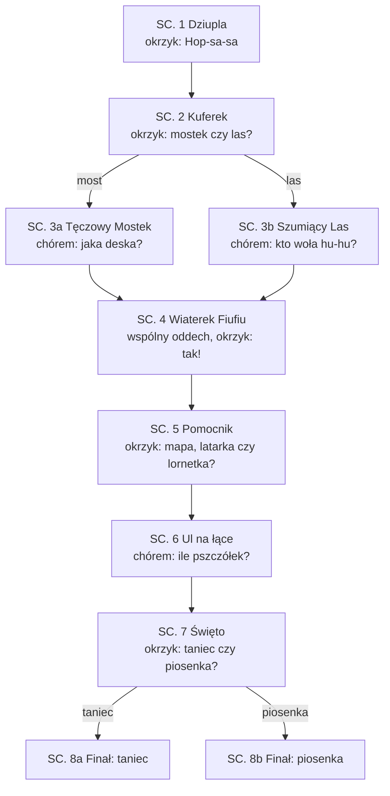

# Bzyczka szuka domu

**Interaktywny animowany film krótkometrażowy z cyklu „Klub Ciekawskich”**

| | |
|---|---|
| **Forma** | Krótkometrażowy film kinowy z udziałem widowni na żywo: widzowie decydują okrzykiem i odpowiadają chórem, a bohaterka reaguje na nich w czasie seansu |
| **Widownia** | Dzieci 4–7 lat z opiekunami, sala kinowa. Działa też dla jednego widza (pokaz dla jury, kiosk) |
| **Czas** | ok. 12 minut: ok. 8 min animacji i ok. 4 min interakcji (zależy od sali) |
| **Styl** | Ilustrowana książka 2D: miękka akwarela, ciepłe pastele (zgodnie z [projektem flow filmu](../docs/superpowers/specs/2026-10-16-flow-filmu-design.md)) |
| **Obraz** | 16:9, 1920×1080, 24 kl./s |
| **Dźwięk** | Stereo; dialogi i muzyka w klipach, cisza w pętlach oczekiwania (wtedy słucha mikrofon) |
| **Język** | Polski; wersja z napisami dla niesłyszących — opcjonalnie |
| **Plik dla aplikacji** | [`klub_ciekawskich.yaml`](klub_ciekawskich.yaml) — graf scen, pytania, wezwania i reakcje Lili |

**Logline.** Mała pszczółka zgubiła drogę do domu. Lila, Fiku i cała sala kinowa ruszają z pomocą:
widzowie okrzykiem wybierają drogę, rozwiązują zagadki, uspokajają rozbrykany wiatr i liczą pszczółki,
aż Bzyczka wraca do ula.

**Streszczenie.** W dziupli starego dębu Lila Lupka i Fiku Fikołek prowadzą Klub Ciekawskich — a członkami
klubu są widzowie na sali. Do dziupli wpada zapłakana pszczółka Bzyczka: zgubiła drogę do ula na końcu
Kwiatowej Łąki. Widownia budzi okrzykiem gadający Kuferek Hopsasa, który daje trzy pomocniki i mapę.
Sala wybiera drogę — przez Tęczowy Mostek albo Szumiący Las — i pomaga pokonać przeszkodę: dopasować
brakującą deskę albo rozpoznać, kto woła „hu-hu”. W połowie drogi rozbrykany Wiaterek Fiufiu rozdmuchuje
wszystko, bo nie umie zapanować nad radością; cała sala uczy go spokojnie oddychać. Lornetka pozwala
dostrzec daleki ul, widzowie liczą pszczółki z rodziny Bzyczki, a na koniec decydują, jak świętować:
tańcem czy piosenką.

**O czym jest ten film.** Razem dajemy radę. Każdy czasem się boi albo ma wielkie emocje — i to jest w porządku,
a spokojny oddech pomaga. Pomyłka to część uczenia się.

## Budowa filmu

| Część | Sceny | Co się dzieje | Czas |
|---|---|---|---|
| **Prolog** | 1 (początek) | Plansza tytułowa, Lila zaprasza widownię do zabawy i pokazuje sygnał „Świecąca Lupka” | 0:30 |
| **Akt I — Wezwanie** | 1–2 | Bzyczka zgubiła drogę. Widownia budzi Kuferek i wybiera drogę | 3:00 |
| **Akt II — Droga** | 3a/3b, 4, 5 | Przeszkoda na drodze, kryzys z Wiaterkiem (środek filmu), dostrzeżenie ula | 5:00 |
| **Akt III — Powrót** | 6, 7, 8a/8b | Ul i rodzina Bzyczki, wybór świętowania, finał i pożegnanie | 3:00 |
| **Napisy końcowe** | 8 (koniec) | Napisy z informacją o AI | 0:40 |

Rozgałęzienia są dwa: droga (mostek albo las) i finał (taniec albo piosenka), czyli cztery wersje filmu.
W zagadkach dobra i zła odpowiedź prowadzą do tej samej sceny — zmienia się tylko reakcja Lili. Dzięki temu
animujemy 10 scen zamiast drzewa kilkudziesięciu klipów.

## Bohaterowie

Wszystkie postacie, ich imiona i wygląd są oryginalne. Projektując je, nie wzorujemy się na postaciach
z innych filmów i seriali (zob. [zgodność z regulaminem](../docs/ZGODNOSC_Z_REGULAMINEM.md)).

| Postać | Kim jest | Wygląd | Charakter | Przemiana w filmie | Głos |
|---|---|---|---|---|---|
| **Lila Lupka** | Siedmioletnia odkrywczyni, liderka klubu | Żółte kalosze, ogrodniczki z kieszeniami na śrubki, wielka lupa na sznurku | Ciekawska, cierpliwa, uwielbia zagadki, liczenie i majsterkowanie. Powiedzonko: „Zajrzyjmy przez lupkę!” | Uczy się oddawać decyzję innym: zamiast rozstrzygać sama, pyta widownię | Ciepły, dziewczęcy, spokojne tempo. **Mówi też na żywo (syntezator)** |
| **Fiku Fikołek** | Rudy wiewiórek, przyjaciel Lili | Puszysty ogon w kształcie znaku zapytania, zielony szalik, fartuszek piekarza | Wesoły i ruchliwy, wrażliwy, piecze żołędziowe ciasteczka. Powiedzonko: „Fiku-miku, fikołek!” (i fikołek) | Od „trochę się boję” do „z wami się nie boję” | Wysoki, energiczny, chłopięcy |
| **Pszczółka Bzyczka** | Zagubiona pszczółka | Malutka, w miętowym sweterku w miodowe paski, różowe policzki, koszyczki na pyłek przy nóżkach | Nieśmiała, mówi cicho, z „bzz” przed zdaniami | Od pochlipywania do głośnego „Bzz-dziękuję!” i prowadzenia świętowania | Cienki, delikatny |
| **Wiaterek Fiufiu** | Mały obłoczek-wietrzyk | Biały, puszysty, z różowymi policzkami; rośnie, gdy się emocjonuje | Gdy się cieszy albo złości, dmucha za mocno. Nie jest zły. Powiedzonko: „Fiu-fiu-fiuuu! Ojej, znowu za mocno!” | Od wichury emocji do spokojnego oddechu | Szybki, świszczący, zadyszany |
| **Kuferek Hopsasa** | Gadający kufer podróżnik | Kolorowy, oklejony naklejkami z podróży, wieko jak usta | Budzi się na okrzyk, rymuje, zawsze ma trzy pomocniki: „Hopsasa, co tu mam? Trzy pomocniki dla was dam!” | — (stały pomocnik) | Głęboki, ciepły, wesoły |

**Pomocniki z Kuferka:** Mapa Rozkładanka (pokazuje drogę), Latarka Świetliczka (świeci w ciemności),
Lornetka Patrzałka (przybliża to, co daleko).

**Motto klubu** z gestami: „Patrzymy (dłonie jak lornetka przy oczach), myślimy (palec przy skroni),
pomagamy (ręce do przodu)!”

## Zasady pisania

1. **Do widowni w liczbie mnogiej, bez czasu przeszłego**: „Pomożecie?”, „Brawo, świetnie wam idzie!”.
   Nigdy „zrobiłeś/zrobiłaś” ani „zrobiliście”. Tak mówią postacie w klipach i Lila na żywo; pilnuje tego test
   `tests/test_klub_ciekawskich.py`.
2. **Bez stereotypów.** Lila majsterkuje i prowadzi; Fiku mówi o uczuciach i piecze. Oboje bywają dzielni
   i oboje czasem się boją.
3. **Pomyłka uczy.** Zła odpowiedź nie zatrzymuje filmu: postać łagodnie pokazuje dobrą odpowiedź i chwali próbę.
4. **Tylko prawdziwe fakty** o świecie (lista na końcu). Fantazja dotyczy postaci, nie wiedzy.
5. **Bez straszenia.** Wiatr, wysokość i las to przygoda, nie zagrożenie.

## Seans w kinie: jak działa interakcja

**Aplikacja mobilna widowni.** Odpowiedzi publiczności zbiera aplikacja na telefony ([opis w README](../README.md#aplikacja-mobilna-widowni)).
Przed seansem na ekranie wisi plansza z kodem QR („Zeskanuj i dołącz do Klubu Ciekawskich!”); widzowie — dzieci
razem z opiekunami — otwierają aplikację i zezwalają na mikrofon. Gdy Lila zadaje pytanie, telefon wibruje,
pokazuje pytanie z opcjami i nagrywa odpowiedź, a komputer z filmem liczy głosy całej sali.

**Sygnał „Świecąca Lupka”.** We wszystkich pętlach oczekiwania w prawym dolnym rogu ekranu świeci i pulsuje
lupa Lili — ta sama lupka pulsuje w aplikacji na telefonie, gdy telefon słucha. W prologu Lila tłumaczy:
„Kiedy zaświeci się lupka, teraz mówicie wy!”. Dzięki temu dzieci wiedzą, kiedy mówić, a kiedy oglądać.

| Rodzaj interakcji | Kiedy | Jak działa |
|---|---|---|
| **Odpowiedź do telefonu** (aplikacja mobilna) | Każda scena z pytaniem: SC. 1–7 | Dziecko mówi odpowiedź do telefonu (albo dotyka opcji). Komputer rozpoznaje nagrania lokalnie i liczy głosy; wygrywa większość. Remis albo cisza → kolejna runda; po dwóch Lila wybiera sama |
| **Okrzyk** (krzykomierz) — zapas bez telefonów | Decyzje: SC. 1, 2, 4, 5, 7 | Gdy żaden telefon nie jest połączony: Lila wzywa po kolei do każdej opcji („Kto chce przez Tęczowy Mostek? Krzyczymy… Mostek!”), a mikrofon przy ekranie mierzy głośność sali |
| **Odpowiedź chórem** — zapas bez telefonów | Zagadki: SC. 3a, 3b, 6 | Gdy żaden telefon nie jest połączony: sala wykrzykuje odpowiedź, a Whisper i model Phi (albo słowa kluczowe) rozpoznają wybór z mikrofonu przy ekranie |
| **Wspólne działanie** (bez nasłuchu) | W klipach | Motto z gestami, wspólny oddech, liczenie paluszkami, taniec i piosenka. Postacie robią to razem z widownią — `[pauza]` w scenariuszu |

Wezwania do okrzyków (pole `call`) i dopytania mówi Lila tylko w trybie bez telefonów; z aplikacją mobilną
pytanie z klipu wystarcza, a opcje widać na ekranie telefonu.

**Przygotowanie sali:**
- Wi-Fi dla widzów w tej samej sieci co komputer z filmem (bez izolacji klientów); plansza z kodem QR (`…/qr`)
  na ekranie przed seansem; na wejściu krótka informacja dla opiekunów o mikrofonie i prywatności.
- Mikrofon pod ekranem, skierowany na widownię, z dala od głośników — na wypadek widzów bez telefonów.
- Przed seansem kalibracja krzykomierza: `python -m bajka.vote` (gwar sali i próbny okrzyk, podpowiedź progów).
- Głośność dialogów umiarkowana — małe dzieci są wrażliwe na hałas.
- Pierwsze uruchomienie modeli zawsze przed seansem (pobieranie), potem wszystko działa bez internetu.

**Prywatność i bezpieczeństwo:** głosu widowni nie zapisujemy — nagrania z telefonów są rozpoznawane w pamięci
komputera z filmem i od razu usuwane. Kwestie Lili pisane na żywo przechodzą przez filtr (`bajka/safety.py`);
podejrzana kwestia zamienia się w sprawdzoną kwestię ze scenariusza.

---

## Scenariusz

Oznaczenia: **KLIP** — animacja z dialogami, kończy się pytaniem do widowni; **PĘTLA** — cicha animacja
oczekiwania (pierwsza klatka = ostatnia klatka klipu) ze Świecącą Lupką; **INTERAKCJA** — co mówi Lila na żywo.
Pytanie na końcu klipu Lila wypowiada tymi samymi słowami co pole `question` w YAML.

### SC. 1 — WNĘTRZE. DZIUPLA KLUBU CIEKAWSKICH — DZIEŃ (`powitanie`)

**KLIP** `01_powitanie.mp4` · ok. 70 s

*Plansza tytułowa na tle akwarelowego dębu: „Klub Ciekawskich — Bzyczka szuka domu”. Kamera wjeżdża w dziuplę:
półki ze słoikami guzików, mapa na ścianie, w kącie chrapie kolorowy kufer. Ciepłe, bursztynowe światło.*

> **LILA** *(wychodzi zza półki, macha do kamery)*: Dzień dobry, kino! Jestem Lila Lupka!
>
> **FIKU** *(fikołek przez cały kadr, ląduje obok)*: A ja Fiku Fikołek! Fiku-miku, fikołek!
>
> **LILA**: Witamy w Klubie Ciekawskich! Dzisiaj wy też jesteście w klubie. *(podnosi lupę, lupa świeci)*
> Kiedy zaświeci się moja lupka, teraz mówicie wy!
>
> **FIKU**: Sprawdźmy! Powiedzcie z nami nasze motto!
>
> **LILA I FIKU** *(z gestami)*: Patrzymy, myślimy, pomagamy! `[pauza 2 s]`
>
> *(Do dziupli wpada, kręcąc się w powietrzu, malutka pszczółka.)*
>
> **BZYCZKA** *(pochlipując)*: Bzz… Dzień dobry… Jestem Bzyczka. Zgubiłam drogę do mojego ula na Kwiatowej Łące…
>
> **FIKU** *(otula ją ogonem)*: Oj, rozumiem cię. Ja też kiedyś się zgubiłem i było mi bardzo smutno.
>
> **LILA**: Pomożemy ci, Bzyczko! Ale najpierw musimy obudzić Kuferek Hopsasa.
>
> **FIKU** *(szeptem, do kamery)*: Kuferek budzi się tylko, kiedy wszyscy razem zawołają hasło…
>
> **LILA** *(do kamery)*: Zawołacie z nami Kuferek? Wszyscy razem, głośno, „Hop-sa-sa”!

**PĘTLA** `01_powitanie_idle.mp4`: Lila i Fiku z dłońmi przy uszach nasłuchują, Kuferek pochrapuje (bez dźwięku).

**INTERAKCJA — okrzyk.** Lila: *„Na trzy krzyczymy «Hop-sa-sa». Raz… dwa… trzy!”*
- Głośny okrzyk: *„Hop-sa-sa! Słyszycie? Kuferek się budzi!”* → SC. 2
- Za cicho: *„Kuferek śpi jak suseł! Jeszcze głośniej, wszyscy razem!”*; po dwóch rundach Lila sama:
  *„Nic nie szkodzi, zawołam go sama. Hop-sa-sa! Słyszycie? Kuferek się budzi!”*

### SC. 2 — WNĘTRZE. DZIUPLA — CHWILĘ PÓŹNIEJ (`kuferek`)

**KLIP** `02_kuferek.mp4` · ok. 45 s

*Kuferek ziewa i otwiera wieko; z wnętrza bije tęczowe światło. Zbliżenia na trzy wyskakujące przedmioty.*

> **KUFEREK**: Ooo, hopsasa! Kto mnie woła? Lila, Fiku i… cała sala! Witajcie w klubie!
>
> **KUFEREK** *(śpiewnie)*: Hopsasa, co tu mam? Trzy pomocniki dla was dam!
>
> *(Z kufra wyskakują po kolei trzy przedmioty, każdy z dźwiękiem „pling”.)*
>
> **KUFEREK**: Mapa Rozkładanka — pokaże drogę! Latarka Świetliczka — zaświeci w ciemności!
> I Lornetka Patrzałka — przybliży to, co daleko!
>
> **LILA** *(rozkłada mapę, patrzy przez lupkę)*: Zajrzyjmy przez lupkę… Do Kwiatowej Łąki prowadzą dwie drogi!
>
> **FIKU** *(pokazuje łapką)*: Jedna przez Tęczowy Mostek nad strumykiem… a druga przez Szumiący Las!
>
> **BZYCZKA**: Bzz… Ja nie pamiętam, którędy przyleciałam…
>
> **LILA** *(do kamery)*: Którędy lecimy do Kwiatowej Łąki? Przez Tęczowy Mostek czy przez Szumiący Las?

**PĘTLA** `02_kuferek_idle.mp4`: mapa na cały ekran; mostek i las delikatnie się mienią (podświetlenie
odpowiada wezwaniom Lili — najpierw mostek, potem las).

**INTERAKCJA — okrzyk.** Lila: *„Kto chce przez Tęczowy Mostek? Krzyczymy… Mostek!”*, potem
*„A kto przez Szumiący Las? Krzyczymy… Las!”*
- Wygrywa mostek: *„Wygrywa Tęczowy Mostek! Ciekawe, jakie ma kolory!”* → SC. 3a
- Wygrywa las: *„Wygrywa Szumiący Las! Posłuchamy, kto tam mieszka!”* → SC. 3b
- Cisza albo remis: *„Nie słychać, która droga wygrywa! Jeszcze jedna runda, głośniej!”*; potem Lila wybiera mostek.

### SC. 3a — PLENER. TĘCZOWY MOSTEK NAD STRUMYKIEM — DZIEŃ (`most`)

**KLIP** `03a_most.mp4` · ok. 40 s

*Plan ogólny: drewniany mostek nad szemrzącym strumykiem, nasycone kolory. Deski: czerwona, niebieska,
czerwona, niebieska — a potem dziura. Czerwień i błękit są rozróżnialne także dla widzów z daltonizmem
czerwono-zielonym.*

> **FIKU** *(zatrzymuje się, ogon mu drży)*: Ojej… Brakuje jednej deski. Trochę się boję…
>
> **LILA** *(kładzie mu rękę na ramieniu)*: Każdy czasem się boi, Fiku. Razem coś wymyślimy.
>
> **FIKU** *(do kamery, uśmiecha się)*: Z wami się nie boję!
>
> **LILA** *(przez lupkę; każda deska podświetla się po kolei)*: Deski idą po kolei. Czerwona… niebieska…
> czerwona… niebieska…
>
> **KUFEREK** *(wysuwa z wieka dwie deski)*: Mam dwie zapasowe! Czerwoną i niebieską!
>
> **LILA** *(do kamery)*: Jaka deska pasuje do dziury, czerwona czy niebieska?

**PĘTLA** `03a_most_idle.mp4`: obie deski unoszą się obok dziury; wzór desek mruga po kolei (wolno — najwyżej
dwa błyski na sekundę).

**INTERAKCJA — odpowiedź chórem.**
- „Czerwona!”: *„Czerwona! Brawo, wzór się zgadza. Czerwona, niebieska, czerwona!”* → SC. 4
- „Niebieska!”: *„Niebieska była przed chwilą, więc teraz kolej na czerwoną. Wkładamy czerwoną i pasuje!”* → SC. 4
- Cisza: *„Popatrzcie na deski. Czerwona, niebieska, czerwona, niebieska… a teraz?”*

### SC. 3b — PLENER. SZUMIĄCY LAS — DZIEŃ (`las`)

**KLIP** `03b_las.mp4` · ok. 40 s

*Las w chłodnym, zielonym świetle przesianym przez liście. Z dziupli wysokiego drzewa dobiega „hu-hu”.*

> **LILA** *(palec przy ustach)*: Ćśś… W lesie trzeba uważnie słuchać.
>
> *(Cisza, szum liści, potem wyraźnie: „Hu-hu… hu-hu…”)*
>
> **FIKU** *(podskakuje)*: Ja wiem, ja wiem! To na pewno żaba!
>
> **BZYCZKA**: Bzz… Hmm… A ja nie jestem pewna…
>
> **LILA** *(mruga do kamery)*: Fiku, nie spieszmy się. Zapytajmy naszą widownię!
>
> **LILA** *(do kamery)*: Kto tak woła „hu-hu”? Sowa czy żaba?

**PĘTLA** `03b_las_idle.mp4`: w dziupli drzewa mrugają dwa duże, zaspane oczy; liście się kołyszą.

**INTERAKCJA — odpowiedź chórem.**
- „Sowa!” albo „hu-hu”: *„Sowa! Macie rację. Sowy w dzień zwykle śpią, a my ją chyba budzimy!”* → SC. 4
- „Żaba!”: *„Żaba robi kum-kum! A hu-hu woła sowa. Zobaczcie, siedzi tam na gałęzi!”* → SC. 4
- Cisza: *„Posłuchajcie jeszcze raz. Hu-hu, hu-hu. To sowa czy żaba?”*

> W SC. 4 zaspana sowa może mignąć w tle w obu wersjach — nie trzeba robić osobnych klipów.

### SC. 4 — PLENER. ŚCIEŻKA NA SKRAJU ŁĄKI — DZIEŃ (`wiaterek`)

**KLIP** `04_wiaterek.mp4` · ok. 55 s · *środek filmu i jego emocjonalny szczyt*

*Paleta jaśnieje, robi się powietrznie. Nadlatuje mały obłoczek; z każdym zdaniem rośnie.*

> **FIUFIU** *(radośnie, coraz szybciej)*: Fiu-fiu-fiuuu! Przygoda? Ja też chcę! Ja też, ja też!
>
> *(Dmucha tak mocno, że Bzyczka kręci się w powietrzu, mapa fruwa, Fiku trzyma się źdźbła trawy.)*
>
> **FIKU**: Hej, Fiufiu, za mocno!
>
> **FIUFIU** *(zatrzymuje się, smutnieje)*: Ojej, znowu za mocno… Kiedy bardzo się cieszę, nie umiem przestać…
>
> **LILA** *(łagodnie)*: Fiufiu, każdy czasem ma emocje wielkie jak wichura. Znamy na to sposób. Spokojny oddech!
>
> **LILA** *(do kamery, pokazując)*: Oddychajcie z nami. Wielki wdech nosem… `[pauza 3 s]` …i powolny wydech buzią,
> fffuuu… `[pauza 4 s]` Jeszcze raz. Wdech… `[pauza 3 s]` …i wydech, fffuuu… `[pauza 4 s]`
>
> *(Fiufiu oddycha razem z salą; z każdym oddechem maleje, mapa łagodnie opada.)*
>
> **LILA** *(do kamery)*: Pomożecie Fiufiu się uspokoić? Wielki wdech nosem… i powolny wydech buzią. Udało się?

**PĘTLA** `04_wiaterek_idle.mp4`: Fiufiu powoli „oddycha” (rośnie i maleje co ok. 4 s), Lila i Fiku oddychają z nim.

**INTERAKCJA — okrzyk.** Lila: *„Jeśli Fiufiu już oddycha spokojnie, krzyknijcie… Tak!”*
- Głośne „tak”: *„Hurra! Fiufiu oddycha spokojnie i już nic nie fruwa. Dziękujemy za pomoc!”* → SC. 5
- Za cicho: *„Jeszcze raz, razem. Wdech nosem… i wydech buzią, fffuuu. Udało się? Krzyknijcie «tak»!”*;
  potem *„Fiufiu chyba sam to poczuł. Hurra!…”*

### SC. 5 — PLENER. BRZEG KWIATOWEJ ŁĄKI — POPOŁUDNIE (`pomocnik`)

**KLIP** `05_pomocnik.mp4` · ok. 40 s

*Złote światło popołudnia. Łąka ciągnie się aż po horyzont; na samym końcu, pod wysoką lipą, majaczy coś
malutkiego.*

> **FIUFIU** *(spokojny, cichutko)*: Fiu… Dziękuję. Polecę z wami, ale delikatnie.
>
> **BZYCZKA** *(wypatruje)*: Bzz… Mój ul stoi na samym końcu łąki, pod wielką lipą… ale to tak daleko! Nic nie widzę…
>
> **FIKU**: Kuferku, pomocy!
>
> **KUFEREK** *(otwiera wieko)*: Hopsasa, co tu mam? Trzy pomocniki dla was dam! Mapa, latarka i lornetka!
>
> **LILA** *(do kamery)*: Który pomocnik pomoże zobaczyć ul daleko na końcu łąki? Mapa, latarka czy lornetka?

**PĘTLA** `05_pomocnik_idle.mp4`: trzy pomocniki unoszą się nad Kuferkiem i świecą po kolei (mapa, latarka, lornetka —
w kolejności wezwań).

**INTERAKCJA — okrzyk.** Lila wzywa po kolei: *„Kto wybiera Mapę Rozkładankę? Krzyczymy… Mapa!”*,
*„Kto wybiera Latarkę Świetliczkę? Krzyczymy… Latarka!”*, *„A kto wybiera Lornetkę Patrzałkę? Krzyczymy… Lornetka!”*
- Lornetka: *„Lornetka! Przybliża to, co jest daleko. Widzę ul!”* → SC. 6
- Latarka: *„Latarka świeci w ciemności, a teraz jest jasno. Weźmy lornetkę… Jest ul!”* → SC. 6
- Mapa: *„Mapa pokazała nam drogę! A żeby zobaczyć daleko, weźmy lornetkę… Jest ul!”* → SC. 6
- Cisza albo remis: *„Mapa pokazuje drogę, latarka świeci w ciemności, a lornetka przybliża. Jeszcze raz, głośniej!”*

### SC. 6 — PLENER. UL NA KOŃCU KWIATOWEJ ŁĄKI — POPOŁUDNIE (`laka`)

**KLIP** `06_laka.mp4` · ok. 40 s

*Widok przez lornetkę (okrągła ramka), potem lot nad kwiatami pod lipę. Ul jest drewniany, kolorowy.*

> **BZYCZKA** *(radośnie)*: Bzz! To mój ul! Jestem w domu!
>
> *(Z ula wylatują po kolei trzy pszczółki — każda z „bzzz” i błyskiem. Zostają duże, wyraźne, w stałych miejscach.)*
>
> **BZYCZKA**: To moje dwie siostry i mój brat! Przyleciały mnie przywitać!
>
> **FIKU** *(łapie się za głowę)*: Tyle pszczółek! Chyba się pogubię w liczeniu…
>
> **LILA**: Policzymy razem! Pokażcie paluszkami każdą pszczółkę. `[pauza 3 s]`
>
> **LILA** *(do kamery)*: Ile pszczółek wyleciało z ula, żeby przywitać Bzyczkę?

**PĘTLA** `06_laka_idle.mp4`: trzy pszczółki krążą powoli wokół swoich miejsc (łatwe do policzenia), kwiaty się kołyszą.

**INTERAKCJA — odpowiedź chórem.**
- „Trzy!”: *„Trzy! Jedna, dwie, trzy pszczółki. Brawo, świetnie liczycie!”* → SC. 7
- Inna liczba: *„Policzmy razem jeszcze raz. Jedna, dwie, trzy! Trzy pszczółki. Super, że liczycie ze mną!”* → SC. 7
- Cisza albo liczenie w trakcie („jedna, dwie…”): *„Policzmy razem paluszkami. Jedna, dwie… ile ich jest?”*

### SC. 7b (wycofana) — PLENER. UL — POPOŁUDNIE (`ozdoby`)

Scena z ilustracją rysowaną na żywo z pomysłu widowni została wycofana razem z rysowaniem na żywo (16.10).
Wszystkie animacje filmu są przygotowane wcześniej; w zamian film dopasowuje wersje scen do tętna sali
([projekt](../docs/superpowers/specs/2026-10-16-film-czuje-sale-design.md)).

### SC. 7 — PLENER. KWIATOWA ŁĄKA — ZŁOTA GODZINA (`swieto`)

**KLIP** `07_swieto.mp4` · ok. 30 s

*Wszyscy przed ulem: pszczoły, Fiufiu, Kuferek, Lila i Fiku. Ciepłe światło przed zachodem słońca.*

> **BZYCZKA** *(już głośno i pewnie)*: Bzz-dziękuję! Bez waszej pomocy nigdy bym nie trafiła do domu!
>
> **FIKU** *(trzy fikołki)*: Fiku-miku, fikołek! To trzeba uczcić!
>
> **FIUFIU** *(delikatnie)*: Fiu… Mogę zrobić leciutki wietrzyk do zabawy!
>
> **LILA** *(do kamery)*: Jak świętujemy powrót Bzyczki? Pszczółkowym tańcem czy piosenką o kwiatkach?

**PĘTLA** `07_swieto_idle.mp4`: wszyscy kołyszą się w oczekiwaniu, Kuferek przytupuje (bez dźwięku).

**INTERAKCJA — okrzyk.** Lila: *„Kto chce pszczółkowy taniec? Krzyczymy… Taniec!”*, potem
*„A kto chce piosenkę o kwiatkach? Krzyczymy… Piosenka!”*
- Taniec: *„Pszczółkowy taniec! Wstańcie i machajcie rękami jak skrzydełkami. Bzz, bzz!”* → SC. 8a
- Piosenka: *„Piosenka! Śpiewajcie z nami. La, la, la!”* → SC. 8b
- Cisza albo remis: *„Nie słychać, co wygrywa! Jeszcze jedna runda, głośniej. Taniec czy piosenka?”*; potem Lila wybiera taniec.

### SC. 8a — PLENER. ŁĄKA — ZACHÓD SŁOŃCA (`koniec_taniec`)

**KLIP** `08a_koniec_taniec.mp4` · ok. 75 s (z pożegnaniem i napisami)

*Bzyczka prowadzi taniec, wszyscy powtarzają ruchy. Muzyka oryginalna, rytm marszowy.*

> **BZYCZKA**: Bzz! Pszczoły naprawdę tańczą — tak pokazują sobie drogę do kwiatów! Tańczcie z nami!
>
> **WSZYSCY** *(rytmicznie, z ruchem)*: Skrzydełka w górę! *(ręce w górę)* Skrzydełka w dół! *(ręce w dół)*
> Kręcimy się w kółko, bzz, bzz, bzz! *(obrót)* I hop — na kwiatek! *(podskok)* `[2 razy]`

Dalej **pożegnanie** i **napisy końcowe**.

### SC. 8b — PLENER. ŁĄKA — ZACHÓD SŁOŃCA (`koniec_piosenka`)

**KLIP** `08b_koniec_piosenka.mp4` · ok. 75 s (z pożegnaniem i napisami)

*Tekst piosenki pojawia się przy kwiatkach, słowo po słowie. Melodia oryginalna, prosta, w rytmie marszu.*

> **WSZYSCY**: Kwiatek żółty, kwiatek biały, pszczółki z ula przyleciały.
> Jedna, druga, trzecia — hop! Dzisiaj święto, bzz i stop! `[2 razy, za drugim razem wolniej]`

Dalej **pożegnanie** i **napisy końcowe**.

### Pożegnanie (koniec SC. 8a i 8b)

> **LILA**: Co już wiemy po dzisiejszej przygodzie w Klubie Ciekawskich?
>
> **FIKU**: Że trzeba uważnie patrzeć i słuchać!
>
> **LILA**: Że liczenie jest super — jedna, dwie, trzy!
>
> **FIUFIU**: Fiu… I że kiedy emocje dmuchają jak wiatr, pomaga spokojny oddech.
>
> **BZYCZKA**: I że razem można pomóc każdemu! Bzz-dziękuję!
>
> **LILA I FIKU** *(z gestami, do kamery)*: Patrzymy, myślimy, pomagamy!
>
> **WSZYSCY**: Do zobaczenia w Klubie Ciekawskich! Hop-sa-sa!
>
> *(Kuferek zamyka wieko, dziupla gaśnie; lupa Lili świeci jeszcze chwilę i gaśnie jako ostatnia.)*

### Napisy końcowe

*Na tle akwarelowej łąki o zmierzchu, spokojna wersja melodii z finału. Uzupełnia zespół.*

> **Bzyczka szuka domu**
> Scenariusz: [imię i nazwisko] · Reżyseria: [imię i nazwisko] · Animacja i ilustracje: [imiona i nazwiska]
> Głosy: Lila — [ ], Fiku — [ ], Bzyczka — [ ], Fiufiu — [ ], Kuferek — [ ]
> Muzyka oryginalna: [ ] · Dźwięk: [ ] · Program: [ ]
>
> **W rolach głównych: widownia — członkinie i członkowie Klubu Ciekawskich**
>
> Reakcje Lili w trakcie seansu tworzy na żywo sztuczna inteligencja działająca na tym komputerze
> (Foundry Local: Whisper i Phi). [Jeśli użyte: ilustracje generowane z pomocą Azure AI Foundry.]
> Odpowiedzi z telefonów widzów są rozpoznawane na miejscu i nie są zapisywane.
>
> Postacie i historia są oryginalnym dziełem zespołu [nazwa zespołu]. Licencje użytego oprogramowania:
> `docs/ZGODNOSC_Z_REGULAMINEM.md`.
> Powstało podczas hackathonu „Kino szuka nowej formy. Znajdź ją.” — 21. Plenery Film Spring Open, Kraków 2026.
> © 2026 [nazwa zespołu]

Ten kadr może też otwierać kolejne doświadczenie (pomysł z projektu flow filmu, P3): montaż ilustracji
powstałych z pomysłów widowni.

---

## Kolorystyka i światło

| Część | Paleta | Światło | Po co |
|---|---|---|---|
| Prolog, SC. 1–2 (dziupla) | Bursztyn, ciepłe brązy, kolorowe akcenty Kuferka | Ciepłe, punktowe, jak lampka | Bezpieczny dom, początek przygody |
| SC. 3a (mostek) | Czyste, nasycone kolory podstawowe | Jasne, rozproszone | Kolory i wzór mają być czytelne z ostatniego rzędu |
| SC. 3b (las) | Chłodne zielenie, mech | Plamy światła przez liście | Uważne słuchanie, lekka tajemniczość bez strachu |
| SC. 4 (wiaterek) | Pastele, biel, dużo powietrza | Jasne, ruchome | Emocje i oddech; po uspokojeniu ruch w kadrze zwalnia |
| SC. 5–6 (łąka, ul) | Złoto, zieleń, plamy kwiatów | Popołudnie | Cel w zasięgu, liczenie dużych, wyraźnych postaci |
| SC. 7–8 (święto) | Ciepły róż i pomarańcz zachodu | Złota godzina, potem zmierzch | Radość, potem spokojne wyciszenie przed wyjściem z kina |

## Dźwięk i muzyka

- **Muzyka i melodie piosenek wyłącznie oryginalne**, skomponowane przez zespół. Bez znanych melodii i gotowych
  podkładów z sieci (wymóg wyłącznych praw — regulamin §3 ust. 9).
- Motywy postaci: Fiku — ksylofon, Fiufiu — flet i gwizdek, Kuferek — fagot, Bzyczka — pizzicato skrzypiec.
- **Pętle oczekiwania bez dźwięku**, bo słucha mikrofon. Muzyka wraca dopiero w kolejnym klipie.
- Głos Lili w klipach nagrywamy jak najbliżej głosu syntezatora, który mówi na żywo
  (`BAJKA_WINDOWS_VOICE_PITCH`, `BAJKA_WINDOWS_VOICE_RATE`).

## Dostępność

- Żadnych szybkich błysków: najwyżej 2–3 na sekundę (bezpieczeństwo osób z padaczką fotogenną).
- Przedmioty do liczenia i wybierania duże i wyraźne, czytelne z końca sali.
- Kolory w zagadce (czerwony i niebieski) rozróżnialne także przy daltonizmie czerwono-zielonym.
- Każda interakcja jest też pokazana obrazem (podświetlenie opcji), nie tylko słowami.
- Opcjonalnie wersja z napisami dla niesłyszących.

## Sprawdzone fakty (regulamin §3 ust. 8: bez treści nieprawdziwych)

| W filmie | Fakt |
|---|---|
| Sowa woła „hu-hu” i w dzień zwykle śpi | Polski odgłos sowy to „hu-hu”; większość sów (np. puszczyk) jest aktywna nocą |
| Żaba robi „kum-kum” | Jeden z polskich odgłosów żaby (obok „rech-rech”); żaby żyją przy wodzie, a las ze strumykiem pasuje |
| Bzyczka ma dwie siostry i brata | W ulu żyją pszczoły-robotnice (samice) i trutnie (samce) |
| Koszyczki na pyłek przy nóżkach | Pszczoły miodne noszą pyłek w „koszyczkach” na tylnych nogach |
| „Pszczoły naprawdę tańczą, żeby pokazać drogę do kwiatów” | Taniec pszczół (np. taniec wywijany) przekazuje kierunek i odległość do pożytku |
| Ul pod lipą na końcu łąki | Pszczoły chętnie zbierają nektar z lip; ule stoją na łąkach i w sadach |
| Lornetka przybliża, latarka świeci w ciemności, mapa pokazuje drogę | Prawdziwe zastosowania przedmiotów |
| Spokojny oddech pomaga przy wielkich emocjach | Powolny wydech to popularna technika uspokajania także u dzieci |
| Wzór czerwona–niebieska | Prosty wzór naprzemienny (ABAB) |

## Lista klipów do produkcji

Pliki trafiają do `scenarios/clips/klub_ciekawskich/` (katalog jest w `.gitignore`, klipy trzymamy na dysku
współdzielonym). Do prób: `python -m bajka.placeholders scenarios/klub_ciekawskich.yaml`.

| Plik | Co | Dźwięk | Długość |
|---|---|---|---|
| `01_powitanie.mp4` | Plansza tytułowa, Świecąca Lupka, motto, Bzyczka, prośba o „Hop-sa-sa” | tak | ~70 s |
| `01_powitanie_idle.mp4` | Lila i Fiku nasłuchują | **cisza** | 4–6 s (pętla) |
| `02_kuferek.mp4` | Kuferek, trzy pomocniki, mapa, wybór drogi | tak | ~45 s |
| `02_kuferek_idle.mp4` | Mapa z mostkiem i lasem | **cisza** | 4–6 s |
| `03a_most.mp4` | Mostek, wzór kolorów | tak | ~40 s |
| `03a_most_idle.mp4` | Dwie deski przy dziurze | **cisza** | 4–6 s |
| `03b_las.mp4` | Las, „hu-hu”, pomyłka Fiku | tak | ~40 s |
| `03b_las_idle.mp4` | Zaspane oczy w dziupli | **cisza** | 4–6 s |
| `04_wiaterek.mp4` | Fiufiu, wspólny oddech | tak | ~55 s |
| `04_wiaterek_idle.mp4` | Fiufiu „oddycha” | **cisza** | 4–8 s |
| `05_pomocnik.mp4` | Daleki ul pod lipą, trzy pomocniki | tak | ~40 s |
| `05_pomocnik_idle.mp4` | Pomocniki świecą po kolei | **cisza** | 4–6 s |
| `06_laka.mp4` | Ul, trzy pszczółki, liczenie | tak | ~40 s |
| `06_laka_idle.mp4` | Trzy pszczółki krążą | **cisza** | 4–6 s |
| `07_swieto.mp4` | Podziękowania, wybór świętowania | tak | ~30 s |
| `07_swieto_idle.mp4` | Wszyscy się kołyszą | **cisza** | 4–6 s |
| `08a_koniec_taniec.mp4` | Taniec, pożegnanie, napisy końcowe | tak | ~75 s |
| `08b_koniec_piosenka.mp4` | Piosenka, pożegnanie, napisy końcowe | tak | ~75 s |

Opcjonalnie, dla lepszej jakości kinowej: wezwania do okrzyków jako krótkie klipy (Lila wskazuje opcję, która się
podświetla) — pole `call_clip` w YAML zamiast mówionego przez syntezator `call`.

## Plan na hackathon (prezentacja 18.10.2026, 19:00)

Pełna animacja 10 scen to za dużo na trzy dni. Regulamin (§2 ust. 2) mówi o „zarysie” filmu, więc na pokaz
wystarczy działający prototyp całego filmu:

1. **Wszystkie sceny jako ilustrowane kotwice**: 1–3 ilustracje na scenę z ruchem kamery (ffmpeg, jak w projekcie
   flow filmu) i nagranymi dialogami. Pętle oczekiwania to ta sama ilustracja z delikatnym ruchem i Świecącą Lupką.
2. **Pełna animacja jednej sceny** jako próbka jakości — najlepiej SC. 4 (Wiaterek), bo pokazuje emocje i wspólny oddech.
3. **Na pokazie dla jury** widownią jest jury: przebieg z okrzykami (krzykomierz) i odpowiedziami chórem działa
   tak samo jak w kinie.
4. Brakujące klipy zastępują zaślepki — aplikacja i tak przechodzi cały film.
